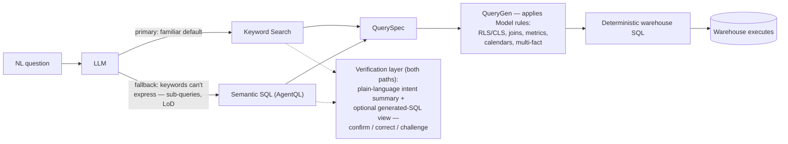

<!-- GENERATED FILE — do not edit by hand.
     Built by tools/validate/generate_agentql_offline.py from the files listed below.
     Edit those sources, then regenerate:
         python3 tools/validate/generate_agentql_offline.py
-->

# AgentQL — offline reference bundle

This is the complete reference library for the **ts-object-model-agentql-query** skill,
assembled into one document so it can be read offline, reviewed end to end, or handed to
an agent as grounding **without making live `ts agentql` calls**. It is generated from the
canonical sources — edit those, not this file.

**Live vs offline.** Running the skill or the course *live* makes real `generate-sql` /
`fetch-data` calls against a cluster (fresh SQL and rows, at the cost of tool round-trips).
Running *offline* means working from this bundle: the AgentQL, the explanations and the
captured SQL are all here, so no cluster and far fewer tokens are needed. The trade-off is
that result *numbers* are not live — where a lesson's totals roll with the sample `date`
formula, offline mode teaches the SQL and the behaviour, not a fresh figure.

## Contents

- **SKILL.md** — The skill — flow, the Learn AgentQL course entry, the six-section output block
- **references/architecture.md** — The why: what executes, and the value vs raw SQL
- **references/agentql-rules.md** — The dialect rules that make a statement valid
- **references/udf-reference.md** — The AgentQL UDF catalogue (dates, ranking, statistics)
- **references/patterns.md** — Complex query shapes
- **references/limitations.md** — What AgentQL can't do, and the silent-wrong traps
- **references/snowflake-sv-backing.md** — Rules for Snowflake Semantic View-backed Models
- **references/learning-path.md** — The guided course (Modules 0–7)
- **references/lesson-sql.md** — Captured warehouse SQL for every course lesson (offline section 3)
- **references/beyond-keywords.md** — Worked examples: where AgentQL earns its keep, and where it can't
- **references/use-cases.md** — Building on the skill: tutorial, agent, test suites
- **references/integration.md** — Calling AgentQL directly: auth, endpoints, response parsing
- **references/open-items.md** — Verification status of the API behaviour this skill relies on

---

## Source: `SKILL.md`

> The skill — flow, the Learn AgentQL course entry, the six-section output block

## ThoughtSpot: Query a Model with AgentQL

> **AgentQL** is a SQL dialect an AI agent writes against a ThoughtSpot **Model**, not against
> warehouse tables. ThoughtSpot never runs AgentQL itself — it **compiles it deterministically**
> into warehouse SQL (Snowflake, Databricks, BigQuery, …), and the warehouse runs that SQL.
> Because the Model supplies the joins, formulas, security and null-handling, the **same
> question always compiles to the same governed SQL and returns the same answer**.

Turn a question about a ThoughtSpot **Model** into an answer. You (the agent) write an
AgentQL statement grounded in the rules in `references/`, then run it through two `ts`
commands: `generate-sql` (**ThoughtSpot** compiles it to warehouse SQL and validates it)
and `fetch-data` (**ThoughtSpot** executes it and returns rows). You never compile or
translate AgentQL yourself — ThoughtSpot does the AgentQL→SQL compilation, deterministically,
so the warehouse SQL and the results are exactly what the platform would run. The result is
a **review** the user can inspect at the level they care about — the data table, the
AgentQL, the warehouse SQL, or the raw JSON.

This skill is the **primitive**. It is the foundation other things build on: an
onboarding tutorial, a drop-in for your own agent, or the per-question engine of an
accuracy / regression / feature test suite. See `references/use-cases.md` for those
compositions — they are *uses* of this skill, not built into it.

### What this skill does

If asked "what can you do?", this is the answer. Given a question about a ThoughtSpot Model
I can:

- **Answer it** — write the AgentQL and hand it to ThoughtSpot, which compiles it to the
  warehouse SQL and executes it; I return the rows as a table.
- **Show the work** — the AgentQL, the generated warehouse SQL, the raw JSON, or just the
  data table, at whatever depth you want.
- **Help you integrate** — hand you ready-to-paste API request bodies and point you at
  `references/integration.md` (auth, endpoints, response parsing) to call AgentQL from your
  own product or agent.
- **Explain the rules** — what AgentQL can and can't express: aggregation (`SUM` vs `AGG`),
  the date/time UDFs, query patterns (top-N, year-over-year, semi-additive measures), and
  the known limitations.
- **Teach you AgentQL** — a guided, hands-on course run live on a sample Model every cluster
  has. See [Learn AgentQL](#learn-agentql--a-guided-course) below.
- **Explain *why* AgentQL exists** — the architecture and its trust/correctness guarantees
  versus raw warehouse SQL (the LLM's SQL is never executed; RLS/CLS, Model joins/filters,
  governed metrics, custom calendars and multi-fact trap resolution are all applied
  deterministically). See `references/architecture.md`.

The one requirement is below: the Model must be backed by an external cloud data warehouse.

> **AgentQL requires an external cloud data warehouse.** The AgentQL endpoints only work on
> Models backed by Snowflake / Databricks / BigQuery / etc. A Model over Falcon, imported
> data, or system data (`DEFAULT` datasource) is rejected with *"This API only supports
> external cloud data warehouses"*. If you hit that, the Model isn't queryable via AgentQL —
> say so plainly.

### Learn AgentQL — a guided course

**New to AgentQL, or need to explain and demo it?** This skill includes a hands-on course.
It shows how to write AgentQL, what the two APIs do, and the exact SQL ThoughtSpot sends to
the warehouse. Built first for SEs and other technical field staff. Anyone who reads SQL
can take it.

**Start it** by asking, in Claude Code or Cortex Code:

> teach me AgentQL

You can also run `/ts-object-model-agentql-query teach me AgentQL`, or be specific: *"teach
me AgentQL, just modules 1 and 2"*, *"start at module 5"*.

**You need nothing to set up.** The course runs **offline** — no profile, no cluster, no Model
to prepare. Every lesson is presented from captured examples (the AgentQL and the exact SQL
ThoughtSpot generated), taken from **`(Sample) Retail - Apparel`**, the sample Model every
cluster ships with.

**How a lesson runs.** The agent states a question and **shows you the AgentQL**, so you never
get stuck on syntax, and asks one quick prediction, such as "which tables will this touch?".
Then it reveals the **real captured warehouse SQL** ThoughtSpot generated, walks through it, and
breaks the query on purpose to show a rule. Lessons come **one at a time** — it pauses for you
before the next.

**Offline by design.** The course makes **no live calls** — it reads from the captured examples
in **[references/lesson-sql.md](references/lesson-sql.md)** (the real `executable_sql` per lesson)
and the bundled **[references/agentql-offline.md](references/agentql-offline.md)**. No cluster, no
profile, far lower token spend; result *numbers* are taught, not fresh. To get fresh numbers
against your **own** data, use the skill's normal live query flow (above) — that is separate from
the course.

| Module | What you learn | Questions |
|---|---|---|
| 0. Why AgentQL | ThoughtSpot compiles AgentQL to warehouse SQL and never runs it itself; the Model supplies joins, formulas and security | concept |
| 1. The two APIs | `generate-sql` vs `fetch-data`, structured errors, a query that compiles but fails, reading result types, why it can only read (writes, DDL and injection are refused) | 5 |
| 2. First queries | reading the SQL ThoughtSpot writes: joins written for you, null handling, the row cap, formulas inlined, the lenient parser, the bare-measure trap | 8 |
| 3. The semantic layer | ratios and safe division, what `AVG` averages, which tables a query reads, formula measures (`AGG`, not `SUM`) on a Model you choose, security you never write, every member via an outer join and the business rules in the generated SQL | 6 |
| 4. Dates and functions | date parts, relative dates without `CURRENT_DATE`, date literals, string functions, `CASE` buckets | 5 |
| 5. Advanced shapes | CTEs, ranking and share of total, top N per group, year over year, set operations | 6 |
| 6. Trust, but verify | queries that return `SUCCESS` with the wrong number, and the control queries that catch them | 4 |
| 7. Building on it | consuming results in code, testing an agent that writes AgentQL | 3 |

37 questions in all; each module stands alone after Module 2. The course itself is
[references/learning-path.md](references/learning-path.md).

**Is the course still accurate on your cluster?** Every lesson claim is a retest case:
`python3 tools/agentql-retest/run.py --profile <profile> --suite lessons` runs them all and
lists any lesson whose behaviour has changed.

---

### References

| File | When to read it |
|---|---|
| [references/architecture.md](references/architecture.md) | **The "why".** What actually executes (ThoughtSpot compiles AgentQL → deterministic warehouse SQL; the LLM's SQL is never run) and the value prop vs raw DB SQL — RLS/CLS, Model joins/filters, governed metrics/LOD/semi-additive, custom calendars, multi-fact chasm/fan-trap resolution. Read when asked "what's the point of AgentQL?" or "is this safe to trust?". |
| [references/agentql-rules.md](references/agentql-rules.md) | **Always, before writing AgentQL.** The hard constraints + dialect rules that make a statement valid (single-Model `FROM`, mandatory aliases, the literal-arithmetic trap, etc.). |
| [references/udf-reference.md](references/udf-reference.md) | Any question involving dates/time, ranking, or statistics — the AgentQL UDF catalogue (use these instead of `DATE_TRUNC`/`NOW()`/etc.). |
| [references/patterns.md](references/patterns.md) | Complex shapes: last-N-periods, year-over-year, top-N / top-N-per-group, period-over-period, anomaly detection. |
| [references/limitations.md](references/limitations.md) | **What AgentQL can't do** — hard-unsupported constructs, silent wrong-answer traps (e.g. `QUALIFY` and `FILTER (WHERE …)` are dropped), and what's been *fixed* on current builds. Read before telling a user something can't be done, and for the known-limitation-retest use case. |
| [references/snowflake-sv-backing.md](references/snowflake-sv-backing.md) | **Snowflake Semantic View backing** (EXPERIMENTAL) — rules R1–R7 for SV-backed Models: the `100072` NULL-key bug, window-via-CTE, no `FROM`-subqueries, the measure-statistics trap, and Databricks MV comparison. Read when the Model's warehouse object is an SV. |
| [references/learning-path.md](references/learning-path.md) | **The user wants to *learn* AgentQL** ("teach me AgentQL", "how does this work", "I need to demo it"). A guided, **offline** course on `(Sample) Retail - Apparel`, the sample Model on every cluster: each lesson shows the AgentQL, the real captured warehouse SQL, and breaks the query on purpose to teach a rule — one lesson at a time, no cluster needed. Run it lesson by lesson instead of the normal flow. |
| [references/lesson-sql.md](references/lesson-sql.md) | **Captured warehouse SQL for every course lesson** (GENERATED). The real `executable_sql` each lesson compiles to, captured live; **offline mode shows it verbatim** in section 3 so no cluster is needed. Keyed by the lesson’s *Guarded by* id. Rebuild with `tools/agentql-retest/run.py … --out` then `tools/agentql-retest/build_lesson_sql.py`; do not edit by hand. |
| [references/beyond-keywords.md](references/beyond-keywords.md) | **Worked examples of questions that need AgentQL — and ones it still can't answer.** Four live-verified cases (rank within a partition, a preceding-N-days window, a cohort semi-join, an unsupported percentile), each shown in the six-section output block. Read for "why not just use search?", for a demo, or before telling a user a question can or can't be done. |
| [references/use-cases.md](references/use-cases.md) | When the user wants to *build on* this skill — tutorial, agent building-block, accuracy/regression/feature/limitation testing. |
| [references/integration.md](references/integration.md) | When the user wants to call AgentQL directly from their own product/agent — auth options, the callosum endpoints, request bodies, the raw columnar response format and a parser. |
| [references/open-items.md](references/open-items.md) | Verification status of the API behaviour this skill relies on. |
| [references/agentql-offline.md](references/agentql-offline.md) | **The whole reference library as one offline document** — every file above, bundled. Read this (or hand it to an agent) to review everything in one place, or to run the skill/course **offline** with no live `ts agentql` calls and lower token spend. Generated from the sources by `tools/validate/generate_agentql_offline.py`; do not edit by hand. |
| [../ts-profile-thoughtspot/SKILL.md](../ts-profile-thoughtspot/SKILL.md) | If no ThoughtSpot profile is configured yet. |

---

### Prerequisites

- A ThoughtSpot profile — run `/ts-profile-thoughtspot` if none exists.
- The `ts` CLI (`pip install -e tools/ts-cli`), version **0.31.0+** (provides `ts agentql`,
  including `ts agentql classify-columns` for Step 2).
- The target Model is backed by an **external cloud data warehouse** (see the note above).

All ThoughtSpot calls go through the `ts` CLI, which handles auth, token caching, and the
keychain — never construct API requests directly.

---

### Flow

Pick the depth from how the user framed the request:

- **Business question** ("what were sales by region last quarter?") → run the flow, then
  show **the answer table**. Keep AgentQL and warehouse SQL out of the way unless asked.
- **Developer / learning** ("show me the AgentQL", "what SQL does this generate?", "I'm
  integrating this") → show every artifact: the AgentQL you wrote, the warehouse SQL, the
  rows, and the raw JSON the commands emit.
- **Learning the capability** ("teach me AgentQL", "walk me through how it works") → follow
  [references/learning-path.md](references/learning-path.md) instead of this flow. It sets
  the Model, the lesson order and the predict-then-run loop.

#### Step 1 — Pick the profile and the Model

If multiple profiles exist in `~/.claude/thoughtspot-profiles.json`, ask which to use, then
confirm it authenticates:

```bash
ts auth whoami --profile "{profile}"
```

**Always ask the user which Model to query.** Accept any of these — you do not need a name
to search for if you already have an identifier:

- **A GUID** — use it directly as `{model_guid}`.
- **A ThoughtSpot URL** — extract the GUID from the path. Users often have the Model open in
  a browser, e.g. `…/#/data/tables/4da3a07f-…` or `…/#/data/embrace/4da3a07f-…` — the GUID
  is the path segment after `tables/` / `embrace/`.
- **A name, or nothing** — fall back to search and let the user pick:

  ```bash
  ts metadata search --subtype WORKSHEET --name "%{search}%" --profile "{profile}"
  ```

  Present matches with **name + GUID + owner + modified date** so the user can disambiguate.

Models are `LOGICAL_TABLE` with header `type: WORKSHEET`. Whichever path you took, **confirm
the resolved Model display name** back to the user — you need it verbatim for the `FROM`
clause in Step 3.

#### Step 2 — Learn the schema

Export the Model's TML to see its columns:

```bash
ts tml export {model_guid} --profile "{profile}"
```

The TML body is in the `edoc` field. It is a structured document — JSON or YAML depending on
build (`yaml.safe_load` parses both; `ts tml export … --parse` returns it already parsed).
For a Model it is rooted at `model:` with these parts:

- **`model.columns[]`** — each entry's `name` is the identifier to use in AgentQL. Matching
  is case-insensitive, but copy the spelling. The column kind is at **`properties.column_type`** (ATTRIBUTE or
  MEASURE) — note it is **nested under `properties`**, not a direct child of the column.
- **`model.formulas[]`** — formula definitions. A formula column references one by carrying a
  **`formula_id`** that matches a `formulas[].id`; that formula's **`expr`** is where the
  aggregation logic lives.

**Classify every column** — this drives the `SUM`-vs-`AGG` decision in Step 3. Don't
eyeball the TML for this: run

```bash
ts agentql classify-columns --model {model_guid} --profile "{profile}"
```

This calls the same aggregate-function detector `ts-object-answer-promote` uses (BL-087 —
one canonical keyword list, not two drifted copies), applied to every `model.columns[]`
entry. It returns a JSON array of `{name, column_type, kind, needs_agg, aggregation, wrapper}`.
The `wrapper` field is the directly-actionable output — the AgentQL function to wrap a
reference to that column in (or `None` for attributes):

| `kind` | Meaning | How it was detected | In AgentQL (`wrapper`) |
|---|---|---|---|
| `attribute` | `properties.column_type: ATTRIBUTE` | — | group by it (`None`) |
| `raw_measure` | `properties.column_type: MEASURE`, **no** aggregating formula (a plain `column_id`, or a `formula_id` whose `expr` has no aggregate) | `needs_agg: false` | `SUM`/`AVG`/`MIN`/`MAX` (`aggregation` field names which) |
| `aggregate_measure` | `properties.column_type: MEASURE` **and** its `formulas[].expr` contains an aggregate | `needs_agg: true` | **`AGG(...)`** — never `SUM` (errors `NESTED_AGGREGATE_NOT_SUPPORTED`) |
| `semiadditive_measure` | aggregate-formula whose **outermost** call is `last_value`/`first_value` (the `last_value(sum(col), query_groups(), {date})` snapshot form) | `needs_agg: false`, `wrapper: SUM` | **`SUM(...)`** — `AGG(...)` errors `NON_CONVERTIBLE_FUNCTION` (see below) |

**Semi-additive is the one inversion of the aggregate-formula rule.** A measure whose
outermost op is `last_value`/`first_value` cannot use `AGG(...)` — the AgentQL→SQL
serializer can't emit its `query_groups()` and fails with `NON_CONVERTIBLE_FUNCTION`
("Non standard sql function QueryGroups"). Wrap it in `SUM(...)` instead: that forces a
per-group materialisation that resolves `query_groups()` and passes the already-collapsed
snapshot value through unchanged (verified at grand-total, grouped, and time-series
grain). The trigger is the **outermost** op only — `sum(last_value(...))` is a normal
`aggregate_measure` (use `AGG`; an extra `SUM` double-aggregates → `NESTED_AGGREGATE`).

Match each column you plan to use in Step 3 against its `wrapper`/`kind` in this output —
do not re-derive the classification by reading the TML expr yourself. See
`agentql-rules.md` § Aggregation for the full rule and the "compile-it-to-check" probe if
a column is still ambiguous after classification. If TML export is FORBIDDEN, you lack
access to that Model — pick another or ask the user.

#### Step 3 — Write the AgentQL

**Read `references/agentql-rules.md` first.** Then write one AgentQL statement for the
question. The essentials (full list in the rules file):

- `FROM "Model Display Name" AS "t1"` — the one Model only, always aliased.
- Every column reference alias-prefixed and double-quoted: `"t1"."Product Category"`.
- **Raw measures** get a real aggregate (`SUM` is the default): `SUM("t1"."Amount")`.
  **Aggregate-formula columns** (formula already contains `sum`/`count`/`group_aggregate`/
  `cumulative_*`/…) get **`AGG("t1"."# Employees")`** — never `SUM` (that errors
  `NESTED_AGGREGATE_NOT_SUPPORTED`). **Semi-additive columns** (`semiadditive_measure` —
  outermost op `last_value`/`first_value`) are the exception: wrap in **`SUM(...)`**, not
  `AGG` (which errors `NON_CONVERTIBLE_FUNCTION`). Just follow each column's `wrapper` from
  Step 2. Attributes go in `GROUP BY`. See `agentql-rules.md`.
  Alias only computed/aggregate expressions, in Title Case. Never alias a plain model column.
- **Never** `SELECT *`, `COUNT(*)`, or subqueries (`IN (SELECT …)` compiles but fails at
  execution — use the semi-join rewrite in `patterns.md`). Set operations and
  aggregate×literal arithmetic **work** on current builds — see the rules and
  `limitations.md` for the caveats.
- **Never** `QUALIFY` or `FILTER (WHERE …)` — both are silently dropped and return
  unfiltered numbers. Use `ROW_NUMBER()` in a CTE, and `SUM(CASE WHEN … THEN x ELSE 0 END)`.
- Results are **capped at 100,000 rows** (a larger `LIMIT` is silently lowered). Say so if
  the user wants a full extract; page with `LIMIT … OFFSET`.
- String `=` / `IN` are case-insensitive — spelling must match, case need not.
- Dates: use the AgentQL UDFs (`YEAR_NUMBER`, `DIFF_MONTH`, `START_OF_CURRENT_MONTH()`, …),
  never `DATE_TRUNC`/`NOW()`/`CURRENT_DATE`.

#### Step 4 — Validate and get the warehouse SQL

```bash
ts agentql generate-sql '{spotql}' --model {model_guid} --profile "{profile}"
```

Returns JSON `{status, executable_sql, errors}`. If `status` is `SUCCESS`, `executable_sql`
is the warehouse SQL ThoughtSpot compiled — this is the "database SQL". If `status` is
anything else, read `errors[]` (e.g. `COLUMN_NOT_FOUND`, `QUERY_GEN_ERROR`), fix the AgentQL
against the rules, and retry. Do not execute a statement that failed validation.

#### Step 5 — Execute

```bash
ts agentql fetch-data '{spotql}' --model {model_guid} --profile "{profile}"
```

Returns JSON `{status, columns, rows, errors}`. `columns` are `{index, type}` — AgentQL
returns per-query column GUIDs, not names, so columns are identified by SELECT ordinal.
You wrote the SELECT, so you know what each ordinal means: label them from your own column
list when you present results.

#### Step 6 — Review

Present **every** question in the same six-section block, in this fixed order, so repeated
questions read consistently. This is the canonical output structure — the course
(`references/learning-path.md`) reports the same shape:

| Section | What goes here |
|---|---|
| **1. Question** | The business question in plain English. |
| **2. AgentQL Sent** | The exact AgentQL statement you wrote (Step 3). |
| **3. DB SQL Generated** | `executable_sql` from Step 4 — the warehouse SQL ThoughtSpot compiled. If `generate-sql` did not return `SUCCESS`, say so here and show nothing else in this section. |
| **4. Error & Explanation** | *Only if a `status` was not `SUCCESS`.* The code + `errors[].message`, the rule it maps to, and what you changed (or why it can't be answered). Omit the section entirely when both calls succeeded. |
| **5. Key Findings** | The one or two things this question teaches: a join the Model added, a type surprise (dates as numbers), a cap applied, a silent reparse. Keep it to what the SQL or rows actually show. |
| **6. Results** | `rows` from Step 5 rendered as a table, headers from your SELECT list (not `col0`/`col1`). This rendered table is *your* presentation of the JSON — the commands emit JSON; you make it readable. |

Depth still scales to the audience (top of this section): a non-technical asker may only
want **1**, **5** and **6**, while a developer wants all six. The order never changes — omit
a section, don't reorder.

**Request bodies (developer, optional add-on).** When the user wants to run the query
themselves, append the ready-to-paste API bodies after section 6, pre-filled with the
AgentQL and Model GUID. (See `references/integration.md` for auth and response parsing.)

```text
POST /callosum/v1/v2/data/spotql/generate-sql
{ "spotql_query": "<the AgentQL from Step 3>", "model_identifier": "<model_guid>" }

POST /callosum/v1/v2/data/spotql/fetch-data
{ "spotql_query": "<the AgentQL from Step 3>", "model_identifier": "<model_guid>" }
```

If the user wants the machine-readable form (for piping or their own code), give them the
raw JSON from Steps 4–5 — that is the building-block interface.

---

### Building on this skill

The six common uses — interactive tutorial, agent building-block, accuracy benchmarking,
functional regression testing, new-feature testing, and known-limitation retesting — are
all *compositions* over Steps 3–5 (write AgentQL → run → compare). They are documented in
[references/use-cases.md](references/use-cases.md), not implemented here: this skill stays
the single-question primitive so consumers can build suites on top of its JSON output
without re-deriving the query mechanics.

---

### Changelog

| Version | Date | Summary |
|---|---|---|
| 2.16.0 | 2026-10-19 | **Custom-calendar worked example in the course.** New illustrative lesson **4.6** (“A custom calendar you never compute”) shows a *last-five-fiscal-years* question on a custom calendar (JulyOffset) compiling to **two** date filters: a **coarse** `TRANSACTIONDATE` bound that prunes partitions on the fact (a Model setting), and the **fine-grain** custom-calendar filter via `absolute_year_number` (the five completed prior years). Teaches that AgentQL never hand-codes fiscal math — the Model's calendar supplies the boundaries deterministically. Labelled illustrative (the sample Model is Gregorian), kept out of the captured `lesson-sql.md`. |
| 2.15.0 | 2026-10-19 | **RLS worked example in the course.** Lesson 3.5 (“Security you never write”) now carries an **illustrative** RLS example — the `_TENANT_ID IN (…)` predicate ThoughtSpot injects — with both shapes and the **strict vs non-strict** distinction: strict RLS puts the rule on one table (the fact) and always forces that join in, so it filters every query; non-strict filters only the tables a query includes, so you place rules by what must be protected — the fact for sales-level data, and any dimension (e.g. store) whose membership must also be restricted. Clearly labelled illustrative (the sample Model has no RLS), kept out of the captured `lesson-sql.md`. First of the purpose-built governance examples. |
| 2.14.0 | 2026-10-19 | **Learn AgentQL is now offline-only.** The course dropped the live/offline toggle: it runs entirely from captured examples ([`lesson-sql.md`](references/lesson-sql.md) + the bundled [`agentql-offline.md`](references/agentql-offline.md)) with no cluster, no profile and no per-lesson `ts agentql` calls — the sample Model can't demonstrate RLS, custom calendars or varied join types, so live added cost without showing the features that matter. Purpose-built example Models for those features are being added as captured offline examples. The skill's **live query flow is unchanged** (query any Model, pull rows, see the SQL); only the *course* is offline. |
| 2.13.0 | 2026-10-19 | **Course: one lesson at a time + captured SQL for offline.** The guided course now presents **a single lesson at a time** and waits for the learner before the next, instead of showing a whole module at once. New generated reference [`lesson-sql.md`](references/lesson-sql.md) stores the **real captured `executable_sql`** for every lesson (live on `(Sample) Retail - Apparel`), so **offline mode shows the exact warehouse SQL** in section 3 rather than reconstructing it; built by `tools/agentql-retest/build_lesson_sql.py` from a `--suite lessons guards` capture and bundled into `agentql-offline.md`. Lesson **1.3** (compiles-then-fails) switched from `BITAND` (which now compiles clean and executes on 26.9.0.cl) to the `IN (SELECT …)` semi-join, which still compiles then fails at fetch ([SCAL-326936](https://thoughtspot.atlassian.net/browse/SCAL-326936)); retest case updated. |
| 2.12.1 | 2026-10-19 | **Pin the Module 0 concept explanation verbatim.** The conceptual text in Module 0 is now a **show-verbatim** block (a cleaner plain-language rewrite — two jobs of keywords, the expressibility↔determinism trade-off, valid SQL ≠ correct business logic, and the three ideas: ThoughtSpot never executes AgentQL / you query the Model not the tables / that is what makes answers consistent), so it reads identically every run instead of being paraphrased. New course-wide rule: concept prose and each lesson's written **Point out** / **Key Findings** are shown as-is; only the generated SQL and live result numbers vary. |
| 2.12.0 | 2026-10-19 | **Consistent course messaging + determinism throughline.** The course now starts with a single **pinned opening message shown verbatim** (the determinism-forward definition + the live/offline choice), and every module opens with three pinned lines shown verbatim — **Key takeaway**, **How determinism holds**, **Covers** — so the messaging is identical on every run instead of improvised; a new **Key takeaways** table at the top of `learning-path.md` collects them for review, with *how deterministic SQL is maintained* as the throughline (Model-defined join types in Module 2; AgentQL overriding the default join for all-members expressibility in Module 3; Gregorian/fiscal/custom-4-4-5 calendars resolved deterministically in Module 4; determinism ≠ correct intent in Module 6). SKILL.md intro replaced the SpotQL-rename banner with a clean determinism-forward definition (the `spotql` API identifiers remain in the integration reference). |
| 2.11.1 | 2026-10-19 | **Terminology: "Keyword Search" replaces "Token Search".** The positioning (Module 0, `architecture.md`, `beyond-keywords.md`) now calls ThoughtSpot's classic search experience **Keyword Search** and its query chips **keywords**, so the word *token* is reserved for AI token spend (and bearer-token auth) and no longer overloaded. Reference file `beyond-tokens.md` renamed to [`beyond-keywords.md`](references/beyond-keywords.md). No behaviour change; offline bundle regenerated. |
| 2.11.0 | 2026-10-16 | **Offline mode + a single-document bundle.** New generated reference [`agentql-offline.md`](references/agentql-offline.md) assembles the whole library (SKILL.md + every `references/*.md`) into one document — for reading/reviewing everything in one place, or handing to an agent as grounding. The course (and the normal flow) now offer **live vs offline**: offline works entirely from the bundle, with no live `ts agentql` calls and far lower token spend (result numbers aren't live). Built by `tools/validate/generate_agentql_offline.py` and gated against drift (`--check`) in pre-commit and CI. |
| 2.10.0 | 2026-10-14 | **Learn AgentQL positioning + business-rules showcase.** Module 0 rewritten as the Keyword-Search-vs-AgentQL positioning (keywords validate, AgentQL expresses; the expressibility↔determinism trade-off; valid SQL ≠ correct business logic), with an optional **three-query taster** — a governed base, expressibility with governance still applied, and a hard limit — so the point lands without working through every module. New lesson **3.6** — *every product including those with no sales* (a `LEFT OUTER JOIN` keywords can't express) — dissects the generated SQL to show the business rules the Model applies for you: `join_progressive` table pruning, Model-supplied inner joins + keys, null-guarded aggregates, a case-insensitive filter, the row cap, and where RLS is injected. Live-verified on `(Sample) Retail - Apparel`; guarded by `l3_all_products_left_join`. Course now 37 questions. |
| 2.9.0 | 2026-10-14 | **New reference: [`beyond-keywords.md`](references/beyond-keywords.md)** — four live-verified worked examples (26.9.0.cl) of questions that need AgentQL and ones it still can't answer: rank within a partition (window `RANK()` in a CTE, since `QUALIFY` is dropped), a preceding-7-days window (AgentQL frames count **rows**, not calendar days — no `RANGE … INTERVAL`), a cohort semi-join (`IN (SELECT …)` compiles then fails; CTE equi-join is the fix), and percentiles (`PERCENTILE_CONT` unsupported; `STDDEV` needs the CTE pattern, where **both** `STDDEV_POP` and `STDDEV_SAMP` work — not sample-only). Each rendered in the six-section block. Linked from the References table and as the course capstone. |
| 2.8.2 | 2026-10-14 | **Consistent per-question output.** Every question — in the main run flow (Step 6) and in every course lesson — now reports in the same fixed six-section block, in the same order: **1. Question · 2. AgentQL Sent · 3. DB SQL Generated · 4. Error & Explanation (if any) · 5. Key Findings · 6. Results**. Section 4 is omitted when the query succeeds; depth still scales to the audience, but the order never changes. |
| 2.8.1 | 2026-10-14 | Learn AgentQL: dropped the audience **tracks** in favour of a plain module list — each module with a one-line summary and its **number of questions** (36 in all). Module headings now show the count. |
| 2.8.0 | 2026-10-14 | **Read-only guards.** A new `guards` suite in `tools/agentql-retest` (26 cases + a positive control) covers statements AgentQL must always refuse: writes, DDL, admin (incl. `PUT`/`GET`/`UNDROP`/`EXECUTE IMMEDIATE`/`SHOW`), a second statement, and a physical table in `FROM`. It also checks that comments, `SELECT … INTO` and a `'; DROP` inside a literal compile to one regenerated `SELECT`. A guard that ever compiles to anything else is a new **BREACH** verdict (exit 3); guards never call `fetch-data`. The read-only check handles backslash and `$$` quoting. The suite's claim is scoped to *no writes or DDL*, not that a `SELECT` reads only the Model. New `limitations.md` § Read-only by design and Learn AgentQL lesson 1.5, "It can only read". |
| 2.7.1 | 2026-10-14 | Learn AgentQL: the agent now **shows each lesson's AgentQL ready to run** rather than asking the learner to write it ("Learner writes" → "Question"). This avoids syntax errors and keeps lessons quick. The SQL prediction is one quick optional question; "run it" skips it. Writing your own query stays available as practice. |
| 2.7.0 | 2026-10-14 | Learn AgentQL lesson 3.4 restored, now generic: **formula measures, `AGG` not `SUM`, on a Model the learner chooses**. The agent runs `ts agentql classify-columns`, picks an aggregate-formula measure, an attribute and (where one exists) a raw-measure control, and writes the question from their names. If the Model has no formula measures, it says so. The Break it step shows `SUM(formula)` → `NESTED_AGGREGATE_NOT_SUPPORTED`, `AGG(raw)` → `QUERY_GEN_ERROR`, and a bare formula measure compiling exactly like `AGG()`. Security moves back to 3.5. New retest cases: `AGG()` equals the raw SUM it wraps, a bare formula measure matches `AGG()`, and `AGG()` on a raw measure is rejected. |
| 2.6.1 | 2026-10-14 | Learn AgentQL: the `SUM` vs `AGG` lesson (3.4) is parked, because `AGG()` is not a released product feature. Former lesson 3.5 (security) is now 3.4. The skill's query rules are unchanged. |
| 2.6.0 | 2026-10-14 | **Learn AgentQL: modules 3–7 written** (the semantic layer, dates and functions, advanced shapes, trust but verify, building on it). The course now covers all eight modules, with tracks, and every claim is checked by the `lessons` suite (57 cases, up from 18). New **Learn AgentQL** section near the top of this file: what the course is, how to start it, the modules and tracks. Rules: `GROUP BY` accepts an output alias (`GROUP BY u`), and ordinals stay rejected. |
| 2.5.0 | 2026-10-14 | **Learn AgentQL pathway** (`references/learning-path.md`): a guided live course on `(Sample) Retail - Apparel`, the sample Model shipped on every cluster and found by exact name plus `system` author rather than a GUID. Modules 0–2 are written (why AgentQL, the two APIs, reading the SQL ThoughtSpot writes); 3–7 are outlined. Every lesson claim is checked by a new `lessons` suite in `tools/agentql-retest` (`--suite lessons`, needs no GUID). Rules corrected from the same probes: identifiers are **case-insensitive** (both the rules file and Step 2 said case-sensitive), a missing `GROUP BY` is filled in implicitly, and a bare raw measure returns row-level values, not the Model's default aggregation. |
| 2.4.0 | 2026-10-14 | Known-limitation retest suite (`tools/agentql-retest/`): one case per `limitations.md` row with controls and value checks, reporting only rows whose behaviour moved. `use-cases.md` #6 and the open-items refresh procedure now run it. Its first run corrected the ✅ `TO_NUMBER` row (typed by input: strings are cast, numeric columns are not). Also new: one-argument `LOG(x)` is the natural log (⚠️), and `ACOS(1)` works in isolation. |
| 2.3.1 | 2026-10-14 | Regex limitation (SCAL-338545) marked build- or cluster-dependent: it fails on Snowflake on 26.9.0.cl PROD for `~`, `!~` and `REGEXP_LIKE`, but the ticket records Snowflake compiling it correctly on a dev cluster, so re-probe before dropping the row. |
| 2.3.0 | 2026-10-14 | Limitation re-probe on **26.9.0.cl (PROD)** — the second build after jul.26.mt, ~80 live probes plus a Jira refresh of both epics. **Now working** (→ ✅, rules relaxed): framed-window-only queries, `LIMIT … OFFSET`, decimal literal arithmetic, `GREATEST`/`LEAST` varargs, constant labels, `NTILE`, `LAG`/`LEAD` offsets and defaults, multi-CTE and chained-CTE joins, `CASE` in `GROUP BY`, `CAST(<literal>)`, constant-only `EXP`/`CHR`/`SPACE`, `TO_DATE('<literal>')` filters, aggregates over CTE-unreferenced columns. **Still broken** on both builds: direct `STDDEV`/`VAR` (despite SCAL-314019 closed as fixed), `QUALIFY`/`FILTER` silently dropped, `IN (SELECT …)`, self/non-equi joins, `ROLLUP`, date-literal `SUM(CASE …)` (now characterised as a result-typing bug — the SQL is right). **Newly documented:** `REGEXP_LIKE`/`~` fails at fetch on Snowflake (SCAL-338545), outer aggregation over a set-op CTE fails (SCAL-330561), an explicit `LIMIT` over 100,000 is silently lowered, `DATE_TRUNC` fails at fetch rather than running silently, string `=`/`IN` are case-insensitive (the rule demanding exact case was wrong), dates return as epoch seconds. Stale claims removed from `udf-reference.md` (MEDIAN "scalar only", `LENGTH()` and literal arithmetic "forbidden", "no form for N rows back"). |
| 2.2.1 | 2026-08-08 | `snowflake-sv-backing.md`: add a do-not-adopt warning on the Snowflake **`SEMANTIC_VIEW` clause**. Snowflake advised 2026-08-08 that it is a **deprecated** solution, so it is no longer a capability upgrade to pursue and the previously-recommended "emit the clause" product ask is withdrawn. The clause description is retained only to explain why the `100072` bug occurs (column nullability). **R2 (`CASE`-wrap) is the recommended remediation** and is portable to Databricks. Open question on what replaces the clause for dimension-anchored aggregation is tracked in [SCAL-331033](https://thoughtspot.atlassian.net/browse/SCAL-331033). No rule or behaviour change. |
| 2.2.0 | 2026-07-29 | Full limitation re-probe on jul.26.mt (dev-cluster, 38 probes): set-op ORDER BY/LIMIT on the combined result, aggregated-branch CTE set-ops, `ROUND(x,N)`, `TO_NUMBER`, `CONCAT_WS`, `LENGTH()` and grouped `MEDIAN` all fixed → moved to ✅ in `limitations.md` and rules relaxed. Two new bugs filed and documented: scalar `STDDEV`/`VAR` regression ([SCAL-326935](https://thoughtspot.atlassian.net/browse/SCAL-326935)) and `IN (SELECT …)` compiles-but-fails-at-fetch ([SCAL-326936](https://thoughtspot.atlassian.net/browse/SCAL-326936)). New `patterns.md` § Semi-join via CTE (membership filters; dedupe-the-key fan-out guard). Fix stale Step 3 "no set operations / literal arithmetic zeros" line. |
| 2.1.0 | 2026-07-24 | Rename the CLI command **`ts spotql` → `ts agentql`** (and all skill/doc references to it). `ts spotql` still works as a deprecated hidden alias, so existing scripts don't break. The server contract is unchanged: the callosum `/data/spotql/*` endpoints and the `spotql_query` request field keep the `spotql` spelling. (ts-cli v0.95.0.) |
| 2.0.0 | 2026-07-24 | Rename the external product name **SpotQL → AgentQL** across the skill and every reference. Breaking: the skill directory and slash command are renamed `ts-object-model-spotql-query` → `ts-object-model-agentql-query` (re-point the `~/.claude/skills/` and `~/.snowflake/cortex/skills/` symlinks), and `references/spotql-rules.md` → `references/agentql-rules.md`. **No behaviour change:** the `ts spotql` CLI, the callosum endpoints, and the `spotql_query` request field are unchanged stable identifiers, so existing integrations and scripts keep working. |
| 1.5.0 | 2026-07-22 | Add `references/snowflake-sv-backing.md` — rules R1–R7 for Snowflake Semantic View-backed Models (NULL-key `100072` fix, window-via-CTE, no FROM-subqueries, measure-statistics trap) with Databricks MV comparison; new silent-wrong-answer row in `limitations.md` for secondary aggregates on SV/MV measures. Live-verified 2026-07-21 on `direct-query-cluster` + native Snowflake + Databricks. |
| 1.4.0 | 2026-07-13 | Semi-additive measures use `SUM(...)`, not `AGG(...)`: a measure whose outermost formula op is `last_value`/`first_value` errors `NON_CONVERTIBLE_FUNCTION` under `AGG()` and must be wrapped in `SUM()` (identity pass-through over the per-group snapshot). `ts spotql classify-columns` now returns this as `kind: semiadditive_measure` + a directly-actionable `wrapper` field (ts-cli v0.52.0). Corrects earlier docs that wrongly showed `AGG("Inventory Balance")` as verified. `sum(last_value(...))` (additive outer op) stays `AGG`. Live-verified at grand-total/grouped/monthly grain on nebula-aggregate-aware. |
| 1.3.2 | 2026-07-10 | Live-verified on nebula-spotQL (Supplier Model): `LEFT`/`RIGHT`/`FULL OUTER JOIN` between CTEs compile verbatim and execute correctly; an attribute-only CTE compiles to a dimension-only scan (no fact join). Together these bypass a Model's inner join without changing it — new `patterns.md` § Dimension-anchored anti-join ("customers without sales"). Fix stale patterns.md set-op-in-CTE notes to match the 1.3.1 finding. |
| 1.3.1 | 2026-07-08 | Fold in 2026-07 set-operator bug-hunt findings (live-verified on nebula-spotQL): correct CTE set-operation limitation — works when no branch contains an aggregate measure, only aggregated branches fail (engineering-confirmed); note `10000: Failed to transform QuerySpec: null` on outer re-aggregation (likely SCAL-318834); document aggregate-in-WHERE silently reparsed as HAVING; document set-op branch type mismatch compiling but failing at fetch-data. |
| 1.3.0 | 2026-07-03 | Column classification now delegates to `ts spotql classify-columns` (BL-087); single canonical aggregate-function list. Prereq ts-cli v0.31.0. |
| 1.2.0 | 2026-06-25 | Add `references/architecture.md` — the "why AgentQL" value proposition and architecture vs raw DB SQL (LLM SQL never executed; RLS/CLS, Model joins/filters, governed metrics/LOD/semi-additive, custom calendars, multi-fact chasm/fan-trap resolution; hybrid keyword/AgentQL NL flow with a unified verification layer across both transformers — co-existence + parity, not replacement). New capability bullet + References row linking it. |
| 1.1.1 | 2026-06-25 | Correct compilation attribution: ThoughtSpot (not the skill/agent) compiles AgentQL to warehouse SQL, deterministically; clarify in the intro and capability summary. |
| 1.1.0 | 2026-06-25 | Add `references/integration.md` (raw AgentQL API for non-CLI consumers); Step 6 emits paste-ready request bodies; fix Step 2 TML parsing (`properties.column_type`, `formulas[]` via `formula_id`) with deterministic raw-vs-aggregate-formula classification; add capability summary; Step 1 accepts Model GUID/URL with search as fallback. |
| 1.0.0 | 2026-06-25 | Initial release — query a Model with AgentQL via `ts spotql`; generate-sql + fetch-data + review. |


---

## Source: `references/architecture.md`

> The why: what executes, and the value vs raw SQL

## Why AgentQL — the architecture, and what it buys you over raw DB SQL

AgentQL looks like SQL, but it is **not** the SQL that runs against your warehouse. This
file explains what actually executes, why that design exists, and the trust/correctness
guarantees it gives you that hand-written database SQL cannot. Read it when someone asks
"what's the point of AgentQL?", "why not just send SQL to the warehouse?", or "is this
safe to trust?".

> One-line version: **The LLM's (or your) AgentQL is treated as *intent*. ThoughtSpot
> compiles it into deterministic warehouse SQL that honours every rule codified in the
> Model — and only that compiled SQL is ever executed.**

---

### The core principle: ThoughtSpot does not execute AgentQL

ThoughtSpot never runs the AgentQL statement against the database. The flow is:

```
AgentQL  ──►  ThoughtSpot QueryGen  ──►  warehouse SQL  ──►  warehouse executes
(intent)     (applies the Model's        (deterministic,
              semantic rules)             governed)
```

The AgentQL is parsed into a **QuerySpec** and handed to ThoughtSpot's **Query Generation**
engine — the *same* engine that powers Liveboards, Answers, Search and Spotter. QueryGen
emits the actual warehouse SQL, applying every rule built into the Model. That compiled SQL
is what `generate-sql` returns and what `fetch-data` executes.

**Why this matters:** the statement an LLM writes can be wrong, unsafe, or hallucinated —
but it is never executed. It only describes *what to answer*; ThoughtSpot decides *how*,
deterministically, against governed definitions. There is no path by which arbitrary
LLM-authored SQL reaches the warehouse.

---

### What the semantic layer guarantees (rules AgentQL respects, raw SQL doesn't)

These rules live in the Model. Because QueryGen — not the LLM — writes the executed SQL,
**every one is enforced automatically**, on every query, with no way to bypass them:

| Rule | What QueryGen enforces | Why raw DB SQL can't guarantee it |
|---|---|---|
| **Data security — Row-Level (RLS)** | Row filters for the querying user are injected into the generated SQL | Hand-written SQL sees all rows unless the author manually re-implements every RLS rule |
| **Data security — Column-Level (CLS)** | Restricted columns are unavailable to the user; the query can't select them | Raw SQL can select any physical column the connection can reach |
| **Model semantics — model-level filters** | Always-on Model filters are applied to every query | A SQL author must remember to add them every time |
| **Model semantics — join definitions** | The Model's declared joins (type, cardinality, path) are used | Raw SQL picks its own joins — easy to choose the wrong path or cardinality |
| **KPI / metric definitions** | Level-of-detail (LOD) calcs, semi-additive measures, and other governed metric logic are computed the way the Model defines them, so results are correct | Each SQL author re-derives the metric and they drift apart |
| **Custom calendars** | Client-defined calendars (4-4-5, fiscal/monthly offset, etc.) drive period logic, so "this year vs last year" lands on the right period boundaries | Calendar logic must be hand-coded into every query and kept in sync |
| **Complex data modelling** | Multi-fact **chasm traps** and **fan traps** are resolved by the engine (correct aggregation across fact tables, no fan-out double counting) | Naïve joins across multiple facts silently inflate measures — one of the most common hand-SQL correctness bugs |

The chasm/fan-trap and semi-additive cases are the headline: these are exactly the queries
where competent engineers writing raw SQL get **wrong numbers that look plausible**.
QueryGen gets them right by construction.

---

### Architecture advantages over raw DB SQL

Beyond the per-rule guarantees above, the architecture itself buys you:

- **No hallucinated query is ever executed.** The LLM produces *intent*; the deterministic
  engine produces the *executed* SQL. Wrong intent yields a wrong-but-governed answer or a
  validation error — never an ungoverned query against your data.
- **Determinism & traceability.** The same question compiles to the same QuerySpec → the
  same warehouse SQL → the same numbers, regardless of which LLM produced the AgentQL or how
  it phrased it. You can inspect the generated SQL (`generate-sql`) and audit exactly what ran.
- **Consistency with the rest of ThoughtSpot.** Because AgentQL rides the same QueryGen as
  Liveboards/Answers/Search/Spotter, an AgentQL result *matches* what a pinned Liveboard shows.
  There are no divergent "shadow metrics" defined in ad-hoc SQL drifting from the governed ones.
- **Physical-layer abstraction & dialect portability.** AgentQL references the **Model**
  (business names), not physical tables/columns. Warehouse refactors, renames, and
  repartitioning don't break it, and the same AgentQL compiles to the target warehouse's
  dialect (Snowflake / Databricks / BigQuery / …).
- **Single point of change.** Fix a definition once in the Model and every AgentQL query
  inherits it. Raw SQL embeds the logic in each query, so a definition change means hunting
  down and editing every copy.
- **Governed scale.** End-to-end governance is enforced while scaling to large row counts;
  access controls also gate *which* Models a user can query at all (and non-CDW Models are
  rejected outright — see `limitations.md` / the SKILL.md requirement note).

---

### Where AgentQL sits in the Spotter NL architecture

AgentQL is the **expressibility fallback** in a hybrid natural-language flow. Both paths end
in the same deterministic, governed QueryGen step — the difference is only how the user's
intent is captured.



<!-- Plain-text fallback for contexts that don't render Mermaid (terminal, agent reads, grep). -->

```
                          ┌─────────────────────────────────────────┐
  NL question ──► LLM ──►  │  Path A (primary): Keyword Search         │ ─┐
                          │     → familiar, default path              │  │
                          ├─────────────────────────────────────────┤  ├─► QuerySpec ─► QueryGen ─► deterministic
                          │  Path B (fallback): Semantic SQL (AgentQL) │  │   (Model rules)   warehouse SQL ─► execute
                          │     → when keywords can't express the       │ ─┘
                          │       question (sub-queries, LoD, etc.)   │
                          └─────────────────────────────────────────┘
                                          │
                                          ▼
                            Verification layer (unified across
                            BOTH paths): plain-language intent
                            summary + optional generated-SQL view
                            → user can confirm / correct / challenge

  The LLM output — keywords OR AgentQL — is INTENT. It is never executed directly.
  QueryGen produces and runs the SQL, with all Model rules (RLS/CLS, joins, metrics,
  calendars, multi-fact resolution) applied. Verifiability holds on both paths.
```

**Why a hybrid, not AgentQL-only:** Keyword-based Answers and AgentQL **co-exist** — AgentQL is
not a replacement. Keyword-based Answers stay the primary path: they are familiar and carry
the verification experience users already trust, letting a business user confirm or correct
how Spotter interpreted their intent before acting. AgentQL is the **expressibility fallback**,
taken when the keyword grammar can't express the question. It closes two gaps in the
keyword-only approach:

- **Spotter training lag.** Keyword answers require Spotter to be trained to emit
  syntactically valid TML for each analytical feature; new Search Data capabilities (e.g.
  Sets, LoD formulas) lag behind in Spotter. AgentQL decouples *expressibility* from that
  training cycle — if Search Data can answer it, AgentQL can express it now.
- **Analytical gaps.** Some questions Search Data can answer aren't reachable through the
  keyword grammar but are straightforward to state in SQL.

Crucially, the trust story is preserved either way: **at no stage is the LLM's SQL executed.**
All answers run deterministic SQL generated on the semantic Model, so codified rules like RLS
are always applied and results are not hallucinations.

---

### Preserving trust as expressibility grows — AgentQL Verification

Determinism (above) guarantees the *executed SQL* is governed and reproducible. It does **not**
guarantee the user knows ThoughtSpot understood their *question* — and that interpretability is
what has made ThoughtSpot uniquely trustworthy. With Keyword-based Answers, the keywords
themselves are the verification layer: a business user can read and correct them without knowing
SQL. AgentQL raises the accuracy ceiling, but a more expressive query is harder to eyeball — and
left unaddressed, an AgentQL answer risks becoming a "black box" indistinguishable from the opaque
AI outputs competitors ship.

The mitigation is a **verification layer unified across both transformers**, so users get one
consistent standard of verifiability *regardless of whether an answer was produced by keywords or
AgentQL*. The principle is co-existence **and parity** — verification is not a keyword-only feature
the AgentQL path quietly loses. It lets users **confirm, correct, or challenge** how the AI
interpreted intent, surfaced at the altitude each persona needs:

| Persona | Need | What verification surfaces |
|---|---|---|
| **Business user** (Finance Director, Sales Manager) | Confidence — "did it read my question right?" | A plain-language **intent summary** (interpreted filters, columns, date ranges). Zero training, no SQL required. |
| **Data analyst** (model owner) | Transparency — structural correctness | A **developer mode** to inspect the generated SQL against the semantic model, catching wrong join paths or aggregation-grain issues before publishing. |
| **Developer / embedder** | Configurable integrity | Control over which verification elements are shown or hidden on embedded surfaces (full detail → plain-language summary only). |

**Why this is the moat, not a footnote.** Human-in-the-loop verification is ThoughtSpot's core
differentiator against black-box LLM search. Extending AgentQL *without* extending verification
would regress Spotter to the standard LLM baseline and erode the accuracy advantage. With it, the
competitive narrative shifts from *"will the AI be accurate?"* to *"how easily can you verify the
AI's accuracy?"* — and the **verifiable-by-anyone** guarantee holds even as AgentQL widens what
Spotter can answer.

> **Scope note:** the verification layer is being built for the **ad-hoc Spotter conversational
> flow** first. Pinnable AgentQL Answers, full Edit-Answer functionality, and verification of
> already-pinned answers (Liveboards) are deferred to later phases — see the AgentQL Verification
> and Pinnability PRDs.

---

### Business value (why this pathway exists)

| Value | Description |
|---|---|
| **Wider Spotter capability** | Answers a substantially wider range of complex analytical questions, closing the expressibility gap of the keyword-only path. |
| **Reduced training / maintenance** | Less burden constantly training Spotter to emit syntactically specific TML; the LLM focuses on generic, correct SQL. |
| **No expressibility lag** | New Search Data features (e.g. Sets) become expressible immediately, decoupled from the Spotter-training cycle. |
| **Better UX** | Faster, more intuitive access to complex insights without users needing to understand data-model nuances — driving adoption. |

---

### Related

- `agentql-rules.md` — the dialect constraints that make a statement valid (the *how*).
- `limitations.md` — what AgentQL can't express today (the boundary of the expressibility gap).
- `integration.md` — calling the deterministic `generate-sql` / `fetch-data` endpoints directly.


---

## Source: `references/agentql-rules.md`

> The dialect rules that make a statement valid

## AgentQL rules — what makes a statement valid

AgentQL is a **restricted PostgreSQL dialect** with ThoughtSpot extensions. It runs against
a single ThoughtSpot **Model** (which maps to one or more warehouse tables behind the
scenes). Read this before writing any AgentQL. Distilled from the agent-expressibility-eval
AgentQL rules (system_prompt_v8) and verified live on champ-staging 2026-06-25.

> Source-of-truth note: these are constraints of the AgentQL engine, not of this skill.
> When a statement is rejected, the fix is almost always a rule below — not a retry.

### The shape of a valid query

```sql
SELECT "t1"."Product Category",
       SUM("t1"."Amount") AS "Total Sales"
FROM "Dunder Mifflin Sales & Inventory" AS "t1"
GROUP BY "t1"."Product Category"
```

- **One Model in `FROM`, always aliased**: `FROM "Model Display Name" AS "t1"`. Use the
  Model's display name (from `ts metadata search` / the TML `name:`), double-quoted. No
  schema-qualified or physical table names — the Model name is the only table reference.
- **Every column reference is alias-prefixed and double-quoted**: `"t1"."Order Date"`,
  never bare `"Order Date"`.
- **Spell column names as the Model's TML does.** Matching is **case-insensitive**:
  `"t1"."Sales"` resolves to a column named `sales`, and the Model name in `FROM` is matched
  the same way (✓ live 2026-10-14, two Models). Still copy the TML spelling, so the
  statement reads the way the Model does. Don't invent columns: an unknown one fails with
  `COLUMN_NOT_FOUND`. If a column the question needs isn't in the Model, say so; don't guess.
- **Always write the `GROUP BY`.** A dimension selected beside an aggregate with no
  `GROUP BY` is accepted and grouped implicitly by the non-aggregated columns (✓ live
  2026-10-14). That is the same lenient parse that reads `WHERE SUM(x) > n` as `HAVING`,
  so don't rely on it: an explicit `GROUP BY` is what other readers and engines expect.

### Aggregation — two kinds of measure (this distinction matters)

A Model has two kinds of numeric column, and they are aggregated **differently**. Tell them
apart from the TML (`ts tml export`): look at each MEASURE column's `formula_id` / formula
expression.

- **Raw measure** — maps to a plain numeric warehouse fact, no aggregating formula (e.g.
  `Amount`, `Quantity`). **Apply a real aggregate yourself:** `SUM` (the default for
  additive facts), `AVG`, `MIN`, `MAX`. `COUNT` must name a column — **`COUNT(*)` /
  `COUNT(1)` are rejected**; use `COUNT("t1"."Order Id")`.

  A raw measure selected **bare**, with no aggregate, is not aggregated. It returns one
  value per fact row, not the Model's default aggregation, so `SELECT region, sales`
  returns every sales row (up to the 100,000-row cap) rather than a total per region (✓ live
  2026-10-14).

  ```sql
  SUM("t1"."Amount") AS "Total Sales"
  ```

- **Aggregate-formula column** — a formula column whose expression **already contains an
  aggregate** (`sum(...)`, `count(...)`, `group_aggregate(...)`, `safe_divide(sum(...),
  sum(...))`, `cumulative_sum(...)`, `sum(last_value(...))`, etc.). **Wrap it in `AGG()`**
  so it is not re-aggregated. **Never `SUM` it** — `SUM("aggregate formula")` fails with
  `NESTED_AGGREGATE_NOT_SUPPORTED`. `AGG()`'s argument must be a bare column reference, not
  an expression.

  ```sql
  AGG("t1"."# Employees")          -- formula is count(...); AGG, never SUM
  AGG("t1"."Avg Revenue Per Unit") -- formula is safe_divide(sum,sum); AGG, never SUM
  ```

  Verified live (nebula-aggregate-aware, 2026-07-13): `AGG()` returns correct results;
  `SUM()` on the same column errors `NESTED_AGGREGATE`. This holds even when an additive
  aggregate *wraps* a window — `sum(last_value(...))`, `sum(group_sum(...))` — because the
  **outermost** op is additive.

- **Semi-additive measure** — an aggregate-formula whose **outermost** call is
  `last_value`/`first_value` (the snapshot form `last_value(sum(col), query_groups(),
  {date})`). This one **inverts** the rule above: **wrap it in `SUM(...)`, never `AGG()`**.
  `AGG()` fails with `NON_CONVERTIBLE_FUNCTION` ("Non standard sql function QueryGroups") —
  the serializer can't emit `query_groups()` natively. `SUM(...)` forces a per-group
  materialisation that resolves `query_groups()` and passes the already-collapsed snapshot
  value through unchanged (it is an identity over one value per query group).

  ```sql
  SUM("t1"."Inventory Balance")    -- formula is last_value(sum(...)); SUM, never AGG
  ```

  Verified live (nebula-aggregate-aware, 2026-07-13) at grand-total, grouped-by-dimension,
  and monthly grain — every result matched Snowflake ground truth (`sum(filled_inventory)`
  at the latest balance date). The trigger is the **outermost** op only: `sum(last_value(...))`
  is a normal aggregate-formula (`AGG`, previous bullet), not this case. `ts agentql
  classify-columns` detects this and returns `kind: semiadditive_measure`, `wrapper: SUM`
  — follow the `wrapper` field; don't re-derive it by eye. (Earlier docs wrongly showed
  `AGG("Inventory Balance")` as correct — that was never verified against a live semi-additive
  measure and is wrong; corrected here.)

  > Quick test if unsure which kind a column is: run `ts agentql classify-columns` (it parses
  > the outer op for you). Or compile a probe: `ts agentql generate-sql 'SELECT
  > AGG("t1"."<col>") FROM "<Model>" AS "t1"'` — `NESTED_AGGREGATE` means raw (use `SUM`),
  > `NON_CONVERTIBLE_FUNCTION` means semi-additive (use `SUM`), success means aggregate-formula
  > (use `AGG`).

- **Attributes go in `GROUP BY`.** Every non-aggregate column in the SELECT must appear in
  `GROUP BY`. Every CTE that contains an aggregate must have its own `GROUP BY` (the main
  SELECT is the only exception — it may aggregate to a single global row without one).
  A computed column can be grouped by repeating its expression or by its output alias
  (`SELECT UPPER("t1"."region") AS u … GROUP BY u`). A position (`GROUP BY 1`) is
  rejected (✓ live 2026-10-14).
- Statistical aggregates: `MEDIAN` works directly — scalar and grouped. `STDDEV_SAMP`/
  `STDDEV_POP` and `VAR_SAMP`/`VAR_POP` **do not compile against a Model column in either
  context** (`UNSUPPORTED_AGGREGATE` — regression since jul.26.mt, still present on
  26.9.0.cl, [SCAL-326935](https://thoughtspot.atlassian.net/browse/SCAL-326935)). Two
  forms work: materialise the aggregate in a CTE and take the statistic over the CTE
  column in the outer SELECT, or the window form `STDDEV_SAMP(SUM(x)) OVER ()`
  (`patterns.md` § Statistics). Always write the explicit `_SAMP`/`_POP` suffix.

### Aliasing (this one bites)

- **Never alias a plain Model column.** `SELECT "t1"."Product Category"` — not
  `... AS product_category`. The Model column name *is* the display name the analyst chose;
  aliasing it breaks downstream filters and round-trips (`WHERE "t"."alias" = …` →
  `COLUMN_NOT_FOUND`).
- **`AS` is only for aggregate/computed expressions** that have no Model name, and the
  alias must be **business-friendly Title Case**:
  - ✅ `SUM("t1"."Amount") AS "Total Sales"`
  - ✅ `"t1"."Sales" - "t1"."Cost" AS "Profit Margin"`
  - ✅ `CASE WHEN … END AS "Customer Segment"`
  - ❌ `SUM("t1"."Amount") AS total_sales` (snake_case — use `"Total Sales"`)
  - ❌ `"t1"."Product Category" AS category` (plain column — don't alias)

### Hard prohibitions (these are silent or hard failures)

- **Arithmetic between an aggregate and a numeric literal** (`SUM("x") * 100`, `/ 100.0`)
  works on current builds — verified champ-staging 2026-06-25. (It silently returned zeros
  on older builds — see `limitations.md`; if you ever see all-zero results, that's the tell.)
  For division still wrap the denominator in `NULLIF(…, 0)` to avoid divide-by-zero.
- **No `SELECT *`** — enumerate columns. Inside a CTE it is hard-rejected.
- **No subqueries anywhere** — no `FROM (SELECT …)`, no `WHERE col IN (SELECT …)`, no
  `WHERE EXISTS (…)`, no scalar subselects. Use named CTEs and JOINs instead. **Beware:**
  `IN (SELECT …)` passes `generate-sql` and only fails at `fetch-data`
  ([SCAL-326936](https://thoughtspot.atlassian.net/browse/SCAL-326936)) — a compile
  SUCCESS is not evidence it works. For a membership filter use the rewrite in
  `patterns.md` § Semi-join via CTE — and dedupe the key CTE with `GROUP BY <key>`,
  or the join fans out and aggregates silently double-count.
- **Set operations** — `UNION ALL`, `UNION`, `EXCEPT`, `EXCEPT ALL`, `INTERSECT`,
  `INTERSECT ALL` **work at the top level** of the query ([SCAL-313049](https://thoughtspot.atlassian.net/browse/SCAL-313049),
  verified 2026-07-07) and **inside a user-defined CTE** — including branches with
  aggregate measures (fixed by jul.26.mt; on older builds an aggregated branch errors
  `QUERY_GEN_ERROR`). **`ORDER BY` and `LIMIT` on the combined result also work**
  (verified on jul.26.mt and 26.9.0.cl; on older builds ORDER BY was silently dropped and
  LIMIT misplaced into the first branch — check the generated SQL if the build is older).
  **Aggregating *over* a set-operation CTE fails** (`10000 Failed to transform QuerySpec:
  null`) — put the aggregate inside each branch instead. Each branch must have the same number of columns with compatible
  types — but type compatibility is **not checked at compile time**: a mismatch (e.g.
  VARCHAR vs DOUBLE at the same position) passes `generate-sql` and fails at `fetch-data`.
  Operator precedence follows the SQL standard (INTERSECT binds tighter than UNION/EXCEPT).
  Parentheses for explicit grouping are supported. See `limitations.md` for details.
- **No self-join of a CTE** (`[SELF_JOIN]`) and **no non-equi `JOIN … ON`** (only `=`
  allowed; use `CROSS JOIN` + `WHERE` for ranges). Between two CTEs a non-equi join
  reports the misleading `CTE table alias not found` instead of `NON_EQUI_JOIN`.
- **No recursive CTEs** (`WITH RECURSIVE`), **no table functions** (`FLATTEN`, `UNNEST`,
  `GENERATOR`), **no `GROUP BY 1` ordinals**, **no `col NOT IN (...)`**
  (rewrite as `!=` chained with `AND` — re-verified 2026-10-14, it fails `Unsupported
  type`). `LENGTH()` works (verified 2026-07-29 — earlier rules wrongly forbade it).
- **No forbidden date functions**: `DATE_TRUNC`, `TRUNC(date, part)`, `NOW()`,
  `CURRENT_DATE`, `AGE`, `INTERVAL` arithmetic. Use the AgentQL UDFs in `udf-reference.md`.
  A date literal in a filter is fine (`d >= '2025-01-01'`, or `TO_DATE('2025-01-01')`).
- **No regex** — `REGEXP_LIKE`, `~`, `REGEXP_SUBSTR`, `REGEXP_REPLACE` all fail (some only
  at `fetch-data`). Use `LIKE` / `ILIKE`.
- **Never rely on more than 100,000 rows.** Every statement is capped: `LIMIT 100000` is
  appended, and a larger explicit `LIMIT` is silently rewritten down to 100,000. For a bulk
  extract, page with `ORDER BY … LIMIT n OFFSET m` (works on 26.9.0.cl) or filter into
  slices.
- **Every CTE must reference a real column** — a CTE selecting only literals errors with
  `QueryTable has no owner tables`.

### CTEs

- Allowed and useful for multi-step logic. Each CTE sources from the one Model. Joining
  two or more model-derived CTEs in the main SELECT, and a CTE selecting `FROM` an earlier
  CTE (chained CTEs), **both work on current builds** (were broken on older ones — see
  `limitations.md`).
- **Outer joins between CTEs work** — `LEFT OUTER JOIN`, `RIGHT OUTER JOIN` and
  `FULL OUTER JOIN` (equi-`ON` only) compile verbatim into the warehouse SQL and execute
  correctly (verified live, nebula-spotQL 2026-07-10). The Model's own join types don't
  constrain this: a query can outer-join CTE results even where the Model defines an
  inner join.
- **An attribute-only CTE compiles to a dimension-only scan** — the fact table (and the
  Model's inner join to it) enters the generated SQL only when a measure requires it. So
  `SELECT "t1"."Customer Name" … GROUP BY` returns *all* members, including those with no
  fact rows. Combined with the outer-join rule above, this expresses "members with no
  activity" without any Model change — see `patterns.md` § Dimension-anchored anti-join.
- **Set operations inside a CTE work**, including branches with `SUM(col) … GROUP BY`
  (fixed by jul.26.mt). An outer aggregation *over* that CTE does not — see the
  set-operations caveats above.
- `SELECT` may appear only at the start of a CTE definition or the main query.
- Still rejected: **self-joining** a CTE (`SELF_JOIN`) and **non-equi** `JOIN … ON`
  (only `=` allowed) — see `limitations.md`.

### CAST

Only `CAST` a `VARCHAR`/`TEXT` column to numeric/date. Columns already `DOUBLE`, `INT64`,
`INT32`, `NUMERIC`, `FLOAT`, `DATE`, `TIMESTAMP` need no cast — omit it.

### Filters

- **String `=`, `<>` and `IN` are case-insensitive.** ThoughtSpot compiles them to
  `LOWER(col) = 'lowercased literal'` (✓ live 2026-10-14: `'Jim Halpert'`, `'jim halpert'`
  and `'JIM HALPERT'` return the same rows), matching ThoughtSpot's own formula semantics.
  Spelling still has to match; case does not. There is no case-sensitive equality. If the
  TML gives `sample_values`, copy a literal from it; for partial matches use `LIKE`/`ILIKE`.
- Null checks: `IS NULL` / `IS NOT NULL`, never `= NULL`.
- Filter early — put `WHERE` inside CTEs rather than wrapping the final SELECT.
- **Aggregate conditions go in `HAVING`, never `WHERE`.** An aggregate in `WHERE`
  (e.g. `WHERE SUM(x) > 0`) does not error — it is silently reinterpreted as `HAVING`
  (verified live 2026-07-07). Write the intended clause explicitly.

### When you can't answer it

If the question needs something AgentQL can't express (non-`MEDIAN` percentiles, direct
`STDDEV`/`VAR` on a Model column — the CTE and window statistics forms work — subqueries,
`QUALIFY`, `FILTER (WHERE …)`, `ROLLUP`/`CUBE`, regex, a column the Model doesn't have, or a
non-CDW Model), don't force a wrong query. State plainly what's not supported and why.
The full, current list (with what's been *fixed* — e.g. set operations incl. ORDER
BY/LIMIT on the combined result, `NTILE`, `LAG`/`LEAD` offsets, `ROWS BETWEEN` frames,
`OFFSET`, multi-CTE joins and literal arithmetic now work) is in `limitations.md`.


---

## Source: `references/udf-reference.md`

> The AgentQL UDF catalogue (dates, ranking, statistics)

## AgentQL UDF reference

The AgentQL date/time functions and aggregate/window support. Use these **instead of**
standard PostgreSQL date functions — `DATE_TRUNC`, `NOW()`, `CURRENT_DATE`, `AGE`, and
`INTERVAL` arithmetic are all forbidden in AgentQL. Lifted from agent-expressibility-eval's
AgentQL UDF reference (verified against build 26.7.0.cl-72; re-verified on champ-staging
2026-06-25).

### Extraction UDFs — date column → integer

Take a date column, return an integer. Safe anywhere — `SELECT`, `WHERE`, `GROUP BY`,
`ORDER BY`, and inside `CASE` predicates of aggregates.

| UDF | Returns | For 2026-05-20 |
|---|---|---|
| `YEAR_NUMBER(date_col)` | INT | 2026 |
| `QUARTER_NUMBER(date_col)` | INT (1–4) | 2 |
| `MONTH_NUMBER(date_col)` | INT (1–12) | 5 |
| `WEEK_IN_YEAR_NUMBER(date_col)` | INT (1–53) | 21 |
| `DAY_NUMBER(date_col)` | INT (1–31) — **day of month**, not day of year | 20 |
| `DAY_IN_MONTH_NUMBER(date_col)` | INT (1–31) — synonym of `DAY_NUMBER` | 20 |
| `DAY_IN_YEAR_NUMBER(date_col)` | INT (1–366) — day of year | 140 |
| `DAY_IN_WEEK_NUMBER(date_col)` | INT (1–7, Mon=1) | 3 |
| `DAY_NAME(date_col)` | VARCHAR | "wednesday" |

Drive conditional aggregation off these (integer date-parts), not raw-date comparisons:

```sql
SUM(CASE WHEN YEAR_NUMBER("t1"."Order Date") = 2026
              AND WEEK_IN_YEAR_NUMBER("t1"."Order Date") = 21
         THEN "t1"."Amount" END)
```

### Period-boundary UDFs — return a date, take ZERO arguments

Anchored to the server's current date. `START_OF_CURRENT_MONTH()` — **empty parens**;
`START_OF_CURRENT_MONTH("Order Date")` parse-errors.

| UDF | Returns |
|---|---|
| `START_OF_CURRENT_YEAR()` / `_QUARTER()` / `_MONTH()` / `_WEEK()` / `_DAY()` | First day of that period |
| `START_OF_LAST_YEAR()` / `_QUARTER()` / `_MONTH()` / `_WEEK()` | First day of the prior period |
| `END_OF_*()` | Last day of the corresponding period |

Don't use a boundary UDF as a `WHERE` filter value directly — pair with a `DIFF_*` UDF.

### Diff UDFs — integer distance between two periods

| UDF | Example |
|---|---|
| `DIFF_YEAR(d1, d2)` | `DIFF_YEAR(START_OF_CURRENT_YEAR(), "d") = 0` → "d" is in the current year |
| `DIFF_QUARTER(d1, d2)` | `= 1` → last complete quarter |
| `DIFF_MONTH(d1, d2)` | `BETWEEN 1 AND 12` → last 12 complete months |
| `DIFF_WEEK(d1, d2)` | `= 1` → last complete week |
| `DIFF_DAY(d1, d2)` | `BETWEEN 1 AND 15` → last 15 days |
| `DIFF_HOUR` / `DIFF_MINUTE` | hour / minute distance |

**Canonical "last N complete periods"** (works in WHERE and in CASE-in-aggregate):

```sql
WHERE DIFF_MONTH(START_OF_CURRENT_MONTH(), "t1"."Order Date") BETWEEN 1 AND 12
```

### Aggregate functions

| Function | Notes |
|---|---|
| `SUM`, `AVG`, `MIN`, `MAX` | Work everywhere. `SUM` is the default for additive measures. |
| `COUNT("t1"."col")` | **Must name a column** — `COUNT(*)` / `COUNT(1)` are rejected. |
| `MEDIAN` | Works directly, scalar and grouped. |
| `STDDEV_SAMP` / `STDDEV_POP`, `VAR_SAMP` / `VAR_POP` | ✗ **Not directly on a Model column** in any context (`UNSUPPORTED_AGGREGATE`, regression [SCAL-326935](https://thoughtspot.atlassian.net/browse/SCAL-326935), still present on 26.9.0.cl). Use the CTE form or `STDDEV_SAMP(SUM(x)) OVER ()` — see `patterns.md` § Statistics. Always write the explicit `_SAMP`/`_POP` suffix; bare `STDDEV` silently means `_POP`. |
| `PERCENTILE_CONT` / `PERCENTILE_DISC` / `APPROX_PERCENTILE` | ✗ Not supported. Only `MEDIAN` works as a percentile. |

> **`AGG(col)` — for aggregate-formula columns (verified live 2026-06-25).** A formula
> column whose expression already contains an aggregate (`sum`, `count`, `group_aggregate`,
> `last_value(sum(...))`, …) must be wrapped in `AGG("col")` so it isn't re-aggregated.
> **Do not `SUM` it** — `SUM("aggregate formula")` errors with
> `NESTED_AGGREGATE_NOT_SUPPORTED`. Use real aggregates (`SUM`/`AVG`/…) only on **raw**
> measure columns. `AGG()`'s argument must be a bare column reference. See `agentql-rules.md`
> § Aggregation for how to tell the two apart.

### Window functions — `OVER (PARTITION BY … ORDER BY …)`

Working on current builds: `RANK()`, `DENSE_RANK()`, `ROW_NUMBER()`, `NTILE(n)`,
`LAG(col)`/`LEAD(col)` (and explicit offsets and defaults, `LAG(col, N, default)`),
`NTH_VALUE(col, N)`, `SUM(col) OVER (PARTITION BY … ORDER BY …)` (cumulative and with
explicit `ROWS BETWEEN …` frames — including a query whose only window function is
framed), and `STDDEV_SAMP(SUM(col)) OVER ()` (the anomaly pattern). Re-verified live on
26.9.0.cl, 2026-10-14.

`NTILE`, explicit `LAG`/`LEAD` offsets > 1, `NTH_VALUE`, and `ROWS BETWEEN` frames were all
broken on older builds and are now fixed (verified champ-staging 2026-06-25 / SCAL-306544).
See `limitations.md` for the dated, ticket-linked list.

"Compare to N rows back" is `LAG(x, N)`; a rolling N-row window is
`ROWS BETWEEN N-1 PRECEDING AND CURRENT ROW`. A `ROWS` frame counts **rows, not
periods**: over data with missing periods it spans further back in time than N periods,
so aggregate to a gap-free grain first (one row per period) before relying on it.

### CAST

Cast only `VARCHAR`/`TEXT` → numeric/date. Already-numeric (`DOUBLE`, `INT64`, `INT32`,
`NUMERIC`, `FLOAT`) and already-date (`DATE`, `TIMESTAMP`) columns need no cast — omit it.

### Forbidden (recap)

`DATE_TRUNC`, `TRUNC(date, part)`, `NOW()`, `CURRENT_DATE`, `AGE`, `INTERVAL` arithmetic,
`DAY_OF_YEAR`, `EXTRACT(DOW|DOY …)` · `SELECT *` · `COUNT(*)` / `COUNT(1)` ·
`WITH RECURSIVE` · subqueries (`FROM (SELECT …)`, `IN (SELECT …)`, `EXISTS`) · non-equi
`JOIN … ON` · CTE self-join · `GROUP BY 1` · `col NOT IN (…)` · `QUALIFY` ·
`FILTER (WHERE …)` · `ROLLUP`/`CUBE` · regex (`REGEXP_*`, `~`) · two-argument
`LTRIM`/`RTRIM` · direct `STDDEV`/`VAR`. (`LENGTH()` and aggregate × literal arithmetic
were on this list once; both work.) Full detail in `limitations.md`.


---

## Source: `references/patterns.md`

> Complex query shapes

## AgentQL patterns

Condensed recipes for the recurring shapes. Each says when to use it and gives a skeleton.
Compose them (e.g. period-over-period inside a top-N). Distilled from
agent-expressibility-eval's AgentQL pattern library. Read `agentql-rules.md` and
`udf-reference.md` first — these patterns assume those rules.

### Last N complete periods

**When:** "last 12 months", "last 4 weeks", "last 30 days". Use a `DIFF_*` UDF against the
period boundary — not a raw-date `>=` filter (which silently misbehaves inside aggregates).

```sql
SELECT "t1"."Product Category", SUM("t1"."Amount") AS "Total Sales"
FROM "Model" AS "t1"
WHERE DIFF_MONTH(START_OF_CURRENT_MONTH(), "t1"."Order Date") BETWEEN 1 AND 12
GROUP BY "t1"."Product Category"
```

`BETWEEN 1 AND N` = last N **complete** periods. Use `BETWEEN 0 AND N-1` to include the
current (partial) period.

### Year-over-year growth

**When:** "sales this year vs last year", "% growth". Compute each year with conditional
aggregation off `YEAR_NUMBER`, then the ratio of aggregates (never `× 100` in SQL — that
zeros out; present the ratio as a percentage in your rendering).

```sql
SELECT "t1"."Product Category",
       SUM(CASE WHEN YEAR_NUMBER("t1"."Order Date") = 2026 THEN "t1"."Amount" END) AS "This Year",
       SUM(CASE WHEN YEAR_NUMBER("t1"."Order Date") = 2025 THEN "t1"."Amount" END) AS "Last Year",
       SUM(CASE WHEN YEAR_NUMBER("t1"."Order Date") = 2026 THEN "t1"."Amount" END)
         / NULLIF(SUM(CASE WHEN YEAR_NUMBER("t1"."Order Date") = 2025 THEN "t1"."Amount" END), 0)
         AS "YoY Ratio"
FROM "Model" AS "t1"
GROUP BY "t1"."Product Category"
```

Compute the literal year numbers from "today" (current year, prior year) — don't hardcode.
If the current year is partial and the question is open-ended, compare the two most recent
**complete** years instead.

### Top-N and top-N-per-group

**When:** "top 10 customers", "top 3 products in each category". Aggregate in a CTE, rank
with a window function, filter on the rank in the main query.

```sql
WITH ranked AS (
  SELECT "t1"."Customer", "t1"."Product Category",
         SUM("t1"."Amount") AS "Total Sales",
         ROW_NUMBER() OVER (PARTITION BY "t1"."Product Category" ORDER BY SUM("t1"."Amount") DESC) AS "Rank"
  FROM "Model" AS "t1"
  GROUP BY "t1"."Customer", "t1"."Product Category"
)
SELECT "Customer", "Product Category", "Total Sales"
FROM ranked
WHERE "Rank" <= 3
```

Plain "top 10" (no per-group): drop the `PARTITION BY`, or just `ORDER BY … DESC LIMIT 10`.
Use `RANK()` (ties share a rank) vs `ROW_NUMBER()` (strict) per intent.

### Period-over-period pivot

**When:** "this month vs last month" side by side. Conditional aggregation with `DIFF_*`
buckets, one column per period.

```sql
SELECT "t1"."Product Category",
       SUM(CASE WHEN DIFF_MONTH(START_OF_CURRENT_MONTH(), "t1"."Order Date") = 1 THEN "t1"."Amount" END) AS "Last Month",
       SUM(CASE WHEN DIFF_MONTH(START_OF_CURRENT_MONTH(), "t1"."Order Date") = 2 THEN "t1"."Amount" END) AS "Prior Month"
FROM "Model" AS "t1"
GROUP BY "t1"."Product Category"
```

### Statistics / anomaly detection

**When:** standard deviation, median, "outliers". `MEDIAN` works directly (scalar and
grouped). `STDDEV_*`/`VAR_*` do **not** compile directly against a Model column in *any*
context (regression since jul.26.mt, still present on 26.9.0.cl —
[SCAL-326935](https://thoughtspot.atlassian.net/browse/SCAL-326935)): **materialise the aggregate in a CTE first**, then take
the statistic over the CTE column — plain (`STDDEV_SAMP("Total Sales")` in a scalar outer
SELECT) for one global number, or the window form to keep per-group rows alongside:

```sql
WITH per_cat AS (
  SELECT "t1"."Product Category", SUM("t1"."Amount") AS "Total Sales"
  FROM "Model" AS "t1" GROUP BY "t1"."Product Category"
)
SELECT "Product Category", "Total Sales",
       AVG("Total Sales") OVER () AS "Mean",
       STDDEV_SAMP("Total Sales") OVER () AS "Std Dev"
FROM per_cat
```

### Semi-additive measures

**When:** a measure that must not be summed across time — e.g. an inventory balance, an
account balance.

**First choice — use the Model's own formula, wrapped in `SUM()`.** If the Model already
has a semi-additive column whose **outermost** op is `last_value`/`first_value` (formula
`last_value(sum(col), query_groups(), {date})` — e.g. `Inventory Balance`), wrap it in
**`SUM(...)`**. The formula encodes the non-additivity; the outer `SUM` is an identity
pass-through over the one already-collapsed value per query group, and it is what forces
the engine to resolve `query_groups()`.

```sql
SELECT "t1"."Product Category", SUM("t1"."Inventory Balance") AS "Inventory Balance"
FROM "Model" AS "t1" GROUP BY "t1"."Product Category"
```

**Do NOT use `AGG()` here** — on a `last_value`/`first_value` semi-additive measure it
errors `NON_CONVERTIBLE_FUNCTION` ("Non standard sql function QueryGroups"). This is the
one measure kind that takes `SUM` over `AGG`; verified live at grand-total, grouped, and
monthly grain (nebula-aggregate-aware, 2026-07-13), all matching Snowflake ground truth.
Run `ts agentql classify-columns` and follow the `wrapper` field (`semiadditive_measure` →
`SUM`) rather than guessing. Note the inverse case — `sum(last_value(...))`, where the
outer op is additive — is a normal aggregate-formula and takes `AGG()`.

**Only if no such column exists:** hand-roll "latest value per entity" with
`ROW_NUMBER()` over the raw measure ordered by date desc, filtered to rank 1. If the
correct behaviour is unclear from the TML, say so rather than silently `SUM`.

### Semi-join via CTE — membership filters without IN (SELECT …)

**When:** any filter that in plain SQL would be `WHERE col IN (SELECT …)` — "quantity by
category for products that appear in <some set>". Subqueries are unsupported, and the
`IN (SELECT …)` form even passes `generate-sql` before failing at
`fetch-data` ([SCAL-326936](https://thoughtspot.atlassian.net/browse/SCAL-326936)) — so
this rewrite is the **only** expressible semi-join.

```sql
WITH "furniture_products" AS (
  SELECT "t2"."Product Name"
  FROM "Model" AS "t2"
  WHERE "t2"."Product Category" = 'Furniture'
  GROUP BY "t2"."Product Name"          -- the guard: dedupe the key
), "qty" AS (
  SELECT "t1"."Product Category", "t1"."Product Name", SUM("t1"."Quantity") AS "Qty"
  FROM "Model" AS "t1"
  GROUP BY "t1"."Product Category", "t1"."Product Name"
)
SELECT "q"."Product Category", SUM("q"."Qty") AS "Total Quantity"
FROM "qty" AS "q"
JOIN "furniture_products" AS "f" ON "q"."Product Name" = "f"."Product Name"
GROUP BY "q"."Product Category"
```

**The `GROUP BY` in the key CTE is load-bearing, not style.** `IN` is a semi-join — each
outer row is kept or dropped exactly once. A `JOIN` is relational multiplication — an
outer row matched by *k* key rows appears *k* times, and the outer `SUM` silently
double-counts. The two are equivalent **only when the key side is unique**, which the
`GROUP BY <key>` guarantees. Never join to a raw projection; pre-aggregating the measure
side does not protect you — deduping the key side is the only guard.

#### The guard is stricter than "has a `GROUP BY`"

> **The CTE's grouped (or `DISTINCT`) column set must be a *subset* of the columns in the
> join's `ON` equality** — or the CTE must return exactly one row.

Measured on `T1_PUBLISH_MODEL` (`<redacted-cluster>`, 2026-08-04), where the true
`SUM(QTY_ON_HAND)` is **18,695**:

| Key CTE | Result |
|---|---|
| Not deduped | **472,314** |
| `GROUP BY <join key>` | 18,695 ✓ |
| `GROUP BY (category, name)`, joined on `category` only | **472,314** |

The last row is the point: a `GROUP BY` is present, and the answer is still 25× too high.
Grouping on a *finer* grain than you join on leaves duplicates at the join grain. Checking
for the presence of a `GROUP BY` is not the check.

#### A single-row CTE is exempt

A CTE that aggregates without grouping returns exactly one row, so it cannot multiply
anything — it is safe joined on any condition, and on none at all:

```sql
WITH "total" AS (
  SELECT SUM("t1"."Quantity") AS "grand_total" FROM "Model" AS "t1"
), "by_cat" AS (
  SELECT "t1"."Product Category" AS "cat", SUM("t1"."Quantity") AS "qty"
  FROM "Model" AS "t1" GROUP BY "t1"."Product Category"
)
SELECT "b"."cat", "b"."qty", "t"."grand_total"
FROM "by_cat" AS "b" CROSS JOIN "total" AS "t"
```

This is how a percent-of-total is expressed without a window function, and it is what a BI
tool's grand-total calculation compiles to. Verified live 2026-08-06: the grand total
repeats on every row, and the per-category values still sum to it.

Two further shapes verified the same day, which together make the pattern composable:

- **A CTE may select from an earlier CTE**, so a filter and the query that uses it can be
  separate CTEs rather than one nested expression. Declaration order matters — the
  referenced CTE must come first.
- **`CROSS JOIN` between two CTEs works**, which is what makes the single-row form above
  expressible at all.

For the negation ("members NOT in the set") this rewrite does not apply — use the
LEFT-OUTER-JOIN + `IS NULL` shape in § Dimension-anchored anti-join below. (Verified live
2026-07-29, `<redacted-cluster>`: the `IN (SELECT …)` original fails at fetch; this rewrite
returns correct rows.)

### Dimension-anchored anti-join — members with no fact rows

**When:** "which customers have **no** sales?", "products never ordered", "suppliers with
no purchase transactions". The Model's dimension↔fact join is typically INNER, so members
with no fact rows vanish from every ordinary query — this pattern surfaces them **without
changing the Model's join definition**.

**Prerequisite — the Model must set `join_progressive: true`.** Check it before writing
anything: `ts tml export {model_guid} --parse` → `model.properties.join_progressive`. If it
is absent or false, ThoughtSpot joins **every table in the Model into every query**, even
one selecting a single dimension column, so step 1 below does not hold, both CTEs return
the same fact-filtered member list, and the anti-join returns **zero rows** — silently, with
no error and a plausible-looking result. Models built in the ThoughtSpot UI carry the
property; **hand-authored model TML does not get it for free**, which is the common way to
hit this. (Verified 2026-08-10, `<redacted-cluster>`: the same query on the same star
compiled to `FROM FACT_ORDER_LINE LEFT OUTER JOIN DIM_PRODUCT …` without the property and
to `FROM DIM_PRODUCT` with it — 73 members vs the true 79.)

**Why it works (both verified live, nebula-spotQL 2026-07-10):**
1. **An attribute-only CTE compiles to a scan of the dimension table alone** — AgentQL only
   pulls the fact table (and the Model's inner join) into the generated SQL when a measure
   demands it. So a CTE selecting just the member attribute returns the *full* member list.
   This is exactly what `join_progressive` governs; see the prerequisite above.
2. **Outer joins between CTEs compile and execute verbatim** — `LEFT OUTER JOIN`,
   `RIGHT OUTER JOIN` and `FULL OUTER JOIN` all work (equi-`ON` only, as with all CTE joins).

```sql
WITH "all_members" AS (
  SELECT "t1"."Customer Name"
  FROM "Model" AS "t1" GROUP BY "t1"."Customer Name"
), "with_sales" AS (
  SELECT "t2"."Customer Name", SUM("t2"."Amount") AS "Total Sales"
  FROM "Model" AS "t2" GROUP BY "t2"."Customer Name"
)
SELECT "a"."Customer Name", "s"."Total Sales"
FROM "all_members" AS "a"
LEFT OUTER JOIN "with_sales" AS "s" ON "a"."Customer Name" = "s"."Customer Name"
WHERE "s"."Total Sales" IS NULL
```

- Drop the `WHERE … IS NULL` to get **all** members with their activity (NULL = none) —
  the outer-join equivalent the Model's inner join can't express.
- The `IS NULL` lands in the outer query of the generated SQL (correct anti-join
  semantics). The compiled aggregated CTE wraps the sum in `CASE … ELSE 0`, but unmatched
  members never appear in that CTE at all (inner join), so they still surface as true NULLs.
- The anchor attribute must live on the **dimension side** (check `column_id` in the TML).
  A formula column spanning other tables drags their joins into the "all members" CTE and
  narrows the list.
- No set operators needed — `EXCEPT` could express "all minus active", but this form also
  returns the measure column.

### When there's no working form

Still no reliable AgentQL form today (re-verified on 26.9.0.cl, 2026-10-14): non-`MEDIAN`
percentiles, direct `STDDEV`/`VAR` on a Model column (the CTE and window forms above work),
subqueries (`IN (SELECT …)` — use § Semi-join via CTE — / `FROM (SELECT …)`), `QUALIFY`
and `FILTER (WHERE …)` (both silently dropped — use `ROW_NUMBER()` in a CTE and
`SUM(CASE …)` respectively), `ROLLUP`/`CUBE`, regex, aggregating over a set-operation CTE,
self-joins, and non-equi joins. Don't emit a query that looks right but
returns wrong numbers — explain the limitation instead.

Several constructs that *used* to be unsupported now work — set operations (`UNION ALL`,
`UNION`, `EXCEPT`, `INTERSECT` at the top level and in CTEs, with ORDER BY / LIMIT on the
combined result), `NTILE`, explicit `LAG`/`LEAD` offsets and defaults, `ROWS BETWEEN`
window frames (rolling N-row windows — aggregate to one row per period first if periods
can be missing), `LIMIT … OFFSET`, multi-CTE joins, aggregate×literal arithmetic,
`GREATEST`/`LEAST`, `LENGTH()`, `CONCAT_WS`, and grouped `MEDIAN`. See
`limitations.md` for the current, dated, ticket-linked list.

### Set operations

**When:** combining disjoint result sets, subtracting one set from another, or finding the
intersection of two sets. Since [SCAL-313049](https://thoughtspot.atlassian.net/browse/SCAL-313049),
set operations work at the **top level** of the query and inside a CTE — including
aggregated branches (since jul.26.mt; hard error on older builds). An outer aggregation
*over* a set-operation CTE fails (`10000`); aggregate inside each branch instead.

**Basic UNION ALL** — combine results from different filters:

```sql
SELECT "t1"."Country", SUM("t1"."Revenue") AS "Total Revenue"
FROM "Model" AS "t1"
WHERE "t1"."Country" = 'united states'
GROUP BY "t1"."Country"
UNION ALL
SELECT "t1"."Country", SUM("t1"."Revenue") AS "Total Revenue"
FROM "Model" AS "t1"
WHERE "t1"."Country" = 'canada'
GROUP BY "t1"."Country"
```

**EXCEPT** — subtract one set from another:

```sql
SELECT "t1"."Country"
FROM "Model" AS "t1"
GROUP BY "t1"."Country"
EXCEPT
SELECT "t1"."Country"
FROM "Model" AS "t1"
WHERE "t1"."Country" = 'united states'
GROUP BY "t1"."Country"
```

**Chained operators** — precedence follows the SQL standard (INTERSECT binds tighter than
UNION ALL / EXCEPT). Use parentheses for explicit grouping:

```sql
(SELECT "t1"."Country" FROM "Model" AS "t1" WHERE "t1"."Country" = 'united states' GROUP BY "t1"."Country"
 UNION ALL
 SELECT "t1"."Country" FROM "Model" AS "t1" WHERE "t1"."Country" = 'canada' GROUP BY "t1"."Country")
EXCEPT
SELECT "t1"."Country" FROM "Model" AS "t1" WHERE "t1"."Country" = 'canada' GROUP BY "t1"."Country"
```

**Rules:**
- Each branch must have the same number of columns with compatible types.
- Each branch independently follows all AgentQL rules (alias, aggregation, GROUP BY).
- Branches can use different aggregate functions (`SUM` in one, `AVG` in another).
- HAVING, ILIKE, window functions all work inside individual branches.
- ORDER BY and LIMIT on the combined result work (verified on jul.26.mt and 26.9.0.cl;
  on older builds ORDER BY was silently dropped and LIMIT misplaced into the first
  branch — check the generated SQL if the build is older). See `limitations.md`.


---

## Source: `references/limitations.md`

> What AgentQL can't do, and the silent-wrong traps

## AgentQL limitations — what doesn't work

<!-- currency: spotql — 2026-10 (SE demo cluster, 26.9.0.cl PROD; epics SCAL-306544 / SCAL-316371) -->

What AgentQL can't do, and what fails *silently* (wrong numbers, no error).
**AgentQL behaviour is build-specific and moving fast** — treat this as a
dated snapshot, not gospel. When in doubt, probe with `ts agentql generate-sql` /
`fetch-data` (see the retest use case in `use-cases.md`).

> **Backing-store-specific:** if the Model is backed by a **Snowflake Semantic
> View**, also read [snowflake-sv-backing.md](snowflake-sv-backing.md)
> (EXPERIMENTAL) — the `100072` NULL-key bug, window-via-CTE, no `FROM`-subqueries,
> and non-additive-metric behaviour are characterised there.

**Authoritative source — two ThoughtSpot Jira epics (review these for live status):**
- **[SCAL-306544](https://thoughtspot.atlassian.net/browse/SCAL-306544)** — *[GA] Support
  Semantic SQL in QueryGen — rollout*. The bug-fix epic: its mostly-**Closed** children are
  the **fixes** below.
- **[SCAL-316371](https://thoughtspot.atlassian.net/browse/SCAL-316371)** — *[BACKLOG]
  AgentQL Feature Evaluations*. The canonical **known-unsupported** backlog.

Last reconciled: **2026-10-14**, against both epics plus an ~80-probe live sweep on the
**SE demo cluster, build 26.9.0.cl (PROD)**, Snowflake-backed "DunderMifflin Sales" Model
(single table, has a date column) and the multi-table "Dunder Mifflin" Model (aggregate
formulas). That is the **second build** to agree with the 2026-07-29 sweep (jul.26.mt dev),
so the rows re-verified on both are no longer single-build findings. The date rows that
2026-07-29 could not reach (no date column on that Model) were probed this time. Earlier:
nebula-spotQL 2026-07-07/08. "✓ live <date>" = probed on that date; "ticket" = status taken
from Jira, not probed.

> **generate-sql SUCCESS ≠ usable.** Many constructs compile (generate-sql SUCCESS) but
> fail at execution or silently return wrong data. For anything risky, check `fetch-data`.

> **A Jira status is not evidence either way.** On 26.9.0.cl, `CAST(<literal>)` works while
> its ticket is still New, and scalar `STDDEV` still fails although
> [SCAL-314019](https://thoughtspot.atlassian.net/browse/SCAL-314019) is closed as fixed in
> 26.8.0.cl. The probe is the source of truth.

### ❌ Unsupported — hard error (you find out immediately, or at `fetch-data`)

| Construct | Failure | Ref |
|---|---|---|
| Self-join of a CTE | `SELF_JOIN` | ✓ live 2026-10-14 · [SCAL-316389](https://thoughtspot.atlassian.net/browse/SCAL-316389) |
| Non-equi `JOIN … ON` (inequality / constant in ON; between CTEs) | Model ⋈ CTE: `NON_EQUI_JOIN`. **Between two CTEs the error is misleading** — `CTE table alias not found: b`, naming the right-hand CTE rather than the inequality | ✓ live 2026-10-14 · [SCAL-316387](https://thoughtspot.atlassian.net/browse/SCAL-316387), [SCAL-316388](https://thoughtspot.atlassian.net/browse/SCAL-316388) |
| Subquery in `FROM` (derived table) | `TABLE_NOT_FOUND` at compile (was `QUERY_GEN_ERROR` on older builds) | ✓ live 2026-10-14 · [SCAL-319337](https://thoughtspot.atlassian.net/browse/SCAL-319337) |
| `IN (SELECT …)` | **compiles (`generate-sql` SUCCESS) but fails at `fetch-data`** — the subquery is emitted untranslated into the warehouse SQL (Snowflake syntax error on 26.9.0.cl; *"Object 'X' does not exist"* on jul.26.mt). Rewrite as a CTE + equi-join (`patterns.md` § Semi-join via CTE — and dedupe the key CTE, or the join fans out) | ✓ live 2026-10-14 · [SCAL-326936](https://thoughtspot.atlassian.net/browse/SCAL-326936), [SCAL-319337](https://thoughtspot.atlassian.net/browse/SCAL-319337) |
| `STDDEV_*` / `VAR_*` on a Model column — **grouped AND scalar** | `UNSUPPORTED_AGGREGATE`. Scalar context worked on earlier builds — regression on jul.26.mt, **still present on 26.9.0.cl** despite [SCAL-314019](https://thoughtspot.atlassian.net/browse/SCAL-314019) being closed as fixed. Two forms work: the CTE workaround (materialise the aggregate in a CTE, take the statistic over the CTE column) and the window form `STDDEV_SAMP(SUM(x)) OVER ()`. `MEDIAN` is unaffected (scalar and grouped — see ✅) | ✓ live 2026-10-14 · [SCAL-326935](https://thoughtspot.atlassian.net/browse/SCAL-326935) |
| Percentiles other than `MEDIAN` (`PERCENTILE_CONT/DISC`, `APPROX_PERCENTILE`) | `UNSUPPORTED_AGGREGATE` | ✓ live 2026-10-14 · [SCAL-314707](https://thoughtspot.atlassian.net/browse/SCAL-314707) (closed as duplicate) |
| `SELECT *` · `COUNT(*)` / `COUNT(1)` | `SELECT_STAR` · `COUNT_STAR` | ✓ live 2026-10-14 |
| `SUM()` on an aggregate-formula column | `NESTED_AGGREGATE_NOT_SUPPORTED` — use `AGG()` (which works) | ✓ live 2026-10-14 |
| `AGG()` (or a bare reference) to a **semi-additive** measure — outermost op `last_value`/`first_value` with `query_groups()` | `NON_CONVERTIBLE_FUNCTION` ("Non standard sql function QueryGroups") — use `SUM()` instead (identity pass-through over the per-group snapshot). Only when it is the *outermost* op: `sum(last_value(...))` is a normal `AGG()` measure. | ✓ live 2026-07-13 (nebula-aggregate-aware) — not re-probed |
| `moving_sum(group_aggregate(...), …)` at grand-total or grouped by a non-order column | `INVALID_WINDOWING_FUNCTION_ARGUMENTS` — distinct from the semi-additive class; wrapper is still `AGG()` (`SUM()` → NESTED). Needs its order column present; may be a broader `moving_sum`/AgentQL gap (untriaged) | ✓ live 2026-07-13 — not re-probed |
| `ROLLUP` / `CUBE` / `GROUPING SETS` | rejected — `Failed to deserialize SQL: NullPointerException` on 26.9.0.cl | ✓ live 2026-10-14 · [SCAL-319339](https://thoughtspot.atlassian.net/browse/SCAL-319339) |
| Unknown scalar functions: `INITCAP`, `REGEXP_SUBSTR`, `TO_VARCHAR` | `Failed to deserialize SQL: Unknown function` | ✓ live 2026-10-14 · [SCAL-319333](https://thoughtspot.atlassian.net/browse/SCAL-319333), [SCAL-319334](https://thoughtspot.atlassian.net/browse/SCAL-319334), [SCAL-319335](https://thoughtspot.atlassian.net/browse/SCAL-319335) |
| `REGEXP_REPLACE` | `NO_BASE_TABLES_IN_QUERY_NOT_SUPPORTED` | ✓ live 2026-10-14 · [SCAL-319338](https://thoughtspot.atlassian.net/browse/SCAL-319338) |
| `CURRENT_DATE`, `NOW()` | `SQL_DATE_FUNCTION` — an explicit validation error (*"Use literal dates"*). `TO_DATE('<literal>')` in a filter works — see ✅ | ✓ live 2026-10-14 (`CURRENT_DATE`) |
| `LOG(base, x)` (two-argument) | `Invalid number of operands for the operator: OP_LOG2` | ✓ live 2026-10-14 · [SCAL-319341](https://thoughtspot.atlassian.net/browse/SCAL-319341) |
| `DAY_OF_YEAR(x)`, `EXTRACT(DOY …)` | compiles, then renders `extract(day_of_year from …)`; Snowflake wants `dayofyear` → fails at `fetch-data`. **Workaround: `DAY_IN_YEAR_NUMBER(x)`**, which returns the true day of year | ✓ live 2026-10-14 · [SCAL-319342](https://thoughtspot.atlassian.net/browse/SCAL-319342), [SCAL-327864](https://thoughtspot.atlassian.net/browse/SCAL-327864) |
| `EXTRACT(DOW …)` | rejected at parse, `DatePart expected`. Exact equivalent: `DAY_IN_WEEK_NUMBER(x) % 7` (Mon=1..Sun=7, so mod 7 gives Sun=0..Sat=6) | ✓ live 2026-10-14 · [SCAL-327864](https://thoughtspot.atlassian.net/browse/SCAL-327864) |
| `DATE_TRUNC(unit, col)` · `TRUNC(date, part)` | **compiles, then fails at `fetch-data`.** The generated SQL leaks the parser alias (`"t1".order date` / `"t1".tabledate`), **drops the unit** (`trunc(x, null)`) and **drops the `GROUP BY`**, wrapping the date in `min()` — the leaked alias is what makes the warehouse reject it, on columns with and without spaces in the name. Over a CTE column it fails at compile (`NullPointerException`). Use the date-part UDFs in `udf-reference.md` | ✓ live 2026-10-14 · [SCAL-326944](https://thoughtspot.atlassian.net/browse/SCAL-326944), [SCAL-319342](https://thoughtspot.atlassian.net/browse/SCAL-319342) |
| Bitwise (`BITAND`, `BIT_*`) | compiles to `&`, which Snowflake rejects (`Unknown function "&"`) at `fetch-data` | ✓ live 2026-10-14 (`BITAND`) · [SCAL-319340](https://thoughtspot.atlassian.net/browse/SCAL-319340) |
| `OVERLAY(… PLACING …)` | compiles, fails at `fetch-data` (syntax error at `placing`) | ✓ live 2026-10-14 · [SCAL-319343](https://thoughtspot.atlassian.net/browse/SCAL-319343) |
| `REGEXP_LIKE(x, p)` / `~` / `!~` | compiles, then emits `like_regex`, which the warehouse cannot parse → fails at `fetch-data`. Filed for Trino; **reproduces on Snowflake on 26.9.0.cl PROD** (all three forms). **Build- or cluster-dependent:** the ticket records the same Snowflake statements compiling to a valid `regexp_like(...)` on the `semantic-sql` profile's dev cluster (2026-09-15), so a Snowflake fix may already exist on a newer build. Re-probe after the next release before dropping this row. Use `LIKE` / `ILIKE` | ✓ live 2026-10-14 (`~`, `!~`, `REGEXP_LIKE`) · [SCAL-338545](https://thoughtspot.atlassian.net/browse/SCAL-338545) |
| `LTRIM(x, chars)` / `RTRIM(x, chars)` (two-argument form) | compiles, then renders ANSI `trim(leading 'D' from …)`, which Snowflake rejects. The **single-argument** form is correct | ✓ live 2026-10-14 · [SCAL-326943](https://thoughtspot.atlassian.net/browse/SCAL-326943) |
| `CAST(<function call> AS <type>)` **in a query block that joins a CTE** | `UNSUPPORTED_EXPRESSION` — *"Failed to traverse CAST source expression"*. The trigger is the **join to a CTE**, not the CTE: the identical expression compiles in a CTE that joins nothing, and fails in either a CTE body or the outer query once one joins a CTE. **The affected set is inconsistent** — `LOWER`, `EXTRACT`, `TRUNC` and `TO_NUMBER` fail; `ABS`, `ROUND`, `MONTH_NUMBER`, arithmetic and bare columns are fine. Workaround: drop the cast where the inner expression already has the target type (`CAST(TRUNC(EXTRACT(…)) AS INTEGER)` → `TRUNC(EXTRACT(…))`), verified to return identical values | ✓ live 2026-10-14 (`LOWER`, `EXTRACT` fail; `ABS` passes) · [SCAL-330772](https://thoughtspot.atlassian.net/browse/SCAL-330772) |
| Outer aggregation over a **set-operation CTE** (`WITH u AS (… UNION ALL …) SELECT u.k, SUM(u.v) FROM u GROUP BY u.k`) | `10000` — *"Failed to transform QuerySpec: null"* | ✓ live 2026-10-14 · [SCAL-330561](https://thoughtspot.atlassian.net/browse/SCAL-330561), [SCAL-318834](https://thoughtspot.atlassian.net/browse/SCAL-318834) |
| Variant / semi-structured / JSON (`ARRAY_CONTAINS`, `ARRAY_SIZE`, lateral flatten) | unsupported. **Ticket movement:** the variant children were closed *Fixed* 2026-08-28 and [SCAL-318984](https://thoughtspot.atlassian.net/browse/SCAL-318984) *Support for JSON* is closed, but the parent [SCAL-325271](https://thoughtspot.atlassian.net/browse/SCAL-325271) is still *In Design* — not probed (no VARIANT column on the test Models) | ticket · [SCAL-316392–316396](https://thoughtspot.atlassian.net/browse/SCAL-316371) |

**Workarounds:** `STDDEV`/`VAR`/percentile → aggregate in a CTE, take the stat in the
outer SELECT (`patterns.md` § Statistics), or `STDDEV_SAMP(SUM(x)) OVER ()`; `MEDIAN`
works directly. Membership filters (`IN (SELECT …)`) → CTE + equi-join (`patterns.md`
§ Semi-join via CTE). Date math → the AgentQL UDFs (`udf-reference.md`), not
`DATE_TRUNC`/`TRUNC`/`CURRENT_DATE`. Regex → `LIKE` / `ILIKE`.

### ⚠️ Silent wrong-answer — avoid (no error, wrong data — the dangerous ones)

| Construct | What actually happens | Ref |
|---|---|---|
| Aggregate condition in `WHERE` (e.g. `WHERE SUM(x) > 0`) | invalid SQL, but silently reinterpreted as `HAVING` — filters post-aggregation, no error. Write `HAVING` explicitly; don't rely on the lenient parse | ✓ live 2026-10-14 |
| **Any dimension-only query on a Model without `join_progressive: true`** | every table in the Model is joined into every query, even one selecting a single dimension column, so results are silently **filtered by the fact table** — members with no fact rows disappear. No error; the row count just looks plausible and is wrong. Anti-join patterns return zero rows. **This is a Model defect, not an AgentQL one** — check `model.properties.join_progressive` via `ts tml export --parse`. UI-built Models set it; hand-authored model TML does not. See `patterns.md` § Dimension-anchored anti-join | ✓ live 2026-08-10 — same query, same star: 73 members without it, the true 79 with it. Not re-probed |
| Set-operation branches with **mismatched column types** at the same ordinal (e.g. VARCHAR vs DOUBLE) | compiles (`generate-sql` SUCCESS) but fails at `fetch-data` with `QUERY_EXECUTION_FAILED` (e.g. *Numeric value 'Dwight Schrute' is not recognized*) — not caught at compile time | ✓ live 2026-10-14 |
| `QUALIFY …` | clause silently dropped from generated SQL (no `ROW_NUMBER` emitted at all) → you get **all** rows, not the filtered set (60 rows where top-1-per-group is 5) | ✓ live 2026-10-14 · [SCAL-319330](https://thoughtspot.atlassian.net/browse/SCAL-319330) |
| `FILTER (WHERE …)` on an aggregate | silently dropped → aggregate ignores the filter and returns the unfiltered total (9,305 where the `SUM(CASE …)` control gives 1,756). Use `SUM(CASE WHEN … THEN x ELSE 0 END)` | ✓ live 2026-10-14 · [SCAL-319332](https://thoughtspot.atlassian.net/browse/SCAL-319332) |
| `SUM(CASE WHEN <raw-date '>=' literal> …)` | the generated warehouse SQL is **correct**, but the result column comes back typed `UNKNOWN` with an empty value — the defect is in ThoughtSpot's result typing, not the SQL. Use integer date-parts inside the CASE (`YEAR(d) >= 2025` returns the right number), or move the date condition to `WHERE` | ✓ live 2026-10-14 · [SCAL-319329](https://thoughtspot.atlassian.net/browse/SCAL-319329) |
| `AVG`/`MIN`/`MAX` on a measure over an **SV or MV backing** | outer aggregate silently dropped — returns the measure's native aggregation (e.g. `AVG` of a `SUM` measure returns the `SUM`). Regular Models hard-error (`NESTED_AGGREGATE_NOT_SUPPORTED`). `MEDIAN`/`STDDEV` fail as nested aggregates on all backings. **Fix:** the CTE statistics pattern — materialise at a grain, apply the statistic in the outer SELECT (`patterns.md` § Statistics). | ✓ live 2026-07-21 · [snowflake-sv-backing.md](snowflake-sv-backing.md). Not re-probed |
| `LIMIT n` with **n > 100,000** | silently rewritten to `LIMIT 100000` — see the note below | ✓ live 2026-10-14 |
| `LOG(x)` (one-argument) | the **natural** log — compiles to `ln(x)` (`LOG(100)` = 4.605…). PostgreSQL's one-argument `LOG` is base 10, so SQL written for Postgres returns a different number with no error. Write `LN(x)` for the natural log; base 10 has no working form, because the two-argument `LOG(10, x)` is rejected (❌ above) — divide by `LN(10)` | ✓ live 2026-10-14 |

> **Every generated statement is capped at 100,000 rows.** `LIMIT 100000` is appended to
> statements that carry no `LIMIT` of their own, and an explicit larger `LIMIT` (e.g.
> `LIMIT 200000`) is **rewritten down** to 100,000 (✓ live 2026-10-14). On a large Model a
> bulk extract is silently truncated with nothing in the response to say so. Whether it is
> configurable is unconfirmed. Smaller explicit limits are honoured as written.

> **Diagnostics that name the wrong thing** ([SCAL-326945](https://thoughtspot.atlassian.net/browse/SCAL-326945)):
> a derived table in a `JOIN` reports `Table 't' not found`, where `'t'` is a hardcoded
> placeholder that appears whatever the real alias is; `GROUP BY 1` reports
> `Missing formula alias: <guid>`; and a non-equi join between two CTEs reports
> `CTE table alias not found` (✓ live 2026-10-14). None names the construct the caller wrote.

### 🔧 In flight — open bugs (behaviour may change; treat results with care)

| Issue | Status (Jira, 2026-10-14) | Ref |
|---|---|---|
| Timestamp (`INT64`) column treated as date without conversion | Resolved — fix version 26.9.0.sw (software release, unreleased). Not probed (no INT64 timestamp column) | [SCAL-317405](https://thoughtspot.atlassian.net/browse/SCAL-317405) |
| Alias not remapped during SQL serialization | Resolved — fix version 26.9.0.sw. Not probed | [SCAL-317423](https://thoughtspot.atlassian.net/browse/SCAL-317423) |
| Doubly-complex queries error at `ComplexQueryTransformer` | Resolved — fix version 26.9.0.sw. Not probed | [SCAL-320205](https://thoughtspot.atlassian.net/browse/SCAL-320205) |
| `Failed to transform QuerySpec: null` on some queries | In Triage. Reproduces via outer aggregation over a set-op CTE (❌ above) | [SCAL-318834](https://thoughtspot.atlassian.net/browse/SCAL-318834) |
| Grouped query combining a distinct-count **aggregate-formula** measure (`AGG`) with any other measure fails | New. A raw `COUNT(DISTINCT x)` alongside `SUM(y)` works on 26.9.0.cl; the ticket's case needs a `count_distinct` formula column, which the test Models lack — not probed | [SCAL-330560](https://thoughtspot.atlassian.net/browse/SCAL-330560) |

### ✅ Fixed — previously broken, now working

"Both builds" = verified on jul.26.mt dev (2026-07-29) **and** 26.9.0.cl PROD (2026-10-14).

| Construct | Previously | Fixed by | Verified |
|---|---|---|---|
| `UNION ALL` / `UNION` / `EXCEPT` / `EXCEPT ALL` / `INTERSECT` / `INTERSECT ALL` at top level | second branch silently dropped | [SCAL-313049](https://thoughtspot.atlassian.net/browse/SCAL-313049) (26.9.0.cl) | ✓ live 2026-07-07 (nebula-spotQL), re-verified 2026-10-14 |
| Set operation **inside a user-defined CTE**, branches without aggregates | previously documented as wholly unsupported — that was too broad | engineering-confirmed; retested after SCAL-313049 | ✓ live 2026-07-08 (nebula-spotQL) — raw-column branches and attribute-only GROUP BY branches both compile and execute; square-bracket identifiers (`[Col]`) also accepted |
| Set operation inside a CTE **with aggregated branches** (`SUM(col) … GROUP BY` in a branch) | `QUERY_GEN_ERROR` (GroupAggregateOptimizationTransformer) | fixed by jul.26.mt | ✓ live 2026-07-29. (Aggregating *over* such a CTE still fails — see ❌) |
| `ORDER BY` / `LIMIT` on a set-operator result | ORDER BY silently dropped; LIMIT misplaced into the first branch | fixed by jul.26.mt | ✓ both builds — applied to the combined result, rows verified sorted |
| `ROUND(x, N)` | rounded to the nearest **multiple of N** | [SCAL-319323](https://thoughtspot.atlassian.net/browse/SCAL-319323) | ✓ both builds — `ROUND(AVG(x), 2)` = 23.23 for a true 23.22795 |
| `TO_NUMBER(x)` | silently dropped (no-op) | behaviour changed by jul.26.mt ([SCAL-319336](https://thoughtspot.atlassian.net/browse/SCAL-319336) still Open) | ✓ both builds; SQL re-checked live 2026-10-14 — **typed by its input**: a string (column or literal) compiles to `CAST(x AS double)` and fails hard (`QUERY_EXECUTION_FAILED`, *"Numeric value '…' is not recognized"*) on non-numeric data; a numeric column is not cast at all (an integer column becomes `round(x)`, a decimal column passes through). Values are correct in every form. Don't use it on non-numeric columns |
| `CONCAT_WS` · `LENGTH()` | rejected · listed as forbidden in the early dialect rules | fixed by jul.26.mt | ✓ both builds — incl. in `GROUP BY` |
| `MEDIAN` in a `GROUP BY` query | grouped statistics rejected (scalar-only) | fixed by jul.26.mt | ✓ both builds — correct per-group values |
| A query whose **only** window function is framed (`SUM(x) OVER (ORDER BY d ROWS BETWEEN 2 PRECEDING AND CURRENT ROW)`) | failed | [SCAL-319898](https://thoughtspot.atlassian.net/browse/SCAL-319898) (26.9.0.cl) | ✓ live 2026-10-14 — rolling values correct |
| `LIMIT n OFFSET m` | `OFFSET` ignored | [SCAL-318291](https://thoughtspot.atlassian.net/browse/SCAL-318291) (26.9.0.cl) | ✓ live 2026-10-14 — returns ranks 2–3 |
| Decimal literals in arithmetic (`SUM(x) * 1.25`) | precision lost | [SCAL-318288](https://thoughtspot.atlassian.net/browse/SCAL-318288) (26.9.0.cl) | ✓ live 2026-10-14 — exact (1,756 × 1.25 = 2,195) |
| `GREATEST` / `LEAST` with 3+ arguments | variable arguments rejected | [SCAL-316385](https://thoughtspot.atlassian.net/browse/SCAL-316385) (26.8.0.cl) | ✓ live 2026-10-14 — emitted as `greatest(a, b, 5)` |
| Selecting a constant as a label (`SELECT 'x' AS lbl, SUM(…)`) | failed | [SCAL-316386](https://thoughtspot.atlassian.net/browse/SCAL-316386) (26.8.0.cl) | ✓ live 2026-10-14 |
| `NTILE(n)` | emitted a literal `$tiles` argument | [SCAL-317244](https://thoughtspot.atlassian.net/browse/SCAL-317244) (26.8.0.cl) | ✓ live 2026-10-14 |
| `LAG(x, N, default)` / `LEAD(x, N)` | optional arguments dropped | [SCAL-314621](https://thoughtspot.atlassian.net/browse/SCAL-314621) | ✓ live 2026-10-14 — `LAG(…, 2, 0)` and `LEAD(…, 3)` correct |
| Joining two or more model-derived CTEs in the main SELECT · CTE selecting `FROM` an earlier CTE | `QuerySpec` transform failure · GUID mismatch | [SCAL-314708](https://thoughtspot.atlassian.net/browse/SCAL-314708) (26.8.0.cl) | ✓ live 2026-10-14 |
| `CASE` expression in `GROUP BY` | failed | [SCAL-314710](https://thoughtspot.atlassian.net/browse/SCAL-314710) | ✓ live 2026-10-14 |
| String literal containing both `'` and `"` | extra backslashes in the compiled SQL | [SCAL-317434](https://thoughtspot.atlassian.net/browse/SCAL-317434) | ✓ live 2026-10-14 |
| `CAST(<literal> AS <type>)` | rejected as a fabricated column `Constant_<value>` | **no ticket closure** — [SCAL-326946](https://thoughtspot.atlassian.net/browse/SCAL-326946) is still New | ✓ live 2026-10-14 — compiles to `min(CAST('1' AS integer))` and returns 1 |
| Constant-only scalar functions (`EXP(1)`, `ACOS(1)`, `CHR(65)`, `SPACE(2)`) | `NO_BASE_TABLES` | not ticketed as fixed ([SCAL-319341](https://thoughtspot.atlassian.net/browse/SCAL-319341) still Open) | ✓ live 2026-10-14 — wrapped in `min(…)` and correct. `LOG(b, x)` still fails — see ❌ |
| `TO_DATE('<literal>')` in a filter | `NO_BASE_TABLES` | — | ✓ live 2026-10-14 — `WHERE d >= TO_DATE('2025-01-01')` returns the same total as the `YEAR(d) >= 2025` control |
| Aggregate over a column a CTE does not otherwise reference (`HAVING COUNT(other_col) > 0`) | `COLUMN_NOT_FOUND` against `wrapper_<model>_<hash>` | — | ✓ live 2026-10-14 — compiles and executes |

**Remaining caveats for set operations:** branch column-type mismatches are still not
caught at compile time (see ⚠️ table above), and an outer aggregation over a set-op CTE
fails (see ❌). On builds older than jul.26.mt expect the previous ORDER BY / LIMIT and
aggregated-branch behaviour.

### 🛡 Read-only by design — must stay rejected

Unlike the rows above, these are **not limitations waiting for a fix**: AgentQL is a
read-only query interface, and every statement below must stay refused. Each is checked by
the retest suite's `guards` cases (`run.py --suite guards`), which only call `generate-sql`,
so nothing is sent to the warehouse. **If one ever compiles to anything but a single
read-only `SELECT`, the run reports BREACH: raise it as a security issue. Never "move it
to ✅".** The guarantee covered here is **no writes and no DDL**; it is not a claim that a
`SELECT` can only read the Model's own tables (see the note below the table).

| Input | Result (✓ live 2026-10-14, 26.9.0.cl PROD) |
|---|---|
| `DELETE` · `UPDATE` · `INSERT` (values or select) · `MERGE` · `TRUNCATE` · `DROP` · `CREATE` (incl. `CREATE … AS SELECT`) · `ALTER TABLE` · `GRANT` · `CALL` · `USE` | rejected at compile: *"Only SELECT queries are supported for deserialization"* |
| `COPY INTO` · `ALTER SESSION` · `PUT`/`GET`/`LIST` · `UNDROP` · `EXECUTE IMMEDIATE` · `SHOW`/`DESCRIBE` | rejected at parse (unsupported statement) |
| A write inside a CTE (`WITH d AS (DELETE …)`) | rejected: `UNSUPPORTED_CONDITION`, *"CTE query must be a SELECT statement"* |
| A second statement after `;` (`SELECT …; DELETE …`) | rejected at parse: *"Unexpected clause"* |
| A physical table name **in `FROM`** | rejected: `TABLE_NOT_FOUND` — the outer `FROM` must be the Model |
| `-- ; DROP …` or `/* ; DELETE … */` comments | **compiles, neutralised:** the warehouse SQL is regenerated as one `SELECT`; the comment is not in it |
| `SELECT … INTO newtab` | **compiles, neutralised:** the `INTO` is dropped, leaving a plain `SELECT` |
| `'x''; DROP TABLE y; --'` inside a string literal | **compiles, neutralised:** it stays a quoted value in the filter |

**Scope of "read-only".** This covers the *statement type*: AgentQL will not write or run
DDL. It is **not** a guarantee that a `SELECT` reads only the Model's tables — a `SELECT`
can reference other warehouse objects, so the warehouse connection's own grants remain the
real boundary for what data a query can reach. How far a `SELECT` can reach, and whether
Model-level security always applies to it, is tracked separately and deliberately not
enumerated here.

Read-only here means AgentQL itself. The warehouse connection's own grants are a separate
control, and they still matter.

### Not bugs — feature requests and security behaviour

- Run AgentQL directly on **tables** (not just Models) — [SCAL-319871](https://thoughtspot.atlassian.net/browse/SCAL-319871) (Open)
- Custom-calendar switching in AgentQL — [SCAL-318205](https://thoughtspot.atlassian.net/browse/SCAL-318205) (Open)
- **Security (ticket, not probed):** data returned through AgentQL now honours Column
  Security Rules ([SCAL-315768](https://thoughtspot.atlassian.net/browse/SCAL-315768), fixed
  26.8.0.cl); a report that AgentQL answers were not RLS-protected was closed as an
  incorrect expectation ([SCAL-330036](https://thoughtspot.atlassian.net/browse/SCAL-330036)).

### Maintaining this file

**Run the retest suite first** (`tools/agentql-retest/run.py`; see its README): it re-probes every row
and lists only those whose behaviour moved. A ❌ case that reports CHANGED ("now compiles") is
an improvement that has shipped. When you re-probe a ❌/⚠️ row and it now works, **move it to ✅** with the date and build,
and relax the matching rule in `agentql-rules.md` / `udf-reference.md` / `patterns.md`, then
bump the currency anchor at the top. When you hit a new failure, check it against
[SCAL-316371](https://thoughtspot.atlassian.net/browse/SCAL-316371) first — it's probably
already logged. To find which rows are worth re-probing, refresh ticket statuses from the
two epics (see `open-items.md` § Refreshing limitations from Jira) — but always confirm with
a live probe, since ticket status and behaviour diverge in both directions (see the note
at the top).


---

## Source: `references/snowflake-sv-backing.md`

> Rules for Snowflake Semantic View-backed Models

## AgentQL over a Snowflake Semantic View backing (EXPERIMENTAL)

> **Status: EXPERIMENTAL / in dev.** Behaviour live-verified 2026-07-21 on the
> `<redacted-cluster>` cluster (model `8ccee1a7-6fb5-4987-bfc8-dbadca9c6cab`,
> "Direct Query - Dunder Mifflin Sales & Inventory") and cross-checked natively
> on Snowflake (`thoughtspot_partner.ap-southeast-2`) against the backing SV
> `DUNDERMIFFLIN.PUBLIC_SV.TEST_SV_DUNDER_MIFFLIN_SALES_INVENTORY`. Full write-up
> and escalation: `~/Dev/spotQL-testing/docs/spotql-snowflake-sv-findings.md`.

### When this applies

The Model's backing warehouse object is a **Snowflake Semantic View** (SV), not a
plain table. Tells: the generated warehouse SQL references a `..._SV`-schema
object and wraps measures in Snowflake's `AGG(...)` function. ThoughtSpot queries
the SV by **direct name reference** (`SELECT dim, AGG(metric) FROM sv GROUP BY dim`),
not via the `SEMANTIC_VIEW(...)` clause. The rules below follow from that.

### Rules for the authoring agent

**R1 — `generate-sql` SUCCESS is not executability.** On SV-backed Models,
`generate-sql` passes queries that fail at execution (the NULL-key bug below,
inlined window functions). **Always `fetch-data` to confirm.**

**R2 — NULL grouping keys + a transform = hard failure (`100072`).** When a
derived grouping (e.g. `YEAR(date)`) is applied to a raw PK-backed dimension
column that carries NULL join keys, Snowflake throws
`100072: NULL result in a non-nullable column`. The PK dimension column is typed
`NOT NULL`; a NULL join key (a fact row whose FK is NULL) violates it once
materialised and transformed. **Fix: wrap the raw dimension column in a
nullable-typed expression before any function touches it:**

```sql
CASE WHEN sv.<col> IS NOT NULL THEN sv.<col> END   -- clearest; also IFF / NVL2
```

Do this **only in `SELECT`/`GROUP BY`, never in a `WHERE` predicate** (that would
defeat partition pruning). A plain cast (`col::TYPE`) or `col + 0` does **not**
work (Snowflake propagates `NOT NULL`); `COALESCE` on the metric does **not** fix
it (the NULL is on the key, not the metric). For date parts specifically,
computing `YEAR(...)`/`MONTH_NUMBER(...)` directly in the SV query also works
(the derived expression is nullable-typed) — but that leniency is date-specific,
so prefer the `CASE`-wrap for any non-date key. No performance/pruning impact
(verified: identical bytes-scanned and partition pruning).

**R3 — Windowed / period analytics must be authored as CTE + outer window.**
Direct name reference cannot put a window function (`RANK`/`LAG`/`SUM() OVER`)
inline (Snowflake: *Unsupported feature 'WINDOW FUNCTIONS'*). Author them as
**aggregate-in-a-CTE, window-in-the-outer-SELECT**. Verified working this way:
cumulative running total, year-over-year (`LAG`), top-N-per-group (`RANK`).

**R4 — No inline subqueries in `FROM`.** `FROM (SELECT ...)` fails
`TABLE_NOT_FOUND`. Use a `WITH` CTE instead (CTEs work).

**R5 — Time bucketing: build from parts, on a fact-resident date.** There is no
date-truncation UDF (`START_OF_*_MONTH()` are zero-arg "current period" only).
Build a monthly series from `YEAR_NUMBER(date)` + `MONTH_NUMBER(date)`. Group on
a **fact-resident** date, not a shared date-dimension key, or R2 bites.

**R6 — Non-additive metrics do not reconcile to the grand total, and that is
correct.** A `COUNT(DISTINCT ...)` metric summed across a dimension finer than
its grain exceeds the total (an order spans products → counted per product). Do
**not** flag this as a fan/error. A reconciliation-to-grand-total guard is valid
only for purely additive (`SUM`) metrics.

**R7 — A grouping dimension with no join path to the metric's fact hard-errors.**
Not a query-form issue; the dimension simply does not join that fact. Nothing to
retry — surface it.

### What is NOT a bug (do not chase)

- Direct name reference and the `SEMANTIC_VIEW` clause return **identical values**.
- Snowflake handles **multi-fact** correctly; additive metrics do not fan across
  facts.
- Small/odd time-series numbers may just be **data** (e.g. a fact with mostly
  NULL FKs to the date dimension).

### Product limitation behind R2/R3 (why this is experimental)

The `CASE`-wrap (R2) and CTE (R3) workarounds fully cover correctness today, and
they are **portable**: Databricks uses the same direct-name-reference shape with
`MEASURE()` (which likewise cannot window inline), so these workarounds carry
over. Snowflake additionally offers the **`SEMANTIC_VIEW` clause**
(`SEMANTIC_VIEW( … DIMENSIONS … METRICS … )`) — value-identical, immune to the
`100072` bug natively, supports inline window functions, and is the only method
that can use semantic-view **variables** — but ThoughtSpot cannot emit it yet,
and it is Snowflake-only (no Databricks analogue).

> ⚠️ **Do not adopt the `SEMANTIC_VIEW` clause.** Snowflake advised on 2026-08-08
> that it is a **deprecated** solution. It is described here only to explain why
> the `100072` bug occurs (column nullability) and as a point of comparison. The
> `CASE`-wrap (R2) is the recommended remediation, and it is portable to Databricks.
> What replaces the clause for dimension-anchored aggregation is an open question
> with Snowflake, tracked in SCAL-331033.

### Databricks note (live-tested 2026-07-21, not yet via ThoughtSpot)

The Databricks Metric View analogue uses `MEASURE()` (same idea as `AGG()`;
DBR 18.1+ also accepts `agg`), queried by direct name reference; there is **no**
`SEMANTIC_VIEW`-clause or variables equivalent. Verified against
`dunder_mifflin_sales_mv` that Databricks is **more forgiving** than Snowflake:
- **R2 (`CASE`-wrap) is Snowflake-only** — the `100072` null-key bug does NOT
  reproduce; Databricks tolerates NULL grouping keys (returns a NULL bucket).
- **R3 (CTE-for-windows) is Snowflake-only** — cumulative / YoY / rank run
  **inline** on Databricks (`SUM(MEASURE()) OVER`, `LAG(MEASURE()) OVER`,
  `RANK() OVER (ORDER BY MEASURE())`). Only windowing the measure itself
  (`MEASURE(x) OVER`) fails.
So apply R2/R3 **Snowflake-conditionally**; do not carry them to Databricks as
correctness requirements (they're merely harmless there).


---

## Source: `references/learning-path.md`

> The guided course (Modules 0–7)

## Learn AgentQL: a guided pathway

A hands-on course in writing AgentQL, what the two APIs do, and what SQL ThoughtSpot actually
sends to the warehouse. **It runs offline:** the agent walks through each exercise from the
captured examples — the AgentQL, the exact warehouse SQL ThoughtSpot generated, and what it
teaches — so **no cluster is needed**. Read this when someone asks to *learn*
AgentQL ("teach me AgentQL", "how does AgentQL work", "I need to demo this"). Not for
answering a business question; that is the normal flow in `SKILL.md`.

**Audience.** Built first for **SEs and other technical field staff** who need to explain and
demo the capability. It works for anyone comfortable reading SQL.

**Status.** All eight modules (0–7) are written and live-verified on 26.9.0.cl PROD. Every
behavioural claim is checked by a retest case, named on the lesson's **Guarded by** line.

---

### Start here — the opening message (show verbatim)

When the course starts, show the learner this message **exactly as written**, before anything
else and before running any lesson. It is the one fixed opening, so every run begins the same
way. Do not paraphrase it, and do not introduce the language by any former name.

> **Learn AgentQL.** AgentQL is a SQL dialect an AI agent writes against a ThoughtSpot
> **Model**, not against warehouse tables. ThoughtSpot never runs AgentQL itself — it
> **compiles it deterministically** into warehouse SQL (Snowflake, Databricks, BigQuery, …),
> and the warehouse runs that SQL. Because the Model supplies the joins, formulas, security
> and null-handling, the **same question always compiles to the same governed SQL and returns
> the same answer**. This course shows you that one question at a time — as much by reading the
> *generated SQL* as by writing AgentQL.
>
> This course runs from **real captured examples** — the actual AgentQL and the exact warehouse
> SQL ThoughtSpot generated for each one — so **no cluster is needed**. Result numbers are taught
> values, not live rows. We'll start with the concept, then take it one question at a time.

---

### The key takeaways — review the whole messaging arc

Every module opens with the same three pinned lines — **Key takeaway**, **How determinism
holds** and **Covers** — shown *verbatim* so the messaging is identical on every run. This
table collects them in one place; the **determinism column is the throughline** of the course.

| Module | Key takeaway | How determinism holds |
|---|---|---|
| **0 · Why AgentQL** | AgentQL widens *what* can be asked; keywords keep a human able to *verify* it — more expressibility, same governance. | ThoughtSpot *compiles* AgentQL and never executes the AI's SQL, so a more expressive question never trades away a governed, reproducible answer. |
| **1 · The two APIs** | `generate-sql` compiles (nothing runs); `fetch-data` compiles then runs. Branch on `status`, not the exit code; AgentQL can only read. | `generate-sql` shows the exact warehouse SQL the engine emits — the same AgentQL always compiles to the same `executable_sql`, inspectable before a row is read. |
| **2 · First queries** | Read the generated SQL: the joins — their *type* and keys — plus null-guards and the row cap are written for you from the Model (e.g. `sales → inner join → products`), not by your query. | The join type and keys come from the Model definition every time, so the same question emits identical governed SQL run-to-run; the lenient parser never changes what's emitted. |
| **3 · The semantic layer** | The Model supplies joins, formulas, security and safe division by default — and AgentQL can *override* the default join for greater expressibility: *all products, including those with no sales* becomes a CTE of all products `LEFT JOIN`ed to sales, instead of the Model's inner join. | Whether you take the Model's join or override it, the governed parts — keys, `AGG`/`SUM`, null-handling and RLS — are still injected deterministically by the engine. You change the join *shape*, never the governance. |
| **4 · Dates and functions** | Date parts, relative periods and functions resolve through the Model's calendar — standard Gregorian, fiscal, or a custom 4-4-5 — so you never hand-code calendar math or use `CURRENT_DATE`. | AgentQL doesn't guess how a fiscal or 4-4-5 calendar works — the engine applies the Model's calendar definition deterministically, so "last period" always compiles to the same bounded SQL. |
| **5 · Advanced shapes** | CTEs, windows, top-N-per-group, period-over-period and set operations expand what you can express — within AgentQL's (narrower-than-SQL) envelope. | Even multi-stage shapes compile deterministically through the same governed engine; expressibility grows while compile-not-execute holds. |
| **6 · Trust, but verify** | `SUCCESS` is not proof of the right answer: deterministic SQL can be deterministically *wrong* — a silently-dropped `QUALIFY`/`FILTER`, or the wrong grain. | The executed SQL is always governed and reproducible — but determinism guarantees *consistency*, not *correct intent*. The control queries verify the agent asked what you meant. |
| **7 · Building on it** | Consume `fetch-data` in code, and test agents that write AgentQL — this course is itself a regression suite. | Because the same question compiles to the same SQL and rows, AgentQL output is testable: assert on generated SQL and results, and catch drift. |

---

### The Model: `(Sample) Retail - Apparel`

Every lesson runs on this Model because it **ships on every cluster**. It is a three-table
star schema (`FACT_RETAPP_SALES` joined to `DIM_RETAPP_PRODUCTS` and `DIM_RETAPP_STORES`):

| Column | Kind | Notes |
|---|---|---|
| `sales`, `quantity purchased` | MEASURE (SUM) | raw measures |
| `region`, `state`, `city`, `store`, `zip code`, … | ATTRIBUTE | from the stores dimension |
| `item type`, `product`, `SKU` | ATTRIBUTE | from the products dimension |
| `date` | ATTRIBUTE, **formula** | `add_days(RECORDDATE, diff_days(today(), 04/30/2020))`: rolls the 2020 data forward so it always ends today |

The captured examples in this course were taken from this Model (it ships on every cluster).
Because the course is **offline**, you never search for or connect to it — the AgentQL and the
generated SQL are already captured in [`lesson-sql.md`](lesson-sql.md). For reference, its GUID
on the SE demo cluster is `cd252e5c-b552-49a8-821d-3eadaa049cca`.

**Because `date` rolls forward, totals bucketed by date change from day to day.** Never tell
a learner to expect a specific dated number. Totals over all time are stable.

---

### How this course runs (offline)

This course is **offline**: nothing runs on a cluster. Each lesson is presented from material
already captured — the AgentQL, and the real warehouse SQL ThoughtSpot compiled for it — so the
learner needs no profile and no Model, and there is no per-lesson tool cost.

- **Section 3 (DB SQL Generated)** shows the **real captured `executable_sql`** for the lesson,
  from [`lesson-sql.md`](lesson-sql.md), matched by the lesson's **Guarded by** id. It is the
  actual output of a live capture — never reconstruct SQL by hand.
- For a *break it* lesson, **section 4** shows the captured `status` and error.
- **Section 6 (Results)** shows taught values, not live rows. Say so once up front, so nobody
  mistakes a taught figure for a fresh one (the sample's rolling `date` moves dated totals anyway).
- A few lessons are **illustrative** (and labelled so): where the sample Model can't show a
  feature — RLS, a custom calendar, non-default join types — the lesson carries its
  representative SQL **inline**, clearly marked, instead of a live capture.

The whole reference library is also bundled as one document,
[`agentql-offline.md`](agentql-offline.md), for reading end to end. *(Want fresh numbers against
your own data? That is the skill's normal live query flow in `SKILL.md` — not the course.)*

---

### How to run a lesson

**Show the AgentQL. Don't ask the learner to write it.** The lesson's query is ready to
run, so nobody loses time to syntax errors, and the learning is in what ThoughtSpot does
with it. A learner who wants practice can write their own instead: run theirs, then compare
it with the lesson's.

Each lesson runs in two moves — a short pause to predict, then the result in a fixed block:

1. **Predict, briefly.** Show the lesson's AgentQL, then ask one short question in the same
   message, such as *"Before I run it: which tables will this touch?"*. Use the lesson's
   **Predict** line if it has one. Then wait. Any answer is fine, and so is a plain "show me":
   reveal it then, without pressing for a guess. The prediction is useful, but it is optional,
   not a quiz.
2. **Reveal and report in the six-section block below.** Present the lesson in the **same six
   sections, in the same order, every time** — the canonical structure from `SKILL.md` Step 6 —
   filling section 3 with the captured SQL (below). Consistency across lessons is the point: a
   learner should see the same shape for question 1 and question 36.

   **One lesson at a time.** Show a *single* lesson's six-section block, then **stop and wait**
   for the learner to say *next* / *continue* before the following lesson. Never present a whole
   module's questions in one message — it overwhelms. The module's pinned opener is shown once,
   at the start of the module; the lessons then come one at a time.

| Section | In a lesson |
|---|---|
| **1. Question** | The lesson's business question in plain English. |
| **2. AgentQL Sent** | The lesson's AgentQL, with any placeholders filled in. |
| **3. DB SQL Generated** | The captured `executable_sql` for this lesson from [`lesson-sql.md`](lesson-sql.md) (matched by its **Guarded by** id). Walk through the lesson's **Point out** items here, comparing them with the prediction if there was one. |
| **4. Error & Explanation** | *Only when a call is rejected* (the "Break it" variants, and any lesson whose point is a failure). The `status` code + message, and the rule in [`agentql-rules.md`](agentql-rules.md) it maps to. Omit when the query succeeds. |
| **5. Key Findings** | The one or two things this lesson teaches — the lesson's **Point out** takeaway, a `columns[].type` surprise, a join the Model added. |
| **6. Results** | The taught result as a table (illustrative, not live rows), with headers from the SELECT list. |

**The "Break it" variant is its own entry in the same six-section block**, where section 4
carries the rejection. At the end of each module, ask its **Check yourself** questions.

*(Optional, live — outside the offline course: a learner with their own Model and a profile can
run any of these through the skill's normal flow in `SKILL.md` to see fresh rows.)*

**Keeping it accurate.** The captured SQL reflects the build it was captured on (dated in
[`lesson-sql.md`](lesson-sql.md)). The **Guarded by** ids name the retest-suite cases that check
each lesson's claims (`tools/agentql-retest`, `--suite lessons`); re-run the capture to refresh
the SQL when the product moves. A failing case means the lesson needs updating, not the learner.

**Opening a module.** Start every module by showing its pinned **Key takeaway**, **How
determinism holds** and **Covers** lines *exactly as written in the module header* — don't
improvise the framing, so a learner sees the same messaging on every run (the
[key-takeaways table](#the-key-takeaways--review-the-whole-messaging-arc) collects them all).
Introduce the language only as **AgentQL** — never by its former name.

**Showing the explanation.** Present concept-explaining text *as written*, never paraphrased:
Module 0's **The concept (show verbatim)** section in full, and in every hands-on lesson the
written **Point out** and **Key Findings** text. Everything the learner reads — concept, Point out, Key Findings, and the captured SQL — is the
same on every run.

---

### Module 0 — Why AgentQL, and why keywords stay (concept, ~15 min)

**Key takeaway.** AgentQL widens *what* can be asked; keywords keep a human able to *verify* it — more expressibility, same governance.

**How determinism holds.** ThoughtSpot *compiles* AgentQL and never executes the AI's SQL, so a more expressive question never trades away a governed, reproducible answer.

**Covers.** The positioning, the expressibility↔determinism trade-off, and a three-query taster. (concept · ~15 min)

Read [`architecture.md`](architecture.md) § "The core principle" for the deeper version. The
concept below is **pinned**: present it to the learner **exactly as written**, in full, before
the taster — don't paraphrase or compress it. This is the one explanation every run shows.

#### The concept (show verbatim)

ThoughtSpot has **two** ways to create a query over the **same** governed Model, and both keep a
human able to validate intent:

| | **Keyword Search** (the foundation) | **AgentQL** (greater expressibility) |
|---|---|---|
| Who writes the query | A person, in natural language → **keywords** | An **AI agent**, in AgentQL (Semantic SQL) |
| What it can express | Filtering, pivoting, drill-down, calendars, governed metrics | All of that **plus** multi-stage analysis, complex expressions, CTEs, outer joins, and (where supported) cross-model queries |
| How a human validates | Inspect the **keywords** — no SQL to read | **Still the keywords** — the agent's query is surfaced as keywords too, so a human confirms intent without reading SQL |
| Execution | Governed engine compiles to warehouse SQL | **Same** governed engine, same compile step |

**Keyword Search isn't replaced.** Today keywords do two jobs: they create the query and they
let a person check it. With AgentQL the agent takes over creating the query, and keywords keep
the checking job.

**The trade-off.** The more an agent can express, the more decisions it makes, and some of those
are about business meaning (which join, at what grain), not just syntax.

- **Keyword Search** is more *deterministic*, because an analyst defined the relationships in the
  Model in advance.
- **AgentQL** is more *flexible*, so someone has to check the logic the agent chose.

**Valid SQL is not proof of correct business logic.** A query can compile, run and return a
confident wrong number. Three ideas run through the rest of the course:

1. **ThoughtSpot never executes AgentQL.** It compiles AgentQL into warehouse SQL, and the
   warehouse runs that SQL.
2. **You query the Model, not the tables.** `FROM` names one Model, and every column is a
   business name such as `"t1"."sales"`.
3. **That's what makes answers consistent.** The joins, row-level security (RLS) and formulas
   come from the Model, so two people asking the same question get the same answer. That is why
   every lesson shows the generated SQL: it shows which parts the Model decided and which parts
   the agent decided.

#### See it in three queries (optional — run these now)

Before the deep dive, here are three short queries that show the whole story at a glance. Run
them live if the learner wants proof; otherwise they stand as the gist. Each maps to a full
lesson later — this is the preview, not the detail. (Every query here is live-verified on the
sample Model and guarded by a retest case.)

**1 — The governed foundation (both languages share this).**
```sql
SELECT SUM("t1"."sales") AS "Total Sales" FROM "(Sample) Retail - Apparel" AS "t1"
```
You name the *business* column `sales`; the Model supplies the physical table and joins. A
keyword search answers this too — it's the common, governed base both approaches stand on.
*(Full: Module 1–2. Guarded by `ctl_ap_total`.)*

**2 — What AgentQL adds, and the business rules it inherits.**
```sql
WITH all_p AS (SELECT "t1"."product" AS p FROM "(Sample) Retail - Apparel" AS "t1" GROUP BY "t1"."product"),
     west AS (SELECT "t2"."product" AS p, SUM("t2"."sales") AS s FROM "(Sample) Retail - Apparel" AS "t2"
              WHERE "t2"."region" = 'West' GROUP BY "t2"."product")
SELECT a.p, COALESCE(west.s, 0) FROM all_p a LEFT OUTER JOIN west ON a.p = west.p
```
*Every* product, including four never sold in the West (they come back `0`, not dropped) — an
outer join keywords can't express. Show the generated SQL: the `LEFT OUTER JOIN` is the agent's
contribution; the inner joins, keys, null-guards and (where present) RLS are the **Model's**,
written for you. *(Full: lesson 3.6. Guarded by `l3_all_products_left_join`.)*

**3 — The honest limit.**
```sql
SELECT PERCENTILE_CONT(0.9) WITHIN GROUP (ORDER BY "t1"."sales") FROM "(Sample) Retail - Apparel" AS "t1"
```
Rejected — `UNSUPPORTED_AGGREGATE`. AgentQL is far more expressive than keywords but **narrower
than raw warehouse SQL**: when a shape has no form, it refuses rather than guessing a wrong
answer. *(Full: [`beyond-keywords.md`](beyond-keywords.md).)*

Together: a governed base (1), expressibility with the governance still applied (2), and a
clear boundary (3) — the three claims of this module, in three queries.

**Check yourself.** Who authors the query in each approach, and who validates it? Name one
thing AgentQL can ask that keywords can't. Why does "the SQL compiled and ran" *not* settle
whether the answer is right — and which parts of the answer are governed regardless?

---

### Module 1 — The two APIs (~20 min · 5 questions)

**Key takeaway.** `generate-sql` compiles (nothing runs); `fetch-data` compiles then runs. Branch on `status`, not the exit code; AgentQL can only read.

**How determinism holds.** `generate-sql` shows the exact warehouse SQL the engine emits — the same AgentQL always compiles to the same `executable_sql`, inspectable before a single row is read.

**Covers.** The two calls, structured errors, a query that compiles but fails, result types, and read-only. (5 questions · ~20 min)

#### 1.1 Same query, both calls

**Question.** Total sales.

```sql
SELECT SUM("t1"."sales") AS "Total Sales"
FROM "(Sample) Retail - Apparel" AS "t1"
```

**Point out.**
- `generate-sql` returns `status`, `executable_sql` and `errors[]`. Nothing ran on the
  warehouse: it is cheap and safe to call repeatedly while drafting.
- `fetch-data` returns `status`, `columns[]` (with types) and `rows[]`. This call does reach
  the warehouse.
- Both return JSON and exit 0 even when the query is rejected, so callers branch on
  `status`, not on the exit code.

**Guarded by:** `ctl_ap_total`.

#### 1.2 A rejected query is a structured error

**Break it.** Two common mistakes:

```sql
SELECT * FROM "(Sample) Retail - Apparel" AS "t1"
SELECT SUM("t1"."revenue") AS s FROM "(Sample) Retail - Apparel" AS "t1"
```

**Point out.** `status` is a specific code (`SELECT_STAR`, `COLUMN_NOT_FOUND`), and
`errors[].message` says what to change. Each code maps to a rule in
[`agentql-rules.md`](agentql-rules.md). The fix is a rule, never a blind retry.

**Guarded by:** `l1_select_star_rejected`, `l1_unknown_column`.

#### 1.3 `generate-sql` SUCCESS is not proof the query runs

```sql
SELECT SUM("t1"."sales") AS s FROM "(Sample) Retail - Apparel" AS "t1"
WHERE "t1"."product" IN (
  SELECT "t2"."product" FROM "(Sample) Retail - Apparel" AS "t2" WHERE "t2"."item type" = 'Jackets')
```

**Predict.** Will this compile? Will it run?

**Point out.** It compiles (`SUCCESS`) — `generate-sql` returns warehouse SQL — but `fetch-data`
fails (`QUERY_EXECUTION_FAILED`, a SQL compilation error): the `IN (SELECT …)` subquery is
passed through untranslated and the warehouse rejects it
([SCAL-326936](https://thoughtspot.atlassian.net/browse/SCAL-326936)). A green `generate-sql`
means *valid AgentQL*, not *runs successfully* — a query is not proven until `fetch-data` returns
rows. The fix is a CTE semi-join (see [`beyond-keywords.md`](beyond-keywords.md) and
`patterns.md`); `limitations.md` lists the compile-then-fail cases.

**Guarded by:** `l1_compiles_then_fails`.

#### 1.4 Reading `fetch-data`: types, and dates as numbers

```sql
SELECT "t1"."date" AS d, SUM("t1"."sales") AS s
FROM "(Sample) Retail - Apparel" AS "t1"
GROUP BY "t1"."date" ORDER BY "t1"."date" DESC LIMIT 1
```

**Point out.** The date comes back as an `INT64` number of seconds since 1970-01-01 UTC, not
as a date string, so the caller has to convert it (see [`integration.md`](integration.md)).
The latest date is today, because the formula rolls the data forward.

**Guarded by:** `l1_dates_are_epoch_seconds`.

#### 1.5 It can only read

The question every customer asks: *"could the AI change or delete my data?"* Show the answer.

```sql
DELETE FROM "(Sample) Retail - Apparel"
SELECT SUM("t1"."sales") AS s FROM "(Sample) Retail - Apparel" AS "t1"; DROP TABLE "(Sample) Retail - Apparel"
SELECT SUM("t1"."sales") AS s FROM "(Sample) Retail - Apparel" AS "t1" -- ; DROP TABLE x
```

**Run these with `generate-sql` only.** It compiles without touching the warehouse.

**Point out.**
- The `DELETE` is rejected: *"Only SELECT queries are supported"*. So are `UPDATE`,
  `INSERT`, `DROP`, `CREATE`, `GRANT` and the rest.
- The second statement after `;` is rejected too.
- The comment compiles, but the warehouse SQL is **generated from scratch** as one `SELECT`,
  and the comment is not in it. That is the core design from Module 0: ThoughtSpot compiles
  AgentQL into new SQL rather than running what it was handed, so a trailing `; DROP` or a
  `-- comment` cannot ride along.
- Scope this correctly: it means AgentQL **will not write or run DDL**. It is not a promise
  that a `SELECT` can read only the Model — the warehouse connection's grants are still what
  bound what a query can reach.
- The full list, and how it is checked on every run, is in
  [`limitations.md`](limitations.md) § "Read-only by design".

**Guarded by:** `g_delete_all`, `g_second_statement_drop`, `g_line_comment`.

**Check yourself.** Which call would you use to check a query in a loop while drafting it,
and why? A query returns `SUCCESS` from `generate-sql`: what can and can't you conclude? A
customer asks whether an agent using AgentQL could drop a table: what do you show them?

---

### Module 2 — First queries: reading the SQL ThoughtSpot writes (~40 min · 8 questions)

**Key takeaway.** Read the generated SQL: the joins — their *type* and keys — plus null-guards and the row cap are written for you from the Model (e.g. `sales → inner join → products`), not by your query.

**How determinism holds.** The join type and keys come from the Model definition every time, so the same question emits identical governed SQL run-to-run; the lenient parser never changes what's emitted.

**Covers.** Joins written for you, null handling, the row cap, inlined formulas, the lenient parser, and the bare-measure trap. (8 questions · ~40 min)

#### 2.1 A total: null handling, the row cap, one table

```sql
SELECT SUM("t1"."sales") AS s, SUM("t1"."quantity purchased") AS q
FROM "(Sample) Retail - Apparel" AS "t1"
```

**Predict.** How many tables will the SQL touch?

**Point out.**
- **One table.** The query needs only the fact table, so ThoughtSpot leaves the dimensions
  out (the Model has `join_progressive` on).
- `CASE WHEN sum(x) IS NOT NULL THEN sum(x) ELSE 0 END`: an empty total comes back as 0,
  not NULL.
- `LIMIT 100000` is added to every statement. That is the row cap (see `limitations.md`).
- Physical names (`"RETAILAPPAREL"."PUBLIC"."FACT_RETAPP_SALES"."SALES"`) replace the
  business names.

**Guarded by:** `l2_total_touches_fact_only`.

#### 2.2 Grouping by a dimension: the join is written for you

```sql
SELECT "t1"."region" AS r, SUM("t1"."sales") AS s
FROM "(Sample) Retail - Apparel" AS "t1"
GROUP BY "t1"."region"
```

**Point out.** A `JOIN` to `DIM_RETAPP_STORES` on `STOREID` appears, and only that one:
`DIM_RETAPP_PRODUCTS` is not needed, so it is not joined. The learner never writes a join.
The Model's join definitions do. The region totals add up to 2.1's total.

**Guarded by:** `l2_group_by_joins_one_dim`.

#### 2.3 Two dimensions, two joins

**Question:** sales by item type and region.

```sql
SELECT "t1"."item type" AS it, "t1"."region" AS r, SUM("t1"."sales") AS s
FROM "(Sample) Retail - Apparel" AS "t1"
GROUP BY "t1"."item type", "t1"."region"
```

**Point out.** Both dimensions are now joined, from the fact table outward. That is the star
schema the Model defines. Ask the learner to sketch it from the SQL alone.

**Guarded by:** `l2_two_dims_two_joins`.

#### 2.4 Top N: `ORDER BY` and `LIMIT`

**Question:** the three best-selling item types.

```sql
SELECT "t1"."item type" AS it, SUM("t1"."sales") AS s
FROM "(Sample) Retail - Apparel" AS "t1"
GROUP BY "t1"."item type" ORDER BY s DESC LIMIT 3
```

**Point out.** `ORDER BY` can use the output alias. ThoughtSpot adds `NULLS LAST`, and the
learner's `LIMIT 3` replaces the default cap.

**Guarded by:** `l2_top_n`.

#### 2.5 A Model formula compiles into the SQL

```sql
SELECT YEAR("t1"."date") AS y, SUM("t1"."sales") AS s
FROM "(Sample) Retail - Apparel" AS "t1"
GROUP BY YEAR("t1"."date")
```

**Predict.** `date` is a formula column. What will the warehouse see?

**Point out.** The formula is **inlined**:
`DATEADD(day, DATEDIFF(day, DATE('2020-04-30', …), CURRENT_DATE()), "RECORDDATE")`. The
learner wrote `"t1"."date"`, and the Model supplied the logic.

**Break it.**

```sql
SELECT CURRENT_DATE AS d, SUM("t1"."sales") AS s FROM "(Sample) Retail - Apparel" AS "t1"
```

The query is rejected (`SQL_DATE_FUNCTION`). The lesson: **"today" logic lives in the
Model, not in the query.** The Model's own formula used `CURRENT_DATE()` above, and AgentQL
may not. That is deliberate: a relative date defined once in the Model means the same thing
to everyone.

**Guarded by:** `l2_formula_compiles_inline`, `l2_current_date_rejected`.

#### 2.6 Filters and counting

**Question:** sales in the West region.

```sql
SELECT SUM("t1"."sales") AS s FROM "(Sample) Retail - Apparel" AS "t1"
WHERE "t1"."region" = 'west'
```

**Point out.** It is written in lower case, yet it matches `West`, because the SQL is
`WHERE LOWER("REGION") = 'west'`. String `=` and `IN` are **case-insensitive**, and there is
no case-sensitive form. Filtering on a dimension also brings in its join.

**Counting.** Distinct stores:

```sql
SELECT COUNT(DISTINCT "t1"."store") AS n FROM "(Sample) Retail - Apparel" AS "t1"
```

**Break it.** `COUNT(*)` is rejected (`COUNT_STAR`). Always count a named column.

**Guarded by:** `l2_filter_case_insensitive`, `l2_count_distinct`, `l2_count_star_rejected`.

#### 2.7 The parser is lenient. Don't rely on it

Two statements that look wrong and still work:

```sql
SELECT SUM("t1"."Sales") AS s FROM "(sample) retail - apparel" AS "t1"          -- wrong case
SELECT "t1"."region" AS r, SUM("t1"."sales") AS s FROM "(Sample) Retail - Apparel" AS "t1"  -- no GROUP BY
```

**Point out.** Identifiers are matched case-insensitively, and a missing `GROUP BY` is
filled in from the non-aggregated columns. Both give the correct answer. Write them properly
anyway: copy the TML spelling, and always write the `GROUP BY`. A lenient parse is not a
contract, and a reader (or another engine) should not have to guess.

**Guarded by:** `l2_identifiers_case_insensitive`, `l2_implicit_group_by`.

#### 2.8 A bare measure is not aggregated

```sql
SELECT "t1"."region" AS r, "t1"."sales" AS s FROM "(Sample) Retail - Apparel" AS "t1"
```

**Predict.** `sales` is defined in the Model as a SUM measure. Will this return five rows?

**Point out.** No. It returns every sales row (up to the 100,000-row cap), each tagged with
its region, and the SQL has no `sum(`. The Model's default aggregation applies in Search, not
in AgentQL. **Aggregate raw measures yourself.** This is the most common beginner mistake,
and it fails silently.

**Guarded by:** `l2_bare_measure_row_level`.

**Check yourself.** Without running anything: which tables will a query for "quantity by
state" touch? What does the query in 2.8 do, and how would you spot it from the result alone?
Why does `CURRENT_DATE` fail when the Model's own formula uses it?

**Try it on your Model.** Pick a Model the learner works with. Write one grouped query for it
(you write it, or the learner does if they want to), then
predict its joins from the Model's TML (`ts tml export … --parse`, `model_tables[].joins`)
before running `generate-sql`.

---

### Module 3 — What the semantic layer does for you (~35 min · 6 questions)

**Key takeaway.** The Model supplies joins, formulas, security and safe division by default — and AgentQL can *override* the default join for greater expressibility: *all products, including those with no sales* becomes a CTE of all products `LEFT JOIN`ed to sales, instead of the Model's inner join.

**How determinism holds.** Whether you take the Model's join or override it, the governed parts — keys, `AGG`/`SUM`, null-handling and RLS — are still injected deterministically by the engine. You change the join *shape*, never the governance.

**Covers.** Ratios and safe division, what `AVG` averages, table pruning, `AGG` vs `SUM`, RLS, and every-member outer joins (3.6). (6 questions · ~35 min)

#### 3.1 A ratio of two measures, divided safely

**Question:** average selling price per item type (sales ÷ quantity).

```sql
SELECT "t1"."item type" AS it, SUM("t1"."sales") / SUM("t1"."quantity purchased") AS avg_price
FROM "(Sample) Retail - Apparel" AS "t1"
GROUP BY "t1"."item type"
```

**Point out.** The divisor is wrapped in `NULLIF(…, 0.0)`, so a zero quantity gives NULL
rather than a division error. Note **ratio of sums, not sum of ratios**: each ratio is
computed from the group's totals, which is the correct average price.

**Guarded by:** `l3_ratio_safe_division`.

#### 3.2 `AVG` averages fact rows

```sql
SELECT "t1"."region" AS r, AVG("t1"."sales") AS a, SUM("t1"."sales") AS s, COUNT("t1"."sales") AS n
FROM "(Sample) Retail - Apparel" AS "t1"
GROUP BY "t1"."region"
```

**Predict.** Is `a` the average sale per *store* in the region, or per *row*?

**Point out.** Per row: `a = s / n`, where `n` counts fact rows. "Average sales per store"
needs a two-step query (5.1). This is the most common reason an `AVG` looks wrong.

**Guarded by:** `l3_avg_is_row_level`.

#### 3.3 Which tables a query reads

```sql
SELECT "t1"."item type" AS it FROM "(Sample) Retail - Apparel" AS "t1" GROUP BY "t1"."item type"
SELECT "t1"."item type" AS it, "t1"."region" AS r FROM "(Sample) Retail - Apparel" AS "t1"
GROUP BY "t1"."item type", "t1"."region"
```

**Predict.** Will either query touch the sales table?

**Point out.**
- **One dimension:** only `DIM_RETAPP_PRODUCTS` is read. The Model has `join_progressive`
  on, so tables a query does not need are left out, as in 2.1.
- **Two dimensions from different tables:** the SQL joins **through the fact table**,
  because that is the only path between products and stores. So the result shows only the
  combinations that have sales, not every possible pairing. Here all 75 exist. On sparser
  data, a "list every product and region" query silently drops pairings with no sales.
- On a Model **without** `join_progressive`, *every* query joins every table, even a
  one-column dimension list, so results are filtered by the fact table. See
  `limitations.md` ⚠️ "Any dimension-only query on a Model without `join_progressive`".

**Guarded by:** `l3_dim_only_one_table`, `l3_two_dims_via_fact`.

#### 3.4 Formula measures: `AGG`, not `SUM` (on a Model the learner chooses)

The sample Model's measures are all raw, so this lesson runs on **a Model the learner
picks**: one they work with, on a cloud warehouse, that has formula measures. On the SE demo
cluster, `Dunder Mifflin` works. Everyone else names their own.

**Set it up.** Do this yourself, in front of the learner. The classification is itself part
of the lesson.

1. **Classify the Model's columns:**

   ```bash
   ts agentql classify-columns --model {guid} --profile {profile}
   ```

   Each column comes back with a `kind` and a `wrapper`. Show the learner the measures:
   `raw_measure` (wrapper `SUM`, or the aggregation it names), `aggregate_measure`
   (wrapper **`AGG`**), and `semiadditive_measure` (wrapper `SUM`, the exception below).
   This is how you tell, for any Model, which wrapper a measure takes.
2. **No `aggregate_measure`?** Say so: this Model has no formula measures. Offer another
   Model, or skip the lesson. Do not invent one.
3. **Pick the pieces:**
   - **one `aggregate_measure`.** Prefer a simple one; read its formula with
     `ts tml export {guid} --profile {profile} --parse` (`model.formulas[].expr`).
   - **one `attribute` with a handful of values** (a country, region, category or type).
     Check with `COUNT(DISTINCT …)` if unsure, and keep it to about 20 or fewer.
   - **a control, if there is one.** When the formula is a plain sum of one column that the
     Model also exposes as a `raw_measure`, that raw measure is the control.
4. **Write the question from those names.** For example: *"What is `Sales - Actual (fx)` by
   `Ship Country`?"*

**Show the query**, filled in with the picked names. **Predict:** `SUM` or `AGG`, and what
will the SQL contain?

```sql
SELECT "t1"."<attribute>" AS a, AGG("t1"."<formula measure>") AS m
FROM "<Model>" AS "t1"
GROUP BY "t1"."<attribute>"
```

**Point out.**
- **`AGG()` means "use the Model's formula as defined."** The formula already aggregates,
  so the compiled SQL carries the formula's own aggregation once, not one you add on top.
- **Read the SQL to see how much the formula does.** A formula built on `group_aggregate`
  (the Dunder Mifflin sales measures are) compiles to a CTE at the formula's own level of
  detail, joined back to the query with a `LEFT OUTER JOIN`. That logic is defined once in
  the Model, and nobody has to write it again in a query.
- **If there is a control,** run `SUM` of the raw column beside it: the two agree.

**Break it.** Three variants, run one at a time:

| Variant | Result | Why |
|---|---|---|
| `SUM("t1"."<formula measure>")` | rejected: `NESTED_AGGREGATE_NOT_SUPPORTED` | the formula already aggregates, so `SUM` would aggregate it twice |
| `AGG("t1"."<raw measure>")` | rejected: `QUERY_GEN_ERROR`, *"All non-constant columns should be grouped by or aggregated"* | a raw column has no aggregation for `AGG` to use. Try it on the sample Model: `AGG("t1"."sales")` |
| `"t1"."<formula measure>"`, bare | **same SQL and rows as `AGG()`** | the aggregation lives in the formula. Contrast 2.8, where a bare *raw* measure returned every row. Write `AGG()` anyway, so the reader can see it |

**The exception: semi-additive measures.** A formula whose outermost call is
`last_value` / `first_value` (a balance or snapshot measure) takes **`SUM`**, and `AGG`
fails on it. `classify-columns` reports these as `semiadditive_measure` with wrapper
`SUM`. Mention it, and follow `wrapper` rather than memorising the rule. Details are in
[`agentql-rules.md`](agentql-rules.md) § Aggregation.

**Guarded by:** `sum_on_agg_formula`, `agg_on_agg_formula`, `agg_formula_equals_raw_sum`, `agg_formula_bare_like_agg`, `l3_agg_on_raw_measure_rejected`.

All but the last are limitations-suite cases on Dunder Mifflin. On another Model, the
lesson's own runs are the check.

#### 3.5 Security you never write

No query here mentions security, and none needs to. If the Model carries **row-level security
(RLS)**, ThoughtSpot injects the user's filter into the compiled SQL automatically — so two
users running the *same* AgentQL get different rows, each correct for them. The agent never
writes the filter and cannot remove it. Read [`architecture.md`](architecture.md) § "What the
semantic layer guarantees".

The sample Model has no RLS rule, so the blocks below are **illustrative** (not live captures).
Assume the rule is on the **fact** table. The clearest test is a **dimension-only** question —
*"list all stores"* — because whether the fact is touched at all now depends on the RLS mode.

**Strict RLS (recommended).** The rule is on one table (the fact), and ThoughtSpot **always
forces the join to it in** — even for a question that only needs the stores dimension. So
*"list all stores"* still joins the fact and applies the filter, and the AgentQL **cannot remove
that join**:
```sql
SELECT "ta_2"."STORE" "ca_1"
FROM "…"."FACT_SALES" "ta_1"
  JOIN "…"."DIM_STORES" "ta_2" ON "ta_1"."STOREID" = "ta_2"."STOREID"
WHERE ("ta_1"."_TENANT_ID" IN (2200539748))
GROUP BY "ta_2"."STORE"
LIMIT 100000
```
The fact join is there **only** to carry the RLS filter — so every query is scoped, even one
that never asked for a measure.

**Non-strict RLS.** Only the tables the question needs are included, so RLS applies per table —
which makes *which tables you secure* a deliberate design choice:

- **Secure the fact only** — appropriate when only sales-level data is sensitive. Any query that
  includes sales is filtered, but *"list all stores"* touches just the stores table, so it has no
  fact join and returns **all** stores:
```sql
SELECT "ta_1"."STORE" "ca_1"
FROM "…"."DIM_STORES" "ta_1"
GROUP BY "ta_1"."STORE"
LIMIT 100000
```

- **Secure the store table too** — when store membership itself must be restricted. The same
  *"list all stores"* is then filtered on the store table directly:
```sql
SELECT "ta_1"."STORE" "ca_1"
FROM "…"."DIM_STORES" "ta_1"
WHERE ("ta_1"."_TENANT_ID" IN (2200539748))
GROUP BY "ta_1"."STORE"
LIMIT 100000
```

With rules on more than one table, a query that joins them carries the predicate on each — e.g.
*"sales by store"* with rules on both fact and stores:
```sql
… FROM "…"."FACT_SALES" "ta_1"
  JOIN "…"."DIM_STORES" "ta_2" ON "ta_1"."STOREID" = "ta_2"."STOREID"
WHERE (
  ("ta_1"."_TENANT_ID" IN (2200539748))
  AND ("ta_2"."_TENANT_ID" IN (2200539748))
)
GROUP BY "ta_2"."STORE"
LIMIT 100000
```

**Key Findings.** The `_TENANT_ID IN (…)` predicate is **injected by the RLS rule** — the agent
never wrote it and can't remove it; the tenant id comes from the user's context. The mode decides
*reach*: **strict RLS forces the secured table's join into every query**, so one rule on the fact
scopes even a dimension-only question; **non-strict** filters only the tables a query includes, so
you place rules by what must be protected — the fact for sales-level data, and any dimension (like
store) whose membership must also be restricted. Either way security lives in the Model, applied at
compile time — the strongest argument for AgentQL over hand-written SQL. (Column-level security
hides columns the same way.)

#### 3.6 Every product, including the ones with no sales — and the business rules in the SQL

This is the module's showcase. It does two things at once: it shows a shape **keywords can't
express** (every member, matched or not — an outer join), and it is the clearest look at
**how much business logic the Model writes into the SQL for you**. Lesson 3.3 ended on a
warning — a query across two dimensions silently drops the combinations with no sales. Here is
the fix, and the anatomy of what ThoughtSpot generated.

**Question:** every product, with its sales **in the West region** — products not sold in the
West should still appear, with no number rather than being dropped.

```sql
WITH all_p AS (
  SELECT "t1"."product" AS p
  FROM "(Sample) Retail - Apparel" AS "t1" GROUP BY "t1"."product"
), west AS (
  SELECT "t2"."product" AS p, SUM("t2"."sales") AS s
  FROM "(Sample) Retail - Apparel" AS "t2"
  WHERE "t2"."region" = 'West' GROUP BY "t2"."product"
)
SELECT a.p AS product, COALESCE(west.s, 0) AS west_sales
FROM all_p a
LEFT OUTER JOIN west ON a.p = west.p
```

**Predict.** Two things: will products never sold in the West appear at all? And what will
their `west_sales` be?

**Read the generated SQL — this is the point of the lesson.** `generate-sql` returns (trimmed):

```sql
WITH "qt_0" AS (                                   -- the "all products" CTE
  SELECT "ta_1"."PRODUCTNAME"
  FROM "…"."DIM_RETAPP_PRODUCTS" "ta_1"            -- ① dimension table ALONE — no fact join
  GROUP BY "PRODUCTNAME"
), "qt_1" AS (                                      -- the "West sales" CTE
  SELECT "ta_2"."PRODUCTNAME",
    CASE WHEN sum("ta_3"."SALES") IS NOT NULL
         THEN sum("ta_3"."SALES") ELSE 0 END       -- ③ null-guarded aggregate
  FROM "…"."FACT_RETAPP_SALES" "ta_3"
    JOIN "…"."DIM_RETAPP_PRODUCTS" "ta_2" ON "ta_3"."PRODUCTID" = "ta_2"."PRODUCTID"   -- ② Model's
    JOIN "…"."DIM_RETAPP_STORES"   "ta_4" ON "ta_3"."STOREID"   = "ta_4"."STOREID"     --    inner joins + keys
  WHERE LOWER("ta_4"."REGION") = 'west'            -- ④ case-insensitive filter
  GROUP BY "PRODUCTNAME"
)
SELECT "ta_5"."PRODUCTNAME",
  CASE WHEN "ta_6".sales IS NOT NULL THEN "ta_6".sales ELSE 0 END
FROM "qt_0" "ta_5"
  LEFT OUTER JOIN "qt_1" "ta_6" ON …               -- ⑤ your outer join, preserved
LIMIT 100000                                        -- ⑥ the row cap
```

**Point out — every numbered item is a decision the agent did *not* make:**
- **① `join_progressive`.** The "all products" CTE reads `DIM_RETAPP_PRODUCTS` **by itself** —
  the Model knows an attribute-only query needs no fact table, so you get the *full* product
  list, not just products that sold. This is what makes the outer join meaningful (3.3).
- **② Join type and keys.** You never wrote `PRODUCTID` or `STOREID`, or that these are inner
  joins. The **Model** supplied the relationships; two people asking this get the same joins.
- **③ Null handling.** Every aggregate is wrapped `CASE WHEN … IS NOT NULL … ELSE 0`. The
  Model decides how NULLs behave — you didn't.
- **④ A governed business rule.** The region filter compiled to `LOWER(REGION) = 'west'` —
  case-insensitive by the Model's definition, not your literal.
- **⑤ Your contribution.** The `LEFT OUTER JOIN` and `COALESCE` are the *agent's* logic — the
  expressibility AgentQL adds. The Model couldn't express "all members" through its inner
  join; you did, with a CTE.
- **⑥ The row cap** (100,000) is applied for you.
- **RLS would live here too.** This sample has no row-level security, but if it did,
  the WHERE in `qt_1` would also carry the user's RLS predicate — injected at compile, not
  writable or removable by the agent (3.5). That is the un-bypassable part.

**Results.** 349 products; **4 come back with `west_sales = 0`** (Classic t-shirt, Penguin
t-shirt, Foothills t-shirt, Organic cotton under tee) — sold elsewhere, never in the West.
Without the outer join they would have silently vanished.

**This is the trade-off from Module 0, made concrete:** ⑤ is the agent's flexibility; ①–④ and
RLS are the Model's guarantees. Validate ⑤; trust the rest.

**Guarded by:** `l3_all_products_left_join`.

**Check yourself.** Why is `SUM(sales) / SUM(quantity)` the right average price, and
`AVG(sales / quantity)` not? A dimension-only query lists fewer products than the product
table holds: name two reasons. In 3.6, which parts of the generated SQL did the agent write,
and which did the Model write — and which of the Model's parts could the agent *not* remove
even if it tried?

---

### Module 4 — Dates and functions (~30 min · 5 questions)

**Key takeaway.** Date parts, relative periods and functions resolve through the Model's calendar — standard Gregorian, fiscal, or a custom 4-4-5 — so you never hand-code calendar math or use `CURRENT_DATE`.

**How determinism holds.** AgentQL doesn't guess how a fiscal or 4-4-5 calendar works — the engine applies the Model's calendar definition deterministically, so "last period" always compiles to the same bounded SQL. (The sample Model is Gregorian; the fiscal/4-4-5 guarantee is the general one.)

**Covers.** Date parts, relative dates without `CURRENT_DATE`, date literals, string functions, `CASE` buckets, and an illustrative custom-calendar example. (5 questions + 1 illustrative · ~30 min)

#### 4.1 Date parts with the extraction functions

```sql
SELECT YEAR_NUMBER("t1"."date") AS y, QUARTER_NUMBER("t1"."date") AS qn, MONTH_NUMBER("t1"."date") AS m,
       SUM("t1"."sales") AS s
FROM "(Sample) Retail - Apparel" AS "t1"
GROUP BY YEAR_NUMBER("t1"."date"), QUARTER_NUMBER("t1"."date"), MONTH_NUMBER("t1"."date")
```

Also try `DAY_NAME("t1"."date")` (returns `monday` … `sunday`) and
`DAY_IN_WEEK_NUMBER("t1"."date")` (1 = Monday … 7 = Sunday).

**Point out.** AgentQL has its own date functions (catalogue in
[`udf-reference.md`](udf-reference.md)). Use them instead of guessing the warehouse's
spellings. The groups add up to the grand total.

**Guarded by:** `l4_date_parts`, `l4_day_name`, `l4_day_in_week`.

#### 4.2 Relative dates: the period functions

**Question:** sales this year, and sales in the last 30 days.

```sql
SELECT SUM("t1"."sales") AS s FROM "(Sample) Retail - Apparel" AS "t1"
WHERE DIFF_YEAR(START_OF_CURRENT_YEAR(), "t1"."date") = 0

SELECT SUM("t1"."sales") AS s FROM "(Sample) Retail - Apparel" AS "t1"
WHERE DIFF_DAY(START_OF_CURRENT_DAY(), "t1"."date") BETWEEN 1 AND 30
```

**Point out.** These compile to `CURRENT_DATE()` in the warehouse SQL. That is the function
2.5 showed you may not write yourself: AgentQL allows "today" only through these named
period functions, which are defined once and behave the same for everyone. "This year"
matches the current-year row of a `YEAR_NUMBER` grouping. `BETWEEN 1 AND 30` means the 30
complete days before today, excluding today.

**Guarded by:** `l4_this_year_relative`, `l4_last_30_days`.

#### 4.3 A date literal in `WHERE`

```sql
SELECT SUM("t1"."sales") AS s FROM "(Sample) Retail - Apparel" AS "t1"
WHERE "t1"."date" >= '<this year>-01-01'
```

**Point out.** A plain `'YYYY-MM-DD'` literal works in `WHERE`, and gives the same total as
4.2's "this year". (Module 6 shows the same comparison going wrong inside `SUM(CASE …)`.)

**Break it.** `DATE_TRUNC('month', "t1"."date")` compiles, then fails in the warehouse. Use
`YEAR_NUMBER` / `MONTH_NUMBER` instead, as in 4.1.

**Guarded by:** `l4_date_literal_filter`, `l4_date_trunc_fails`.

#### 4.4 String functions

```sql
SELECT UPPER("t1"."region") AS u, LENGTH("t1"."region") AS l,
       CONCAT("t1"."region", '-', "t1"."state") AS c, SUBSTR("t1"."state", 1, 3) AS sub
FROM "(Sample) Retail - Apparel" AS "t1"
GROUP BY UPPER("t1"."region"), LENGTH("t1"."region"), CONCAT("t1"."region", '-', "t1"."state"),
         SUBSTR("t1"."state", 1, 3)
```

**Point out.** Familiar SQL string functions work. A computed column in `SELECT` must also
be grouped: repeat the expression, as above, or name its output alias (`GROUP BY u`). A
position (`GROUP BY 1`) is rejected. Regex functions do not work (`limitations.md`).

**Guarded by:** `l4_string_functions`, `l4_group_by_alias`, `l4_group_by_ordinal_rejected`.

#### 4.5 `CASE` to bucket values

**Question:** count and total of sales rows, bucketed small / medium / large.

```sql
SELECT CASE WHEN "t1"."sales" >= 1000 THEN 'large' WHEN "t1"."sales" >= 100 THEN 'medium' ELSE 'small' END AS b,
       COUNT("t1"."sales") AS n, SUM("t1"."sales") AS s
FROM "(Sample) Retail - Apparel" AS "t1"
GROUP BY CASE WHEN "t1"."sales" >= 1000 THEN 'large' WHEN "t1"."sales" >= 100 THEN 'medium' ELSE 'small' END
```

**Point out.** `CASE` works both in `SELECT` and in `GROUP BY`, and the buckets add up to the
grand total. This is bucketing per fact row. Bucketing *customers by their total* needs a
CTE first (Module 5).

**Guarded by:** `l4_case_buckets`.

#### 4.6 A custom calendar you never compute (illustrative)

Not every business runs on the Gregorian year. A Model can carry a **custom calendar** — here
**JulyOffset**, a fiscal calendar whose year starts in July — and relative-period questions then
resolve through *it*, not the Gregorian year. The sample Model has no custom calendar, so this is
**illustrative** (not a live capture).

**Question.** Sales for the **last five fiscal years**, on the JulyOffset calendar.

**AgentQL Sent** *(representative — the learner names the period; the Model's calendar supplies the
boundaries):*
```sql
SELECT SUM("t1"."sales") AS "Sales (last 5 fiscal years)"
FROM "<a Model on the JulyOffset calendar>" AS "t1"
WHERE <the last five completed fiscal years>
```

**DB SQL Generated** *(illustrative).* ThoughtSpot compiles **two** date filters, each doing a
different job:
```sql
-- 1. Coarse filter — partition pruning on the fact. A Model setting applies coarse date bounds
--    so the warehouse prunes partitions before the fine filter runs (a performance step):
AND "ta_3"."TRANSACTIONDATE" >= DATE('2020-01-01', 'YYYY-MM-DD')
AND "ta_2"."TRANSACTIONDATE" >= DATE('2020-01-01', 'YYYY-MM-DD')

-- 2. Fine-grain filter — the JulyOffset custom calendar, via its absolute_year_number
--    (ta_1 = the calendar, ta_4 = the current period): the five completed prior fiscal years.
AND ((
    "ta_1"."absolute_year_number" >= ("ta_4"."absolute_year_number" - 5)
    AND "ta_1"."absolute_year_number" <= ("ta_4"."absolute_year_number" - 1)
  ))
```

**Key Findings.** AgentQL never computed a fiscal boundary. "Last five fiscal years" is resolved
by the **custom calendar**: the engine joins the calendar table and compares its
`absolute_year_number` against the current period's — deterministically, the same way every run.
The two filters have distinct jobs: the **coarse** `TRANSACTIONDATE >= …` bounds are a *pruning*
optimisation on the fact, while the **fine-grain** `absolute_year_number` window is the actual
answer. Swap JulyOffset for a 4-4-5 or any fiscal calendar and the AgentQL is unchanged — only the
Model's calendar definition differs. That is why "last period" means the right thing to everyone,
with no hand-coded fiscal math.

**Check yourself.** Write "sales in the last complete quarter" without `CURRENT_DATE`. Why
does `DATE_TRUNC` compile but fail, and what do you use instead?

---

### Module 5 — Advanced shapes (~40 min · 6 questions)

**Key takeaway.** CTEs, windows, top-N-per-group, period-over-period and set operations expand what you can express — within AgentQL's (narrower-than-SQL) envelope.

**How determinism holds.** Even multi-stage shapes compile deterministically through the same governed engine; expressibility grows while compile-not-execute holds.

**Covers.** CTEs, ranking and share of total, top N per group, period over period, and set operations. (6 questions · ~40 min)

#### 5.1 A CTE for two-step aggregation

**Question:** the average total sales per store (3.2's question, answered properly).

```sql
WITH st AS (
  SELECT "t1"."store" AS store, SUM("t1"."sales") AS s
  FROM "(Sample) Retail - Apparel" AS "t1" GROUP BY "t1"."store")
SELECT AVG(st.s) AS avg_store_sales, COUNT(st.store) AS n FROM st
```

**Point out.** The CTE aggregates to the store grain, then the outer query averages over the
CTE's columns. A CTE's columns are referenced through the CTE's name (`st.s`), not `t1`.
Most "aggregate of an aggregate" questions take this shape.

**Guarded by:** `l5_cte_two_step`.

#### 5.2 Window functions: rank and share of total

```sql
SELECT "t1"."region" AS r, "t1"."store" AS store, SUM("t1"."sales") AS s,
       RANK() OVER (PARTITION BY "t1"."region" ORDER BY SUM("t1"."sales") DESC) AS rk
FROM "(Sample) Retail - Apparel" AS "t1"
GROUP BY "t1"."region", "t1"."store"

SELECT "t1"."region" AS r, SUM("t1"."sales") AS s,
       SUM("t1"."sales") / SUM(SUM("t1"."sales")) OVER () AS share
FROM "(Sample) Retail - Apparel" AS "t1"
GROUP BY "t1"."region"
```

**Point out.** A window function can run over an aggregate (`SUM(SUM(x)) OVER ()` is the
grand total beside each group). The shares add up to 1, and the division is again made safe
with `NULLIF`.

**Guarded by:** `l5_rank`, `l5_share_of_total`.

#### 5.3 Top N per group

**Question:** the two best-selling item types in each region.

```sql
WITH x AS (
  SELECT "t1"."region" AS r, "t1"."item type" AS it, SUM("t1"."sales") AS s,
         ROW_NUMBER() OVER (PARTITION BY "t1"."region" ORDER BY SUM("t1"."sales") DESC) AS rn
  FROM "(Sample) Retail - Apparel" AS "t1" GROUP BY "t1"."region", "t1"."item type")
SELECT x.r, x.it, x.s FROM x WHERE x.rn <= 2
```

**Point out.** Number the rows in a CTE, then filter in the outer query. Do **not** reach for
`QUALIFY`: it is accepted and silently ignored (6.1).

**Guarded by:** `l5_top_n_per_group`.

#### 5.4 Period over period and running totals

```sql
SELECT YEAR_NUMBER("t1"."date") AS y, SUM("t1"."sales") AS s,
       LAG(SUM("t1"."sales")) OVER (ORDER BY YEAR_NUMBER("t1"."date")) AS prev
FROM "(Sample) Retail - Apparel" AS "t1"
GROUP BY YEAR_NUMBER("t1"."date")
```

Swap `LAG(…)` for `SUM(SUM("t1"."sales")) OVER (ORDER BY YEAR_NUMBER("t1"."date"))` to get a
running total.

**Point out.** `prev` is the previous year's total, and NULL for the first year. The running
total for the latest year equals the grand total. The rows may not come back in year order:
add an `ORDER BY` if order matters. More shapes (last N periods, year to date) are in
[`patterns.md`](patterns.md).

**Guarded by:** `l5_year_over_year`, `l5_running_total`.

#### 5.5 Combining results: set operations and CTE joins

```sql
SELECT "t1"."region" AS r, SUM("t1"."sales") AS s FROM "(Sample) Retail - Apparel" AS "t1"
WHERE "t1"."region" = 'West' GROUP BY "t1"."region"
UNION ALL
SELECT "t1"."region" AS r, SUM("t1"."sales") AS s FROM "(Sample) Retail - Apparel" AS "t1"
WHERE "t1"."region" = 'East' GROUP BY "t1"."region"
```

**Question:** sales per store for each region, from two CTEs joined on region.

```sql
WITH a AS (SELECT "t1"."region" AS r, SUM("t1"."sales") AS s FROM "(Sample) Retail - Apparel" AS "t1" GROUP BY "t1"."region"),
     b AS (SELECT "t1"."region" AS r, COUNT(DISTINCT "t1"."store") AS n FROM "(Sample) Retail - Apparel" AS "t1" GROUP BY "t1"."region")
SELECT a.r, a.s, b.n, a.s / b.n AS per_store FROM a JOIN b ON a.r = b.r
```

**Point out.** Both branches of a `UNION ALL` survive. Joining CTEs on an equality works. An
inequality join, or joining a CTE to itself, does not (`limitations.md`).

**Guarded by:** `l5_union_all`, `l5_join_ctes`.

#### 5.6 `HAVING`, and the shapes that are not allowed

```sql
SELECT "t1"."store" AS store, SUM("t1"."sales") AS s FROM "(Sample) Retail - Apparel" AS "t1"
GROUP BY "t1"."store" HAVING SUM("t1"."sales") > 40000000
```

**Break it.** A subquery in `FROM` (`SELECT x.r FROM (SELECT …) AS x`) is rejected with
`TABLE_NOT_FOUND`. Rewrite it as a CTE: everything a derived table does, a CTE does here.

**Guarded by:** `l5_having`, `l5_from_subquery_rejected`.

**Check yourself.** Write "stores whose sales are above their region's average" (a CTE plus
a window, or two CTEs). Why does 5.3 use a CTE instead of `QUALIFY`?

---

### Module 6 — Trust, but verify (~30 min · 4 questions)

**Key takeaway.** `SUCCESS` is not proof of the right answer: deterministic SQL can be deterministically *wrong* — a silently-dropped `QUALIFY`/`FILTER`, or the wrong grain.

**How determinism holds.** The executed SQL is always governed and reproducible — but determinism guarantees *consistency*, not *correct intent*. The control queries verify the agent asked what you meant.

**Covers.** Queries that return `SUCCESS` with the wrong number, and the control queries that catch them. (4 questions · ~30 min)

The hardest lesson in the course: **a `SUCCESS` with a plausible number can still be
wrong.** Some constructs are accepted, then partly ignored.

#### 6.1 `QUALIFY` is silently dropped (and one more silent case)

```sql
SELECT "t1"."region" AS r, "t1"."item type" AS it, SUM("t1"."sales") AS s
FROM "(Sample) Retail - Apparel" AS "t1"
GROUP BY "t1"."region", "t1"."item type"
QUALIFY ROW_NUMBER() OVER (PARTITION BY "t1"."region" ORDER BY SUM("t1"."sales") DESC) = 1
```

**Predict.** How many rows: one per region (5)?

**Point out.** 75 rows, every region and item type pairing. The generated SQL has no
`ROW_NUMBER` at all: the clause was dropped without an error. The **control** is 5.3's CTE
form with `rn = 1`, which returns 5 rows. Comparing the two is how you catch this.

**One more:** `SUM(CASE WHEN "t1"."date" >= '<this year>-01-01' THEN "t1"."sales" ELSE 0 END)`
generates **correct** SQL, but the result comes back typed `UNKNOWN` with an empty value. 4.3
showed the same comparison working in `WHERE`. The control is `YEAR_NUMBER(date) >= <this
year>` inside the `CASE`, which returns the number.

**Guarded by:** `l6_qualify_dropped`, `l6_sum_case_date_literal`.

#### 6.2 `FILTER (WHERE …)` is silently dropped

```sql
SELECT SUM("t1"."sales") FILTER (WHERE "t1"."region" = 'West') AS s FROM "(Sample) Retail - Apparel" AS "t1"
```

**Point out.** It returns the **grand total**, because the filter is not in the SQL. The
control, `SUM(CASE WHEN "t1"."region" = 'West' THEN "t1"."sales" ELSE 0 END)`, returns
West's share. A plausible-looking number is not a correct one.

**Guarded by:** `l6_filter_dropped`.

#### 6.3 Lenient rewrites you should not rely on

```sql
SELECT "t1"."store" AS store, SUM("t1"."sales") AS s FROM "(Sample) Retail - Apparel" AS "t1"
WHERE SUM("t1"."sales") > 40000000 GROUP BY "t1"."store"
```

**Point out.** This is invalid SQL, but it is quietly rewritten as `HAVING` and gives 5.6's
answer. Together with 2.7 (identifier case, a missing `GROUP BY`), that makes three lenient
parses. They help a beginner, and they are exactly why a successful query proves less than
it seems.

**Guarded by:** `l6_where_aggregate_is_having`.

#### 6.4 Loud failures, and their workarounds

| Try | What happens | Instead |
|---|---|---|
| `STDDEV_SAMP("t1"."sales")` | rejected, `UNSUPPORTED_AGGREGATE` | apply it to a CTE column, e.g. the per-store totals from 5.1 |
| `WHERE region IN (SELECT …)` | compiles, then fails in the warehouse | join a CTE, or filter on the values directly |

Loud failures are the easy kind: the error tells you. The full list, with dates and
tickets, is [`limitations.md`](limitations.md).

**Guarded by:** `l6_stddev_rejected`, `l6_stddev_over_cte`, `l6_in_subquery_fails`.

#### The verification habit

For any answer someone will act on:
1. **Read the generated SQL** and check that every clause you wrote is in it. A dropped
   `QUALIFY` or `FILTER` is visible there.
2. **For a number that matters, run a control:** the same question in a second form (a
   `CASE` instead of `FILTER`, a CTE instead of `QUALIFY`, the parts of a ratio). If the
   two agree, trust it.
3. **Check the result's types.** An `UNKNOWN` column, or an empty value where you expected a
   number, is a defect, not a zero.

**Check yourself.** A colleague's AgentQL returns `SUCCESS` and a total that "looks about
right". Name three checks you would run before putting it in front of a customer.

---

### Module 7 — Building on it (~30 min · 3 questions)

**Key takeaway.** Consume `fetch-data` in code, and test agents that write AgentQL — this course is itself a regression suite.

**How determinism holds.** Because the same question compiles to the same SQL and rows, AgentQL output is testable: assert on generated SQL and results, and catch drift.

**Covers.** Consuming results in code, testing an agent that writes AgentQL, and the course as a test suite. (3 questions · ~30 min)

For developers and anyone wiring AgentQL into an agent or a test suite.

#### 7.1 Consuming `fetch-data` in code

`fetch-data` returns `columns[]` (index and type) and `rows[]` (one list per row, in
`SELECT` order). Pair them by position, and convert `INT64` dates from epoch seconds:

```python
import datetime as dt, json, subprocess

def agentql(sql, model, profile):
    out = json.loads(subprocess.run(["ts", "agentql", "fetch-data", "--profile", profile, "-m", model, sql],
                                    capture_output=True, text=True, check=True).stdout)
    if out["status"] != "SUCCESS":
        raise RuntimeError(f'{out["status"]}: {out["errors"]}')
    return out["columns"], out["rows"]

cols, rows = agentql('SELECT "t1"."region" AS r, "t1"."date" AS d, SUM("t1"."sales") AS s '
                     'FROM "(Sample) Retail - Apparel" AS "t1" GROUP BY "t1"."region", "t1"."date" '
                     'ORDER BY "t1"."date" DESC LIMIT 5', model_guid, profile)
for region, epoch, sales in rows:
    print(region, dt.datetime.fromtimestamp(epoch, dt.timezone.utc).date(), sales)
```

**Point out.** Branch on `status`, never on the exit code (1.1). The response carries no
column names, so keep your own `SELECT` order. Calling the REST endpoints directly from a
product, with auth options and the raw response format, is covered in
[`integration.md`](integration.md).

**Guarded by:** `l7_columns_match_rows`.

#### 7.2 Testing an agent that writes AgentQL

The patterns are in [`use-cases.md`](use-cases.md):
- **Accuracy benchmarking:** a set of questions, each with an answer you know is right (from
  a control query, as in Module 6), run through the agent and compared.
- **Regression testing:** the same set re-run after a ThoughtSpot upgrade.
- **Known-limitation retesting:** queries that are expected to fail, re-run to find out when
  they start working.

#### 7.3 This course is a test suite too

Every lesson above names the cases that check it. To see whether the course still matches
the product on your cluster, run:

```bash
python3 tools/agentql-retest/run.py --profile {profile} --suite lessons
```

It finds the sample Model by name, runs every lesson claim, and lists only the ones whose
behaviour has changed. Treat it as the worked example for 7.2: controls, value checks and
statuses that are never trusted alone. See `tools/agentql-retest/README.md`.

**Check yourself.** Design a five-question accuracy test for an agent on the sample Model.
How will you know each expected answer is right?

---

### The modules

| Module | In short | Questions |
|---|---|---|
| 0. Why AgentQL | ThoughtSpot compiles AgentQL to warehouse SQL and never runs it; the Model supplies the joins, formulas and security | concept |
| 1. The two APIs | `generate-sql` vs `fetch-data`, structured errors, a query that compiles but fails, result types, why it can only read | 5 |
| 2. First queries | reading the generated SQL: joins written for you, null handling, the row cap, inlined formulas, the lenient parser, the bare-measure trap | 8 |
| 3. The semantic layer | ratios and safe division, what `AVG` averages, which tables a query reads, formula measures (`AGG` not `SUM`), security you never write, every member via an outer join and the business rules in the generated SQL | 6 |
| 4. Dates and functions | date parts, relative dates without `CURRENT_DATE`, date literals, string functions, `CASE` buckets | 5 |
| 5. Advanced shapes | CTEs, ranking and share of total, top N per group, period over period, set operations | 6 |
| 6. Trust, but verify | queries that return `SUCCESS` with the wrong number, and the control queries that catch them | 4 |
| 7. Building on it | consuming results in code, testing an agent that writes AgentQL | 3 |

37 questions in all. Each module stands alone after Module 2, so a learner can stop and pick
up later ("teach me AgentQL, start at module 5").

### After the course — where AgentQL earns its keep, and where it can't

[`beyond-keywords.md`](beyond-keywords.md) is the capstone: four live-verified worked examples of
questions that **keywords can't answer**, and ones where **even AgentQL hits a wall** —
rank within a partition, a preceding-7-days window, a cohort semi-join, and an unsupported
percentile. Each is written in the same six-section block the lessons use, so it reads like
four more questions. Good material for a demo, and the honest answer to "why not just use
search?".


---

## Source: `references/lesson-sql.md`

> Captured warehouse SQL for every course lesson (offline section 3)

<!-- GENERATED FILE — do not edit by hand.
     Regenerate (needs a live cluster for the capture, then offline for the build):
       python3 tools/agentql-retest/run.py --profile <profile> --suite lessons guards --out /tmp/cap.json
       python3 tools/agentql-retest/build_lesson_sql.py --from /tmp/cap.json
-->
## Captured warehouse SQL — Learn AgentQL lessons

The exact warehouse SQL ThoughtSpot compiled (`executable_sql`) for every course lesson,
captured live on the sample Model **`(Sample) Retail - Apparel`** (the SE demo cluster) on
2026-10-19. **Offline mode shows these verbatim in section 3** — a lesson should never reconstruct
the SQL by hand. Each entry is keyed by the lesson's **Guarded by** id. A *break it* lesson
(one whose point is a rejection) shows the real `status` and error instead of SQL.

Keep this in step with the lessons: the ids come straight from `tools/agentql-retest`
(`--suite lessons guards`), so re-run the two commands above whenever a lesson's AgentQL
changes.


### ctl_ap_total

*control*

**AgentQL**

```sql
SELECT SUM("t1"."sales") AS s FROM "(Sample) Retail - Apparel" AS "t1"
```

**Generated SQL** (`status: SUCCESS`)

```sql
SELECT CASE
  WHEN sum("ta_1"."SALES") IS NOT NULL THEN sum("ta_1"."SALES")
  ELSE 0
END "ca_1"
FROM "RETAILAPPAREL"."PUBLIC"."FACT_RETAPP_SALES" "ta_1"
LIMIT 100000
```

---

### ctl_ap_by_region

*control*

**AgentQL**

```sql
SELECT "t1"."region" AS r, SUM("t1"."sales") AS s FROM "(Sample) Retail - Apparel" AS "t1" GROUP BY "t1"."region"
```

**Generated SQL** (`status: SUCCESS`)

```sql
SELECT 
  "ta_1"."REGION" "ca_1", 
  CASE
    WHEN sum("ta_2"."SALES") IS NOT NULL THEN sum("ta_2"."SALES")
    ELSE 0
  END "ca_2"
FROM "RETAILAPPAREL"."PUBLIC"."FACT_RETAPP_SALES" "ta_2"
  JOIN "RETAILAPPAREL"."PUBLIC"."DIM_RETAPP_STORES" "ta_1"
    ON "ta_2"."STOREID" = "ta_1"."STOREID"
GROUP BY "ca_1"
LIMIT 100000
```

---

### l1_select_star_rejected

*📘 1.2 a rejected query is a structured error*

**AgentQL**

```sql
SELECT * FROM "(Sample) Retail - Apparel" AS "t1"
```

**Rejected — `status: SELECT_STAR`** — Error Code: QUERY_GEN_ERROR Error Message: SQL validation failed with 1 error(s) Validation Errors: 1. [SELECT_STAR] SELECT * is not supported. Please explicitly list columns. in SELECT clause, column 1 (near '*')

---

### l1_unknown_column

*📘 1.2 a rejected query is a structured error*

**AgentQL**

```sql
SELECT SUM("t1"."revenue") AS s FROM "(Sample) Retail - Apparel" AS "t1"
```

**Rejected — `status: COLUMN_NOT_FOUND`** — Error Code: QUERY_GEN_ERROR Error Message: SQL validation failed with 1 error(s) Validation Errors: 1. [COLUMN_NOT_FOUND] Column 'revenue' not found in table '(Sample) Retail - Apparel'. in SELECT clause, column 1

---

### l1_compiles_then_fails

*📘 1.3 generate-sql SUCCESS is not proof the query runs*

**AgentQL**

```sql
SELECT SUM("t1"."sales") AS s FROM "(Sample) Retail - Apparel" AS "t1" WHERE "t1"."product" IN (SELECT "t2"."product" FROM "(Sample) Retail - Apparel" AS "t2" WHERE "t2"."item type" = 'Jackets')
```

**Generated SQL** (`status: SUCCESS`)

```sql
SELECT CASE
  WHEN sum("ta_1"."SALES") IS NOT NULL THEN sum("ta_1"."SALES")
  ELSE 0
END "ca_1"
FROM "RETAILAPPAREL"."PUBLIC"."FACT_RETAPP_SALES" "ta_1"
  JOIN "RETAILAPPAREL"."PUBLIC"."DIM_RETAPP_PRODUCTS" "ta_2"
    ON "ta_1"."PRODUCTID" = "ta_2"."PRODUCTID"
WHERE "ta_2"."PRODUCTNAME" in (select "t2".product from (sample) retail - apparel "t2" where "t2".item type = 'Jackets')
LIMIT 100000
```

---

### l1_dates_are_epoch_seconds

*📘 1.4 reading fetch-data: types, and dates as epoch seconds*

**AgentQL**

```sql
SELECT "t1"."date" AS d, SUM("t1"."sales") AS s FROM "(Sample) Retail - Apparel" AS "t1" GROUP BY "t1"."date" ORDER BY "t1"."date" DESC LIMIT 1
```

**Generated SQL** (`status: SUCCESS`)

```sql
SELECT 
  DATEADD(day, DATEDIFF(day, DATE('2020-04-30', 'YYYY-MM-DD'), CURRENT_DATE()), "ta_1"."RECORDDATE") "ca_1", 
  CASE
    WHEN sum("ta_1"."SALES") IS NOT NULL THEN sum("ta_1"."SALES")
    ELSE 0
  END "ca_2"
FROM "RETAILAPPAREL"."PUBLIC"."FACT_RETAPP_SALES" "ta_1"
GROUP BY "ca_1"
ORDER BY "ca_1" DESC NULLS LAST
LIMIT 1
```

---

### l2_total_touches_fact_only

*📘 2.1 a total: null handling, the row cap, one table*

**AgentQL**

```sql
SELECT SUM("t1"."sales") AS s, SUM("t1"."quantity purchased") AS q FROM "(Sample) Retail - Apparel" AS "t1"
```

**Generated SQL** (`status: SUCCESS`)

```sql
SELECT 
  CASE
    WHEN sum("ta_1"."SALES") IS NOT NULL THEN sum("ta_1"."SALES")
    ELSE 0
  END "ca_1", 
  CASE
    WHEN sum("ta_1"."QUANTITYPURCHASED") IS NOT NULL THEN sum("ta_1"."QUANTITYPURCHASED")
    ELSE 0
  END "ca_2"
FROM "RETAILAPPAREL"."PUBLIC"."FACT_RETAPP_SALES" "ta_1"
LIMIT 100000
```

---

### l2_group_by_joins_one_dim

*📘 2.2 grouping by a dimension: the join is written for you*

**AgentQL**

```sql
SELECT "t1"."region" AS r, SUM("t1"."sales") AS s FROM "(Sample) Retail - Apparel" AS "t1" GROUP BY "t1"."region"
```

**Generated SQL** (`status: SUCCESS`)

```sql
SELECT 
  "ta_1"."REGION" "ca_1", 
  CASE
    WHEN sum("ta_2"."SALES") IS NOT NULL THEN sum("ta_2"."SALES")
    ELSE 0
  END "ca_2"
FROM "RETAILAPPAREL"."PUBLIC"."FACT_RETAPP_SALES" "ta_2"
  JOIN "RETAILAPPAREL"."PUBLIC"."DIM_RETAPP_STORES" "ta_1"
    ON "ta_2"."STOREID" = "ta_1"."STOREID"
GROUP BY "ca_1"
LIMIT 100000
```

---

### l2_two_dims_two_joins

*📘 2.3 two dimensions, two joins*

**AgentQL**

```sql
SELECT "t1"."item type" AS it, "t1"."region" AS r, SUM("t1"."sales") AS s FROM "(Sample) Retail - Apparel" AS "t1" GROUP BY "t1"."item type", "t1"."region"
```

**Generated SQL** (`status: SUCCESS`)

```sql
SELECT 
  "ta_1"."PRODUCTTYPE" "ca_1", 
  "ta_2"."REGION" "ca_2", 
  CASE
    WHEN sum("ta_3"."SALES") IS NOT NULL THEN sum("ta_3"."SALES")
    ELSE 0
  END "ca_3"
FROM "RETAILAPPAREL"."PUBLIC"."FACT_RETAPP_SALES" "ta_3"
  JOIN "RETAILAPPAREL"."PUBLIC"."DIM_RETAPP_PRODUCTS" "ta_1"
    ON "ta_3"."PRODUCTID" = "ta_1"."PRODUCTID"
  JOIN "RETAILAPPAREL"."PUBLIC"."DIM_RETAPP_STORES" "ta_2"
    ON "ta_3"."STOREID" = "ta_2"."STOREID"
GROUP BY 
  "ca_1", 
  "ca_2"
LIMIT 100000
```

---

### l2_top_n

*📘 2.4 top N: ORDER BY and LIMIT*

**AgentQL**

```sql
SELECT "t1"."item type" AS it, SUM("t1"."sales") AS s FROM "(Sample) Retail - Apparel" AS "t1" GROUP BY "t1"."item type" ORDER BY s DESC LIMIT 3
```

**Generated SQL** (`status: SUCCESS`)

```sql
SELECT 
  "ta_1"."PRODUCTTYPE" "ca_1", 
  CASE
    WHEN sum("ta_2"."SALES") IS NOT NULL THEN sum("ta_2"."SALES")
    ELSE 0
  END "ca_2"
FROM "RETAILAPPAREL"."PUBLIC"."FACT_RETAPP_SALES" "ta_2"
  JOIN "RETAILAPPAREL"."PUBLIC"."DIM_RETAPP_PRODUCTS" "ta_1"
    ON "ta_2"."PRODUCTID" = "ta_1"."PRODUCTID"
GROUP BY "ca_1"
ORDER BY "ca_2" DESC NULLS LAST
LIMIT 3
```

---

### l2_formula_compiles_inline

*📘 2.5 a Model formula compiles into the SQL*

**AgentQL**

```sql
SELECT YEAR("t1"."date") AS y, SUM("t1"."sales") AS s FROM "(Sample) Retail - Apparel" AS "t1" GROUP BY YEAR("t1"."date")
```

**Generated SQL** (`status: SUCCESS`)

```sql
SELECT 
  extract(year from DATEADD(day, DATEDIFF(day, DATE('2020-04-30', 'YYYY-MM-DD'), CURRENT_DATE()), "ta_1"."RECORDDATE")) "ca_1", 
  CASE
    WHEN sum("ta_1"."SALES") IS NOT NULL THEN sum("ta_1"."SALES")
    ELSE 0
  END "ca_2"
FROM "RETAILAPPAREL"."PUBLIC"."FACT_RETAPP_SALES" "ta_1"
GROUP BY "ca_1"
LIMIT 100000
```

---

### l2_current_date_rejected

*📘 2.5 a Model formula compiles into the SQL (break it)*

**AgentQL**

```sql
SELECT CURRENT_DATE AS d, SUM("t1"."sales") AS s FROM "(Sample) Retail - Apparel" AS "t1"
```

**Rejected — `status: SQL_DATE_FUNCTION`** — Error Code: QUERY_GEN_ERROR Error Message: SQL validation failed with 1 error(s) Validation Errors: 1. [SQL_DATE_FUNCTION] SQL date functions like 'current_date' are not supported. Use literal dates. in SELECT clause, column 1 (near 'current_date')

---

### l2_filter_case_insensitive

*📘 2.6 filters: string equality is case-insensitive*

**AgentQL**

```sql
SELECT SUM("t1"."sales") AS s FROM "(Sample) Retail - Apparel" AS "t1" WHERE "t1"."region" = 'west'
```

**Generated SQL** (`status: SUCCESS`)

```sql
SELECT CASE
  WHEN sum("ta_1"."SALES") IS NOT NULL THEN sum("ta_1"."SALES")
  ELSE 0
END "ca_1"
FROM "RETAILAPPAREL"."PUBLIC"."FACT_RETAPP_SALES" "ta_1"
  JOIN "RETAILAPPAREL"."PUBLIC"."DIM_RETAPP_STORES" "ta_2"
    ON "ta_1"."STOREID" = "ta_2"."STOREID"
WHERE LOWER("ta_2"."REGION") = 'west'
LIMIT 100000
```

---

### l2_identifiers_case_insensitive

*📘 2.7 the parser is lenient: identifier case*

**AgentQL**

```sql
SELECT SUM("t1"."Sales") AS s FROM "(sample) retail - apparel" AS "t1"
```

**Generated SQL** (`status: SUCCESS`)

```sql
SELECT CASE
  WHEN sum("ta_1"."SALES") IS NOT NULL THEN sum("ta_1"."SALES")
  ELSE 0
END "ca_1"
FROM "RETAILAPPAREL"."PUBLIC"."FACT_RETAPP_SALES" "ta_1"
LIMIT 100000
```

---

### l2_implicit_group_by

*📘 2.7 the parser is lenient: a missing GROUP BY*

**AgentQL**

```sql
SELECT "t1"."region" AS r, SUM("t1"."sales") AS s FROM "(Sample) Retail - Apparel" AS "t1"
```

**Generated SQL** (`status: SUCCESS`)

```sql
SELECT 
  "ta_1"."REGION" "ca_1", 
  CASE
    WHEN sum("ta_2"."SALES") IS NOT NULL THEN sum("ta_2"."SALES")
    ELSE 0
  END "ca_2"
FROM "RETAILAPPAREL"."PUBLIC"."FACT_RETAPP_SALES" "ta_2"
  JOIN "RETAILAPPAREL"."PUBLIC"."DIM_RETAPP_STORES" "ta_1"
    ON "ta_2"."STOREID" = "ta_1"."STOREID"
GROUP BY "ca_1"
LIMIT 100000
```

---

### l2_bare_measure_row_level

*📘 2.8 a bare measure is not aggregated*

**AgentQL**

```sql
SELECT "t1"."region" AS r, "t1"."sales" AS s FROM "(Sample) Retail - Apparel" AS "t1"
```

**Generated SQL** (`status: SUCCESS`)

```sql
SELECT 
  "ta_1"."REGION" "ca_1", 
  "ta_2"."SALES" "ca_2"
FROM "RETAILAPPAREL"."PUBLIC"."FACT_RETAPP_SALES" "ta_2"
  JOIN "RETAILAPPAREL"."PUBLIC"."DIM_RETAPP_STORES" "ta_1"
    ON "ta_2"."STOREID" = "ta_1"."STOREID"
LIMIT 100000
```

---

### l2_count_distinct

*📘 2.6 counting: COUNT(DISTINCT col), never COUNT(*)*

**AgentQL**

```sql
SELECT COUNT(DISTINCT "t1"."store") AS n FROM "(Sample) Retail - Apparel" AS "t1"
```

**Generated SQL** (`status: SUCCESS`)

```sql
SELECT count(DISTINCT "ta_1"."STORENAME") "ca_1"
FROM "RETAILAPPAREL"."PUBLIC"."DIM_RETAPP_STORES" "ta_1"
LIMIT 100000
```

---

### l2_count_star_rejected

*📘 2.6 counting: COUNT(DISTINCT col), never COUNT(*)*

**AgentQL**

```sql
SELECT COUNT(*) AS n FROM "(Sample) Retail - Apparel" AS "t1"
```

**Rejected — `status: COUNT_STAR`** — Error Code: QUERY_GEN_ERROR Error Message: SQL validation failed with 1 error(s) Validation Errors: 1. [COUNT_STAR] COUNT(*) is not supported. Please use COUNT(column_name). in SELECT clause, column 1 (near 'count(*)')

---

### ctl_ap_item_parts

*control*

**AgentQL**

```sql
SELECT "t1"."item type" AS it, SUM("t1"."sales") AS s, SUM("t1"."quantity purchased") AS q FROM "(Sample) Retail - Apparel" AS "t1" GROUP BY "t1"."item type"
```

**Generated SQL** (`status: SUCCESS`)

```sql
SELECT 
  "ta_1"."PRODUCTTYPE" "ca_1", 
  CASE
    WHEN sum("ta_2"."SALES") IS NOT NULL THEN sum("ta_2"."SALES")
    ELSE 0
  END "ca_2", 
  CASE
    WHEN sum("ta_2"."QUANTITYPURCHASED") IS NOT NULL THEN sum("ta_2"."QUANTITYPURCHASED")
    ELSE 0
  END "ca_3"
FROM "RETAILAPPAREL"."PUBLIC"."FACT_RETAPP_SALES" "ta_2"
  JOIN "RETAILAPPAREL"."PUBLIC"."DIM_RETAPP_PRODUCTS" "ta_1"
    ON "ta_2"."PRODUCTID" = "ta_1"."PRODUCTID"
GROUP BY "ca_1"
LIMIT 100000
```

---

### l3_ratio_safe_division

*📘 3.1 a ratio of two measures, divided safely*

**AgentQL**

```sql
SELECT "t1"."item type" AS it, SUM("t1"."sales") / SUM("t1"."quantity purchased") AS avg_price FROM "(Sample) Retail - Apparel" AS "t1" GROUP BY "t1"."item type"
```

**Generated SQL** (`status: SUCCESS`)

```sql
SELECT 
  "ta_1"."PRODUCTTYPE" "ca_1", 
  (CASE
    WHEN sum("ta_2"."SALES") IS NOT NULL THEN sum("ta_2"."SALES")
    ELSE 0
  END / NULLIF(CASE
    WHEN sum("ta_2"."QUANTITYPURCHASED") IS NOT NULL THEN sum("ta_2"."QUANTITYPURCHASED")
    ELSE 0
  END,0.0)) "ca_2"
FROM "RETAILAPPAREL"."PUBLIC"."FACT_RETAPP_SALES" "ta_2"
  JOIN "RETAILAPPAREL"."PUBLIC"."DIM_RETAPP_PRODUCTS" "ta_1"
    ON "ta_2"."PRODUCTID" = "ta_1"."PRODUCTID"
GROUP BY "ca_1"
LIMIT 100000
```

---

### l3_avg_is_row_level

*📘 3.2 AVG averages fact rows, not anything larger*

**AgentQL**

```sql
SELECT "t1"."region" AS r, AVG("t1"."sales") AS a, SUM("t1"."sales") AS s, COUNT("t1"."sales") AS n FROM "(Sample) Retail - Apparel" AS "t1" GROUP BY "t1"."region"
```

**Generated SQL** (`status: SUCCESS`)

```sql
SELECT 
  "ta_1"."REGION" "ca_1", 
  avg("ta_2"."SALES") "ca_2", 
  CASE
    WHEN sum("ta_2"."SALES") IS NOT NULL THEN sum("ta_2"."SALES")
    ELSE 0
  END "ca_3", 
  count("ta_2"."SALES") "ca_4"
FROM "RETAILAPPAREL"."PUBLIC"."FACT_RETAPP_SALES" "ta_2"
  JOIN "RETAILAPPAREL"."PUBLIC"."DIM_RETAPP_STORES" "ta_1"
    ON "ta_2"."STOREID" = "ta_1"."STOREID"
GROUP BY "ca_1"
LIMIT 100000
```

---

### l3_agg_on_raw_measure_rejected

*📘 3.4 formula measures: AGG, not SUM (break it)*

**AgentQL**

```sql
SELECT "t1"."region" AS r, AGG("t1"."sales") AS s FROM "(Sample) Retail - Apparel" AS "t1" GROUP BY "t1"."region"
```

**Rejected — `status: QUERY_GEN_ERROR`** — Failed to transform QuerySpec: Error Code: QUERY_GEN_ERROR Error Message: Failed validation for GroupAggregateOptimizationTransformer: All non-constant columns should be grouped by or aggregated in a query. id { guid: "…" name: "SQL Query" } column { id { guid: "…" name: "REGION" } output_id { guid: "…" name: "r" } column_type: ATTRIBUTE data_type: CHAR } column { id { guid: "…" name: "SALES" } ou …

---

### l3_dim_only_one_table

*📘 3.3 a dimension-only query reads only its own table*

**AgentQL**

```sql
SELECT "t1"."item type" AS it FROM "(Sample) Retail - Apparel" AS "t1" GROUP BY "t1"."item type"
```

**Generated SQL** (`status: SUCCESS`)

```sql
SELECT "ta_1"."PRODUCTTYPE" "ca_1"
FROM "RETAILAPPAREL"."PUBLIC"."DIM_RETAPP_PRODUCTS" "ta_1"
GROUP BY "ca_1"
LIMIT 100000
```

---

### l3_two_dims_via_fact

*📘 3.3 two dimensions are joined through the fact table*

**AgentQL**

```sql
SELECT "t1"."item type" AS it, "t1"."region" AS r FROM "(Sample) Retail - Apparel" AS "t1" GROUP BY "t1"."item type", "t1"."region"
```

**Generated SQL** (`status: SUCCESS`)

```sql
SELECT 
  "ta_1"."PRODUCTTYPE" "ca_1", 
  "ta_2"."REGION" "ca_2"
FROM "RETAILAPPAREL"."PUBLIC"."FACT_RETAPP_SALES" "MTA_0"
  JOIN "RETAILAPPAREL"."PUBLIC"."DIM_RETAPP_PRODUCTS" "ta_1"
    ON "MTA_0"."PRODUCTID" = "ta_1"."PRODUCTID"
  JOIN "RETAILAPPAREL"."PUBLIC"."DIM_RETAPP_STORES" "ta_2"
    ON "MTA_0"."STOREID" = "ta_2"."STOREID"
GROUP BY 
  "ca_1", 
  "ca_2"
LIMIT 100000
```

---

### l3_all_products_left_join

*📘 3.6 every product via an outer join; business rules in the generated SQL*

**AgentQL**

```sql
WITH all_p AS (SELECT "t1"."product" AS p FROM "(Sample) Retail - Apparel" AS "t1" GROUP BY "t1"."product"), west AS (SELECT "t2"."product" AS p, SUM("t2"."sales") AS s FROM "(Sample) Retail - Apparel" AS "t2" WHERE "t2"."region" = 'West' GROUP BY "t2"."product") SELECT a.p AS product, COALESCE(west.s, 0) AS west_sales FROM all_p a LEFT OUTER JOIN west ON a.p = west.p
```

**Generated SQL** (`status: SUCCESS`)

```sql
WITH 
  "qt_0" AS (
    SELECT "ta_1"."PRODUCTNAME" "ca_1"
    FROM "RETAILAPPAREL"."PUBLIC"."DIM_RETAPP_PRODUCTS" "ta_1"
    GROUP BY "ca_1"
  ), 
  "qt_1" AS (
    SELECT 
      "ta_2"."PRODUCTNAME" "ca_2", 
      CASE
        WHEN sum("ta_3"."SALES") IS NOT NULL THEN sum("ta_3"."SALES")
        ELSE 0
      END "ca_3"
    FROM "RETAILAPPAREL"."PUBLIC"."FACT_RETAPP_SALES" "ta_3"
      JOIN "RETAILAPPAREL"."PUBLIC"."DIM_RETAPP_PRODUCTS" "ta_2"
        ON "ta_3"."PRODUCTID" = "ta_2"."PRODUCTID"
      JOIN "RETAILAPPAREL"."PUBLIC"."DIM_RETAPP_STORES" "ta_4"
        ON "ta_3"."STOREID" = "ta_4"."STOREID"
    WHERE LOWER("ta_4"."REGION") = 'west'
    GROUP BY "ca_2"
  )
SELECT 
  "ta_5"."ca_1" "ca_4", 
  CASE
    WHEN "ta_6"."ca_3" IS NOT NULL THEN "ta_6"."ca_3"
    ELSE 0
  END "ca_5"
FROM "qt_0" "ta_5"
  LEFT OUTER JOIN "qt_1" "ta_6"
    ON "ta_5"."ca_1" = "ta_6"."ca_2"
LIMIT 100000
```

---

### ctl_ap_by_year

*control*

**AgentQL**

```sql
SELECT YEAR_NUMBER("t1"."date") AS y, SUM("t1"."sales") AS s FROM "(Sample) Retail - Apparel" AS "t1" GROUP BY YEAR_NUMBER("t1"."date")
```

**Generated SQL** (`status: SUCCESS`)

```sql
SELECT 
  EXTRACT(YEAR FROM DATEADD(day, DATEDIFF(day, DATE('2020-04-30', 'YYYY-MM-DD'), CURRENT_DATE()), "ta_1"."RECORDDATE")) "ca_1", 
  CASE
    WHEN sum("ta_1"."SALES") IS NOT NULL THEN sum("ta_1"."SALES")
    ELSE 0
  END "ca_2"
FROM "RETAILAPPAREL"."PUBLIC"."FACT_RETAPP_SALES" "ta_1"
GROUP BY "ca_1"
LIMIT 100000
```

---

### l4_date_parts

*📘 4.1 date parts with the extraction functions*

**AgentQL**

```sql
SELECT YEAR_NUMBER("t1"."date") AS y, QUARTER_NUMBER("t1"."date") AS qn, MONTH_NUMBER("t1"."date") AS m, SUM("t1"."sales") AS s FROM "(Sample) Retail - Apparel" AS "t1" GROUP BY YEAR_NUMBER("t1"."date"), QUARTER_NUMBER("t1"."date"), MONTH_NUMBER("t1"."date")
```

**Generated SQL** (`status: SUCCESS`)

```sql
SELECT 
  EXTRACT(YEAR FROM DATEADD(day, DATEDIFF(day, DATE('2020-04-30', 'YYYY-MM-DD'), CURRENT_DATE()), "ta_1"."RECORDDATE")) "ca_1", 
  CEIL((EXTRACT(MONTH FROM DATEADD(day, DATEDIFF(day, DATE('2020-04-30', 'YYYY-MM-DD'), CURRENT_DATE()), "ta_1"."RECORDDATE")) / NULLIF(3.0,0.0))) "ca_2", 
  EXTRACT(MONTH FROM DATEADD(day, DATEDIFF(day, DATE('2020-04-30', 'YYYY-MM-DD'), CURRENT_DATE()), "ta_1"."RECORDDATE")) "ca_3", 
  CASE
    WHEN sum("ta_1"."SALES") IS NOT NULL THEN sum("ta_1"."SALES")
    ELSE 0
  END "ca_4"
FROM "RETAILAPPAREL"."PUBLIC"."FACT_RETAPP_SALES" "ta_1"
GROUP BY 
  "ca_1", 
  "ca_2", 
  "ca_3"
LIMIT 100000
```

---

### l4_day_name

*📘 4.1 date parts with the extraction functions*

**AgentQL**

```sql
SELECT DAY_NAME("t1"."date") AS dn, SUM("t1"."sales") AS s FROM "(Sample) Retail - Apparel" AS "t1" GROUP BY DAY_NAME("t1"."date")
```

**Generated SQL** (`status: SUCCESS`)

```sql
SELECT 
  CASE
    WHEN (MOD((DATEDIFF(day, DATE '1970-01-01', DATEADD(day, DATEDIFF(day, DATE('2020-04-30', 'YYYY-MM-DD'), CURRENT_DATE()), "ta_1"."RECORDDATE")) + 3), 7) + 1) = 1 THEN 'monday'
    WHEN (MOD((DATEDIFF(day, DATE '1970-01-01', DATEADD(day, DATEDIFF(day, DATE('2020-04-30', 'YYYY-MM-DD'), CURRENT_DATE()), "ta_1"."RECORDDATE")) + 3), 7) + 1) = 2 THEN 'tuesday'
    WHEN (MOD((DATEDIFF(day, DATE '1970-01-01', DATEADD(day, DATEDIFF(day, DATE('2020-04-30', 'YYYY-MM-DD'), CURRENT_DATE()), "ta_1"."RECORDDATE")) + 3), 7) + 1) = 3 THEN 'wednesday'
    WHEN (MOD((DATEDIFF(day, DATE '1970-01-01', DATEADD(day, DATEDIFF(day, DATE('2020-04-30', 'YYYY-MM-DD'), CURRENT_DATE()), "ta_1"."RECORDDATE")) + 3), 7) + 1) = 4 THEN 'thursday'
    WHEN (MOD((DATEDIFF(day, DATE '1970-01-01', DATEADD(day, DATEDIFF(day, DATE('2020-04-30', 'YYYY-MM-DD'), CURRENT_DATE()), "ta_1"."RECORDDATE")) + 3), 7) + 1) = 5 THEN 'friday'
    WHEN (MOD((DATEDIFF(day, DATE '1970-01-01', DATEADD(day, DATEDIFF(day, DATE('2020-04-30', 'YYYY-MM-DD'), CURRENT_DATE()), "ta_1"."RECORDDATE")) + 3), 7) + 1) = 6 THEN 'saturday'
    WHEN (MOD((DATEDIFF(day, DATE '1970-01-01', DATEADD(day, DATEDIFF(day, DATE('2020-04-30', 'YYYY-MM-DD'), CURRENT_DATE()), "ta_1"."RECORDDATE")) + 3), 7) + 1) = 7 THEN 'sunday'
  END "ca_1", 
  CASE
    WHEN sum("ta_1"."SALES") IS NOT NULL THEN sum("ta_1"."SALES")
    ELSE 0
  END "ca_2"
FROM "RETAILAPPAREL"."PUBLIC"."FACT_RETAPP_SALES" "ta_1"
GROUP BY "ca_1"
LIMIT 100000
```

---

### l4_day_in_week

*📘 4.1 date parts with the extraction functions*

**AgentQL**

```sql
SELECT DAY_IN_WEEK_NUMBER("t1"."date") AS dw, SUM("t1"."sales") AS s FROM "(Sample) Retail - Apparel" AS "t1" GROUP BY DAY_IN_WEEK_NUMBER("t1"."date")
```

**Generated SQL** (`status: SUCCESS`)

```sql
SELECT 
  (MOD((DATEDIFF(day, DATE '1970-01-01', DATEADD(day, DATEDIFF(day, DATE('2020-04-30', 'YYYY-MM-DD'), CURRENT_DATE()), "ta_1"."RECORDDATE")) + 3), 7) + 1) "ca_1", 
  CASE
    WHEN sum("ta_1"."SALES") IS NOT NULL THEN sum("ta_1"."SALES")
    ELSE 0
  END "ca_2"
FROM "RETAILAPPAREL"."PUBLIC"."FACT_RETAPP_SALES" "ta_1"
GROUP BY "ca_1"
LIMIT 100000
```

---

### l4_this_year_relative

*📘 4.2 relative dates: the period functions*

**AgentQL**

```sql
SELECT SUM("t1"."sales") AS s FROM "(Sample) Retail - Apparel" AS "t1" WHERE DIFF_YEAR(START_OF_CURRENT_YEAR(), "t1"."date") = 0
```

**Generated SQL** (`status: SUCCESS`)

```sql
SELECT CASE
  WHEN sum("ta_1"."SALES") IS NOT NULL THEN sum("ta_1"."SALES")
  ELSE 0
END "ca_1"
FROM "RETAILAPPAREL"."PUBLIC"."FACT_RETAPP_SALES" "ta_1"
WHERE (EXTRACT(YEAR FROM DATE_FROM_PARTS(EXTRACT(YEAR FROM CURRENT_DATE()), 1, 01)) - EXTRACT(YEAR FROM DATEADD(day, DATEDIFF(day, DATE('2020-04-30', 'YYYY-MM-DD'), CURRENT_DATE()), "ta_1"."RECORDDATE"))) = 0
LIMIT 100000
```

---

### l4_last_30_days

*📘 4.2 relative dates: the period functions*

**AgentQL**

```sql
SELECT SUM("t1"."sales") AS s FROM "(Sample) Retail - Apparel" AS "t1" WHERE DIFF_DAY(START_OF_CURRENT_DAY(), "t1"."date") BETWEEN 1 AND 30
```

**Generated SQL** (`status: SUCCESS`)

```sql
SELECT CASE
  WHEN sum("ta_1"."SALES") IS NOT NULL THEN sum("ta_1"."SALES")
  ELSE 0
END "ca_1"
FROM "RETAILAPPAREL"."PUBLIC"."FACT_RETAPP_SALES" "ta_1"
WHERE (
  DATEDIFF(day, DATEADD(day, DATEDIFF(day, DATE('2020-04-30', 'YYYY-MM-DD'), CURRENT_DATE()), "ta_1"."RECORDDATE"), CURRENT_DATE()) >= 1
  AND DATEDIFF(day, DATEADD(day, DATEDIFF(day, DATE('2020-04-30', 'YYYY-MM-DD'), CURRENT_DATE()), "ta_1"."RECORDDATE"), CURRENT_DATE()) <= 30
)
LIMIT 100000
```

---

### l4_date_literal_filter

*📘 4.3 a date literal in WHERE*

**AgentQL**

```sql
SELECT SUM("t1"."sales") AS s FROM "(Sample) Retail - Apparel" AS "t1" WHERE "t1"."date" >= '2026-01-01'
```

**Generated SQL** (`status: SUCCESS`)

```sql
SELECT CASE
  WHEN sum("ta_1"."SALES") IS NOT NULL THEN sum("ta_1"."SALES")
  ELSE 0
END "ca_1"
FROM "RETAILAPPAREL"."PUBLIC"."FACT_RETAPP_SALES" "ta_1"
WHERE DATEADD(day, DATEDIFF(day, DATE('2020-04-30', 'YYYY-MM-DD'), CURRENT_DATE()), "ta_1"."RECORDDATE") >= '2026-01-01'
LIMIT 100000
```

---

### l4_date_trunc_fails

*📘 4.3 a date literal in WHERE (break it)*

**AgentQL**

```sql
SELECT DATE_TRUNC('month', "t1"."date") AS m, SUM("t1"."sales") AS s FROM "(Sample) Retail - Apparel" AS "t1" GROUP BY DATE_TRUNC('month', "t1"."date")
```

**Generated SQL** (`status: SUCCESS`)

```sql
SELECT 
  min(trunc("t1".date, null)) "ca_1", 
  CASE
    WHEN sum("ta_1"."SALES") IS NOT NULL THEN sum("ta_1"."SALES")
    ELSE 0
  END "ca_2"
FROM "RETAILAPPAREL"."PUBLIC"."FACT_RETAPP_SALES" "ta_1"
LIMIT 100000
```

---

### l4_string_functions

*📘 4.4 string functions*

**AgentQL**

```sql
SELECT UPPER("t1"."region") AS u, LENGTH("t1"."region") AS l, CONCAT("t1"."region", '-', "t1"."state") AS c, SUBSTR("t1"."state", 1, 3) AS sub FROM "(Sample) Retail - Apparel" AS "t1" GROUP BY UPPER("t1"."region"), LENGTH("t1"."region"), CONCAT("t1"."region", '-', "t1"."state"), SUBSTR("t1"."state", 1, 3)
```

**Generated SQL** (`status: SUCCESS`)

```sql
SELECT 
  upper("ta_1"."REGION") "ca_1", 
  LENGTH("ta_1"."REGION") "ca_2", 
  ("ta_1"."REGION" || '-' || "ta_1"."STATE") "ca_3", 
  substring("ta_1"."STATE", 1, 3) "ca_4"
FROM "RETAILAPPAREL"."PUBLIC"."DIM_RETAPP_STORES" "ta_1"
GROUP BY 
  "ca_1", 
  "ca_2", 
  "ca_3", 
  "ca_4"
LIMIT 100000
```

---

### l4_group_by_alias

*📘 4.4 string functions*

**AgentQL**

```sql
SELECT UPPER("t1"."region") AS u, SUM("t1"."sales") AS s FROM "(Sample) Retail - Apparel" AS "t1" GROUP BY u
```

**Generated SQL** (`status: SUCCESS`)

```sql
SELECT 
  upper("ta_1"."REGION") "ca_1", 
  CASE
    WHEN sum("ta_2"."SALES") IS NOT NULL THEN sum("ta_2"."SALES")
    ELSE 0
  END "ca_2"
FROM "RETAILAPPAREL"."PUBLIC"."FACT_RETAPP_SALES" "ta_2"
  JOIN "RETAILAPPAREL"."PUBLIC"."DIM_RETAPP_STORES" "ta_1"
    ON "ta_2"."STOREID" = "ta_1"."STOREID"
GROUP BY "ca_1"
LIMIT 100000
```

---

### l4_group_by_ordinal_rejected

*📘 4.4 string functions*

**AgentQL**

```sql
SELECT UPPER("t1"."region") AS u, SUM("t1"."sales") AS s FROM "(Sample) Retail - Apparel" AS "t1" GROUP BY 1
```

**Rejected — `status: QUERY_GEN_ERROR`** — Error Code: QUERY_GEN_ERROR Error Message: Failed to deserialize SQL: Missing formula alias: 3f87fea7-e1e4-478e-b7be-66386ae08c23

---

### l4_case_buckets

*📘 4.5 CASE to bucket values*

**AgentQL**

```sql
SELECT CASE WHEN "t1"."sales" >= 1000 THEN 'large' WHEN "t1"."sales" >= 100 THEN 'medium' ELSE 'small' END AS b, COUNT("t1"."sales") AS n, SUM("t1"."sales") AS s FROM "(Sample) Retail - Apparel" AS "t1" GROUP BY CASE WHEN "t1"."sales" >= 1000 THEN 'large' WHEN "t1"."sales" >= 100 THEN 'medium' ELSE 'small' END
```

**Generated SQL** (`status: SUCCESS`)

```sql
SELECT 
  CASE
    WHEN "ta_1"."SALES" >= 1000 THEN 'large'
    ELSE CASE
      WHEN "ta_1"."SALES" >= 100 THEN 'medium'
      ELSE 'small'
    END
  END "ca_1", 
  count("ta_1"."SALES") "ca_2", 
  CASE
    WHEN sum("ta_1"."SALES") IS NOT NULL THEN sum("ta_1"."SALES")
    ELSE 0
  END "ca_3"
FROM "RETAILAPPAREL"."PUBLIC"."FACT_RETAPP_SALES" "ta_1"
GROUP BY "ca_1"
LIMIT 100000
```

---

### ctl_ap_by_store

*control*

**AgentQL**

```sql
SELECT "t1"."store" AS st, SUM("t1"."sales") AS s FROM "(Sample) Retail - Apparel" AS "t1" GROUP BY "t1"."store"
```

**Generated SQL** (`status: SUCCESS`)

```sql
SELECT 
  "ta_1"."STORENAME" "ca_1", 
  CASE
    WHEN sum("ta_2"."SALES") IS NOT NULL THEN sum("ta_2"."SALES")
    ELSE 0
  END "ca_2"
FROM "RETAILAPPAREL"."PUBLIC"."FACT_RETAPP_SALES" "ta_2"
  JOIN "RETAILAPPAREL"."PUBLIC"."DIM_RETAPP_STORES" "ta_1"
    ON "ta_2"."STOREID" = "ta_1"."STOREID"
GROUP BY "ca_1"
LIMIT 100000
```

---

### l5_cte_two_step

*📘 5.1 a CTE for two-step aggregation*

**AgentQL**

```sql
WITH st AS (SELECT "t1"."store" AS store, SUM("t1"."sales") AS s FROM "(Sample) Retail - Apparel" AS "t1" GROUP BY "t1"."store") SELECT AVG(st.s) AS avg_store_sales, COUNT(st.store) AS n FROM st
```

**Generated SQL** (`status: SUCCESS`)

```sql
WITH "qt_0" AS (
  SELECT 
    "ta_1"."STORENAME" "ca_1", 
    CASE
      WHEN sum("ta_2"."SALES") IS NOT NULL THEN sum("ta_2"."SALES")
      ELSE 0
    END "ca_2"
  FROM "RETAILAPPAREL"."PUBLIC"."FACT_RETAPP_SALES" "ta_2"
    JOIN "RETAILAPPAREL"."PUBLIC"."DIM_RETAPP_STORES" "ta_1"
      ON "ta_2"."STOREID" = "ta_1"."STOREID"
  GROUP BY "ca_1"
)
SELECT 
  avg("ta_3"."ca_2") "ca_3", 
  count("ta_3"."ca_1") "ca_4"
FROM "qt_0" "ta_3"
LIMIT 100000
```

---

### l5_rank

*📘 5.2 window functions: rank and share of total*

**AgentQL**

```sql
SELECT "t1"."region" AS r, "t1"."store" AS store, SUM("t1"."sales") AS s, RANK() OVER (PARTITION BY "t1"."region" ORDER BY SUM("t1"."sales") DESC) AS rk FROM "(Sample) Retail - Apparel" AS "t1" GROUP BY "t1"."region", "t1"."store"
```

**Generated SQL** (`status: SUCCESS`)

```sql
SELECT 
  "ta_1"."REGION" "ca_1", 
  "ta_1"."STORENAME" "ca_2", 
  CASE
    WHEN sum("ta_2"."SALES") IS NOT NULL THEN sum("ta_2"."SALES")
    ELSE 0
  END "ca_3", 
  rank() over (partition by "ta_1"."REGION" order by CASE
    WHEN sum("ta_2"."SALES") IS NOT NULL THEN sum("ta_2"."SALES")
    ELSE 0
  END desc) "ca_4"
FROM "RETAILAPPAREL"."PUBLIC"."FACT_RETAPP_SALES" "ta_2"
  JOIN "RETAILAPPAREL"."PUBLIC"."DIM_RETAPP_STORES" "ta_1"
    ON "ta_2"."STOREID" = "ta_1"."STOREID"
GROUP BY 
  "ca_1", 
  "ca_2"
LIMIT 100000
```

---

### l5_share_of_total

*📘 5.2 window functions: rank and share of total*

**AgentQL**

```sql
SELECT "t1"."region" AS r, SUM("t1"."sales") AS s, SUM("t1"."sales") / SUM(SUM("t1"."sales")) OVER () AS share FROM "(Sample) Retail - Apparel" AS "t1" GROUP BY "t1"."region"
```

**Generated SQL** (`status: SUCCESS`)

```sql
SELECT 
  "ta_1"."REGION" "ca_1", 
  CASE
    WHEN sum("ta_2"."SALES") IS NOT NULL THEN sum("ta_2"."SALES")
    ELSE 0
  END "ca_2", 
  (CASE
    WHEN sum("ta_2"."SALES") IS NOT NULL THEN sum("ta_2"."SALES")
    ELSE 0
  END / NULLIF(sum(CASE
    WHEN sum("ta_2"."SALES") IS NOT NULL THEN sum("ta_2"."SALES")
    ELSE 0
  END) over (),0.0)) "ca_3"
FROM "RETAILAPPAREL"."PUBLIC"."FACT_RETAPP_SALES" "ta_2"
  JOIN "RETAILAPPAREL"."PUBLIC"."DIM_RETAPP_STORES" "ta_1"
    ON "ta_2"."STOREID" = "ta_1"."STOREID"
GROUP BY "ca_1"
LIMIT 100000
```

---

### l5_top_n_per_group

*📘 5.3 top N per group*

**AgentQL**

```sql
WITH x AS (SELECT "t1"."region" AS r, "t1"."item type" AS it, SUM("t1"."sales") AS s, ROW_NUMBER() OVER (PARTITION BY "t1"."region" ORDER BY SUM("t1"."sales") DESC) AS rn FROM "(Sample) Retail - Apparel" AS "t1" GROUP BY "t1"."region", "t1"."item type") SELECT x.r, x.it, x.s FROM x WHERE x.rn <= 2
```

**Generated SQL** (`status: SUCCESS`)

```sql
WITH "qt_0" AS (
  SELECT 
    "ta_1"."REGION" "ca_1", 
    "ta_2"."PRODUCTTYPE" "ca_2", 
    CASE
      WHEN sum("ta_3"."SALES") IS NOT NULL THEN sum("ta_3"."SALES")
      ELSE 0
    END "ca_3", 
    row_number() over (partition by "ta_1"."REGION" order by CASE
      WHEN sum("ta_3"."SALES") IS NOT NULL THEN sum("ta_3"."SALES")
      ELSE 0
    END desc) "ca_4"
  FROM "RETAILAPPAREL"."PUBLIC"."FACT_RETAPP_SALES" "ta_3"
    JOIN "RETAILAPPAREL"."PUBLIC"."DIM_RETAPP_STORES" "ta_1"
      ON "ta_3"."STOREID" = "ta_1"."STOREID"
    JOIN "RETAILAPPAREL"."PUBLIC"."DIM_RETAPP_PRODUCTS" "ta_2"
      ON "ta_3"."PRODUCTID" = "ta_2"."PRODUCTID"
  GROUP BY 
    "ca_1", 
    "ca_2"
  
)
SELECT 
  "ta_4"."ca_1" "ca_5", 
  "ta_4"."ca_2" "ca_6", 
  "ta_4"."ca_3" "ca_7"
FROM "qt_0" "ta_4"
WHERE "ta_4"."ca_4" <= 2
LIMIT 100000
```

---

### l5_year_over_year

*📘 5.4 period over period and running totals*

**AgentQL**

```sql
SELECT YEAR_NUMBER("t1"."date") AS y, SUM("t1"."sales") AS s, LAG(SUM("t1"."sales")) OVER (ORDER BY YEAR_NUMBER("t1"."date")) AS prev FROM "(Sample) Retail - Apparel" AS "t1" GROUP BY YEAR_NUMBER("t1"."date")
```

**Generated SQL** (`status: SUCCESS`)

```sql
SELECT 
  EXTRACT(YEAR FROM DATEADD(day, DATEDIFF(day, DATE('2020-04-30', 'YYYY-MM-DD'), CURRENT_DATE()), "ta_1"."RECORDDATE")) "ca_1", 
  CASE
    WHEN sum("ta_1"."SALES") IS NOT NULL THEN sum("ta_1"."SALES")
    ELSE 0
  END "ca_2", 
  lag(CASE
    WHEN sum("ta_1"."SALES") IS NOT NULL THEN sum("ta_1"."SALES")
    ELSE 0
  END) over (order by EXTRACT(YEAR FROM DATEADD(day, DATEDIFF(day, DATE('2020-04-30', 'YYYY-MM-DD'), CURRENT_DATE()), "ta_1"."RECORDDATE")) asc) "ca_3"
FROM "RETAILAPPAREL"."PUBLIC"."FACT_RETAPP_SALES" "ta_1"
GROUP BY "ca_1"
LIMIT 100000
```

---

### l5_running_total

*📘 5.4 period over period and running totals*

**AgentQL**

```sql
SELECT YEAR_NUMBER("t1"."date") AS y, SUM("t1"."sales") AS s, SUM(SUM("t1"."sales")) OVER (ORDER BY YEAR_NUMBER("t1"."date")) AS running FROM "(Sample) Retail - Apparel" AS "t1" GROUP BY YEAR_NUMBER("t1"."date")
```

**Generated SQL** (`status: SUCCESS`)

```sql
SELECT 
  EXTRACT(YEAR FROM DATEADD(day, DATEDIFF(day, DATE('2020-04-30', 'YYYY-MM-DD'), CURRENT_DATE()), "ta_1"."RECORDDATE")) "ca_1", 
  CASE
    WHEN sum("ta_1"."SALES") IS NOT NULL THEN sum("ta_1"."SALES")
    ELSE 0
  END "ca_2", 
  sum(CASE
    WHEN sum("ta_1"."SALES") IS NOT NULL THEN sum("ta_1"."SALES")
    ELSE 0
  END) over (order by EXTRACT(YEAR FROM DATEADD(day, DATEDIFF(day, DATE('2020-04-30', 'YYYY-MM-DD'), CURRENT_DATE()), "ta_1"."RECORDDATE")) asc) "ca_3"
FROM "RETAILAPPAREL"."PUBLIC"."FACT_RETAPP_SALES" "ta_1"
GROUP BY "ca_1"
LIMIT 100000
```

---

### l5_union_all

*📘 5.5 combining results: set operations and CTE joins*

**AgentQL**

```sql
SELECT "t1"."region" AS r, SUM("t1"."sales") AS s FROM "(Sample) Retail - Apparel" AS "t1" WHERE "t1"."region" = 'West' GROUP BY "t1"."region" UNION ALL SELECT "t1"."region" AS r, SUM("t1"."sales") AS s FROM "(Sample) Retail - Apparel" AS "t1" WHERE "t1"."region" = 'East' GROUP BY "t1"."region"
```

**Generated SQL** (`status: SUCCESS`)

```sql
WITH 
  "qt_0" AS (
    SELECT 
      "ta_1"."REGION" "ca_1", 
      CASE
        WHEN sum(CASE
          WHEN LOWER("ta_1"."REGION") = 'west' THEN "ta_2"."SALES"
          ELSE NULL
        END) IS NOT NULL THEN sum(CASE
          WHEN LOWER("ta_1"."REGION") = 'west' THEN "ta_2"."SALES"
          ELSE NULL
        END)
        ELSE 0
      END "ca_2", 
      (CASE
        WHEN sum(CASE
          WHEN (
            LOWER("ta_1"."REGION") = 'west'
            AND NOT("ta_2"."SALES" IS NULL)
          ) THEN 1
          ELSE 0
        END) IS NOT NULL THEN sum(CASE
          WHEN (
            LOWER("ta_1"."REGION") = 'west'
            AND NOT("ta_2"."SALES" IS NULL)
          ) THEN 1
          ELSE 0
        END)
        ELSE 0
      END > 0) "ca_3", 
      CASE
        WHEN sum(CASE
          WHEN LOWER("ta_1"."REGION") = 'east' THEN "ta_2"."SALES"
          ELSE NULL
        END) IS NOT NULL THEN sum(CASE
          WHEN LOWER("ta_1"."REGION") = 'east' THEN "ta_2"."SALES"
          ELSE NULL
        END)
        ELSE 0
      END "ca_4", 
      (CASE
        WHEN sum(CASE
          WHEN (
            LOWER("ta_1"."REGION") = 'east'
            AND NOT("ta_2"."SALES" IS NULL)
          ) THEN 1
          ELSE 0
        END) IS NOT NULL THEN sum(CASE
          WHEN (
            LOWER("ta_1"."REGION") = 'east'
            AND NOT("ta_2"."SALES" IS NULL)
          ) THEN 1
          ELSE 0
        END)
        ELSE 0
      END > 0) "ca_5"
    FROM "RETAILAPPAREL"."PUBLIC"."FACT_RETAPP_SALES" "ta_2"
      JOIN "RETAILAPPAREL"."PUBLIC"."DIM_RETAPP_STORES" "ta_1"
        ON "ta_2"."STOREID" = "ta_1"."STOREID"
    GROUP BY "ca_1"
  ), 
  "qt_1" AS (
    SELECT 
      "ta_3"."ca_1" "ca_6", 
      "ta_3"."ca_2" "ca_7"
    FROM "qt_0" "ta_3"
    WHERE "ta_3"."ca_3"
  ), 
  "qt_2" AS (
    SELECT 
      "ta_3"."ca_1" "ca_8", 
      "ta_3"."ca_4" "ca_9"
    FROM "qt_0" "ta_3"
    WHERE "ta_3"."ca_5"
  )
(
  SELECT *
  FROM "qt_1"
)
UNION ALL (
  SELECT *
  FROM "qt_2"
)
```

---

### l5_join_ctes

*📘 5.5 combining results: set operations and CTE joins*

**AgentQL**

```sql
WITH a AS (SELECT "t1"."region" AS r, SUM("t1"."sales") AS s FROM "(Sample) Retail - Apparel" AS "t1" GROUP BY "t1"."region"), b AS (SELECT "t1"."region" AS r, COUNT(DISTINCT "t1"."store") AS n FROM "(Sample) Retail - Apparel" AS "t1" GROUP BY "t1"."region") SELECT a.r, a.s, b.n, a.s / b.n AS per_store FROM a JOIN b ON a.r = b.r
```

**Generated SQL** (`status: SUCCESS`)

```sql
WITH 
  "qt_0" AS (
    SELECT 
      "ta_1"."REGION" "ca_1", 
      CASE
        WHEN sum("ta_2"."SALES") IS NOT NULL THEN sum("ta_2"."SALES")
        ELSE 0
      END "ca_2"
    FROM "RETAILAPPAREL"."PUBLIC"."FACT_RETAPP_SALES" "ta_2"
      JOIN "RETAILAPPAREL"."PUBLIC"."DIM_RETAPP_STORES" "ta_1"
        ON "ta_2"."STOREID" = "ta_1"."STOREID"
    GROUP BY "ca_1"
  ), 
  "qt_1" AS (
    SELECT 
      "ta_3"."REGION" "ca_3", 
      count(DISTINCT "ta_3"."STORENAME") "ca_4"
    FROM "RETAILAPPAREL"."PUBLIC"."DIM_RETAPP_STORES" "ta_3"
    GROUP BY "ca_3"
  )
SELECT 
  "ta_4"."ca_1" "ca_5", 
  "ta_4"."ca_2" "ca_6", 
  "ta_5"."ca_4" "ca_7", 
  ("ta_4"."ca_2" / NULLIF("ta_5"."ca_4",0)) "ca_8"
FROM "qt_0" "ta_4"
  JOIN "qt_1" "ta_5"
    ON "ta_4"."ca_1" = "ta_5"."ca_3"
LIMIT 100000
```

---

### l5_having

*📘 5.6 HAVING, and the shapes that are not allowed*

**AgentQL**

```sql
SELECT "t1"."store" AS store, SUM("t1"."sales") AS s FROM "(Sample) Retail - Apparel" AS "t1" GROUP BY "t1"."store" HAVING SUM("t1"."sales") > 40000000
```

**Generated SQL** (`status: SUCCESS`)

```sql
SELECT 
  "ta_1"."STORENAME" "ca_1", 
  CASE
    WHEN sum("ta_2"."SALES") IS NOT NULL THEN sum("ta_2"."SALES")
    ELSE 0
  END "ca_2"
FROM "RETAILAPPAREL"."PUBLIC"."FACT_RETAPP_SALES" "ta_2"
  JOIN "RETAILAPPAREL"."PUBLIC"."DIM_RETAPP_STORES" "ta_1"
    ON "ta_2"."STOREID" = "ta_1"."STOREID"
GROUP BY "ca_1"
HAVING CASE
  WHEN sum("ta_2"."SALES") IS NOT NULL THEN sum("ta_2"."SALES")
  ELSE 0
END > 40000000
LIMIT 100000
```

---

### l5_from_subquery_rejected

*📘 5.6 HAVING, and the shapes that are not allowed*

**AgentQL**

```sql
SELECT x.r FROM (SELECT "t1"."region" AS r, SUM("t1"."sales") AS s FROM "(Sample) Retail - Apparel" AS "t1" GROUP BY "t1"."region") AS x
```

**Rejected — `status: TABLE_NOT_FOUND`** — Error Code: QUERY_GEN_ERROR Error Message: SQL validation failed with 2 error(s) Validation Errors: 1. [TABLE_NOT_FOUND] Table 't' not found. in FROM clause 2. [TABLE_NOT_FOUND] Table 'x' not found. in SELECT clause, column 1

---

### ctl_ap_top1_per_region

*control*

**AgentQL**

```sql
WITH x AS (SELECT "t1"."region" AS r, "t1"."item type" AS it, SUM("t1"."sales") AS s, ROW_NUMBER() OVER (PARTITION BY "t1"."region" ORDER BY SUM("t1"."sales") DESC) AS rn FROM "(Sample) Retail - Apparel" AS "t1" GROUP BY "t1"."region", "t1"."item type") SELECT x.r, x.it, x.s FROM x WHERE x.rn = 1
```

**Generated SQL** (`status: SUCCESS`)

```sql
WITH "qt_0" AS (
  SELECT 
    "ta_1"."REGION" "ca_1", 
    "ta_2"."PRODUCTTYPE" "ca_2", 
    CASE
      WHEN sum("ta_3"."SALES") IS NOT NULL THEN sum("ta_3"."SALES")
      ELSE 0
    END "ca_3", 
    row_number() over (partition by "ta_1"."REGION" order by CASE
      WHEN sum("ta_3"."SALES") IS NOT NULL THEN sum("ta_3"."SALES")
      ELSE 0
    END desc) "ca_4"
  FROM "RETAILAPPAREL"."PUBLIC"."FACT_RETAPP_SALES" "ta_3"
    JOIN "RETAILAPPAREL"."PUBLIC"."DIM_RETAPP_STORES" "ta_1"
      ON "ta_3"."STOREID" = "ta_1"."STOREID"
    JOIN "RETAILAPPAREL"."PUBLIC"."DIM_RETAPP_PRODUCTS" "ta_2"
      ON "ta_3"."PRODUCTID" = "ta_2"."PRODUCTID"
  GROUP BY 
    "ca_1", 
    "ca_2"
  
)
SELECT 
  "ta_4"."ca_1" "ca_5", 
  "ta_4"."ca_2" "ca_6", 
  "ta_4"."ca_3" "ca_7"
FROM "qt_0" "ta_4"
WHERE "ta_4"."ca_4" = 1
LIMIT 100000
```

---

### ctl_ap_west_case

*control*

**AgentQL**

```sql
SELECT SUM(CASE WHEN "t1"."region" = 'West' THEN "t1"."sales" ELSE 0 END) AS s FROM "(Sample) Retail - Apparel" AS "t1"
```

**Generated SQL** (`status: SUCCESS`)

```sql
SELECT CASE
  WHEN sum(CASE
    WHEN LOWER("ta_2"."REGION") = 'west' THEN "ta_1"."SALES"
    ELSE 0
  END) IS NOT NULL THEN sum(CASE
    WHEN LOWER("ta_2"."REGION") = 'west' THEN "ta_1"."SALES"
    ELSE 0
  END)
  ELSE 0
END "ca_1"
FROM "RETAILAPPAREL"."PUBLIC"."FACT_RETAPP_SALES" "ta_1"
  JOIN "RETAILAPPAREL"."PUBLIC"."DIM_RETAPP_STORES" "ta_2"
    ON "ta_1"."STOREID" = "ta_2"."STOREID"
LIMIT 100000
```

---

### l6_qualify_dropped

*📘 6.1 QUALIFY is silently dropped*

**AgentQL**

```sql
SELECT "t1"."region" AS r, "t1"."item type" AS it, SUM("t1"."sales") AS s FROM "(Sample) Retail - Apparel" AS "t1" GROUP BY "t1"."region", "t1"."item type" QUALIFY ROW_NUMBER() OVER (PARTITION BY "t1"."region" ORDER BY SUM("t1"."sales") DESC) = 1
```

**Generated SQL** (`status: SUCCESS`)

```sql
SELECT 
  "ta_1"."REGION" "ca_1", 
  "ta_2"."PRODUCTTYPE" "ca_2", 
  CASE
    WHEN sum("ta_3"."SALES") IS NOT NULL THEN sum("ta_3"."SALES")
    ELSE 0
  END "ca_3"
FROM "RETAILAPPAREL"."PUBLIC"."FACT_RETAPP_SALES" "ta_3"
  JOIN "RETAILAPPAREL"."PUBLIC"."DIM_RETAPP_STORES" "ta_1"
    ON "ta_3"."STOREID" = "ta_1"."STOREID"
  JOIN "RETAILAPPAREL"."PUBLIC"."DIM_RETAPP_PRODUCTS" "ta_2"
    ON "ta_3"."PRODUCTID" = "ta_2"."PRODUCTID"
GROUP BY 
  "ca_1", 
  "ca_2"
LIMIT 100000
```

---

### l6_filter_dropped

*📘 6.2 FILTER (WHERE …) is silently dropped*

**AgentQL**

```sql
SELECT SUM("t1"."sales") FILTER (WHERE "t1"."region" = 'West') AS s FROM "(Sample) Retail - Apparel" AS "t1"
```

**Generated SQL** (`status: SUCCESS`)

```sql
SELECT CASE
  WHEN sum("ta_1"."SALES") IS NOT NULL THEN sum("ta_1"."SALES")
  ELSE 0
END "ca_1"
FROM "RETAILAPPAREL"."PUBLIC"."FACT_RETAPP_SALES" "ta_1"
LIMIT 100000
```

---

### l6_where_aggregate_is_having

*📘 6.3 lenient rewrites you should not rely on*

**AgentQL**

```sql
SELECT "t1"."store" AS store, SUM("t1"."sales") AS s FROM "(Sample) Retail - Apparel" AS "t1" WHERE SUM("t1"."sales") > 40000000 GROUP BY "t1"."store"
```

**Generated SQL** (`status: SUCCESS`)

```sql
SELECT 
  "ta_1"."STORENAME" "ca_1", 
  CASE
    WHEN sum("ta_2"."SALES") IS NOT NULL THEN sum("ta_2"."SALES")
    ELSE 0
  END "ca_2"
FROM "RETAILAPPAREL"."PUBLIC"."FACT_RETAPP_SALES" "ta_2"
  JOIN "RETAILAPPAREL"."PUBLIC"."DIM_RETAPP_STORES" "ta_1"
    ON "ta_2"."STOREID" = "ta_1"."STOREID"
GROUP BY "ca_1"
HAVING CASE
  WHEN sum("ta_2"."SALES") IS NOT NULL THEN sum("ta_2"."SALES")
  ELSE 0
END > 40000000
LIMIT 100000
```

---

### l6_stddev_rejected

*📘 6.4 loud failures, and their workarounds*

**AgentQL**

```sql
SELECT STDDEV_SAMP("t1"."sales") AS sd FROM "(Sample) Retail - Apparel" AS "t1"
```

**Rejected — `status: UNSUPPORTED_AGGREGATE`** — Error Code: QUERY_GEN_ERROR Error Message: SQL validation failed with 1 error(s) Validation Errors: 1. [UNSUPPORTED_AGGREGATE] Aggregate/window function 'stddev_samp' is not supported directly on a model. Select the arguments as output columns in a CTE and apply this function over those output columns. in SELECT clause, column 1 (near 'stddev_samp("t1".sales)')

---

### l6_stddev_over_cte

*📘 6.4 loud failures, and their workarounds*

**AgentQL**

```sql
WITH st AS (SELECT "t1"."store" AS store, SUM("t1"."sales") AS s FROM "(Sample) Retail - Apparel" AS "t1" GROUP BY "t1"."store") SELECT STDDEV_SAMP(st.s) AS sd FROM st
```

**Generated SQL** (`status: SUCCESS`)

```sql
WITH "qt_0" AS (
  SELECT 
    "ta_1"."STORENAME" "ca_1", 
    CASE
      WHEN sum("ta_2"."SALES") IS NOT NULL THEN sum("ta_2"."SALES")
      ELSE 0
    END "ca_2"
  FROM "RETAILAPPAREL"."PUBLIC"."FACT_RETAPP_SALES" "ta_2"
    JOIN "RETAILAPPAREL"."PUBLIC"."DIM_RETAPP_STORES" "ta_1"
      ON "ta_2"."STOREID" = "ta_1"."STOREID"
  GROUP BY "ca_1"
)
SELECT stddev_samp("ta_3"."ca_2") "ca_3"
FROM "qt_0" "ta_3"
LIMIT 100000
```

---

### l6_in_subquery_fails

*📘 6.4 loud failures, and their workarounds*

**AgentQL**

```sql
SELECT "t1"."region" AS r, SUM("t1"."sales") AS s FROM "(Sample) Retail - Apparel" AS "t1" WHERE "t1"."region" IN (SELECT "t2"."region" FROM "(Sample) Retail - Apparel" AS "t2" WHERE "t2"."state" = 'california') GROUP BY "t1"."region"
```

**Generated SQL** (`status: SUCCESS`)

```sql
SELECT 
  "ta_1"."REGION" "ca_1", 
  CASE
    WHEN sum("ta_2"."SALES") IS NOT NULL THEN sum("ta_2"."SALES")
    ELSE 0
  END "ca_2"
FROM "RETAILAPPAREL"."PUBLIC"."FACT_RETAPP_SALES" "ta_2"
  JOIN "RETAILAPPAREL"."PUBLIC"."DIM_RETAPP_STORES" "ta_1"
    ON "ta_2"."STOREID" = "ta_1"."STOREID"
WHERE "ta_1"."REGION" in (select "t2".region from (sample) retail - apparel "t2" where "t2".state = 'california')
GROUP BY "ca_1"
LIMIT 100000
```

---

### l6_sum_case_date_literal

*📘 6.1 QUALIFY is silently dropped (and one more silent case)*

**AgentQL**

```sql
SELECT SUM(CASE WHEN "t1"."date" >= '2026-01-01' THEN "t1"."sales" ELSE 0 END) AS s FROM "(Sample) Retail - Apparel" AS "t1"
```

**Generated SQL** (`status: SUCCESS`)

```sql
SELECT CASE
  WHEN sum(CASE
    WHEN DATEADD(day, DATEDIFF(day, DATE('2020-04-30', 'YYYY-MM-DD'), CURRENT_DATE()), "ta_1"."RECORDDATE") >= '2026-01-01' THEN "ta_1"."SALES"
    ELSE 0
  END) IS NOT NULL THEN sum(CASE
    WHEN DATEADD(day, DATEDIFF(day, DATE('2020-04-30', 'YYYY-MM-DD'), CURRENT_DATE()), "ta_1"."RECORDDATE") >= '2026-01-01' THEN "ta_1"."SALES"
    ELSE 0
  END)
  ELSE 0
END "ca_1"
FROM "RETAILAPPAREL"."PUBLIC"."FACT_RETAPP_SALES" "ta_1"
LIMIT 100000
```

---

### ctl_ap_this_year_case

*control*

**AgentQL**

```sql
SELECT SUM(CASE WHEN YEAR_NUMBER("t1"."date") >= 2026 THEN "t1"."sales" ELSE 0 END) AS s FROM "(Sample) Retail - Apparel" AS "t1"
```

**Generated SQL** (`status: SUCCESS`)

```sql
SELECT CASE
  WHEN sum(CASE
    WHEN EXTRACT(YEAR FROM DATEADD(day, DATEDIFF(day, DATE('2020-04-30', 'YYYY-MM-DD'), CURRENT_DATE()), "ta_1"."RECORDDATE")) >= 2026 THEN "ta_1"."SALES"
    ELSE 0
  END) IS NOT NULL THEN sum(CASE
    WHEN EXTRACT(YEAR FROM DATEADD(day, DATEDIFF(day, DATE('2020-04-30', 'YYYY-MM-DD'), CURRENT_DATE()), "ta_1"."RECORDDATE")) >= 2026 THEN "ta_1"."SALES"
    ELSE 0
  END)
  ELSE 0
END "ca_1"
FROM "RETAILAPPAREL"."PUBLIC"."FACT_RETAPP_SALES" "ta_1"
LIMIT 100000
```

---

### l7_columns_match_rows

*📘 7.1 consuming fetch-data in code*

**AgentQL**

```sql
SELECT "t1"."region" AS r, "t1"."date" AS d, SUM("t1"."sales") AS s FROM "(Sample) Retail - Apparel" AS "t1" GROUP BY "t1"."region", "t1"."date" ORDER BY "t1"."date" DESC LIMIT 5
```

**Generated SQL** (`status: SUCCESS`)

```sql
SELECT 
  "ta_1"."REGION" "ca_1", 
  DATEADD(day, DATEDIFF(day, DATE('2020-04-30', 'YYYY-MM-DD'), CURRENT_DATE()), "ta_2"."RECORDDATE") "ca_2", 
  CASE
    WHEN sum("ta_2"."SALES") IS NOT NULL THEN sum("ta_2"."SALES")
    ELSE 0
  END "ca_3"
FROM "RETAILAPPAREL"."PUBLIC"."FACT_RETAPP_SALES" "ta_2"
  JOIN "RETAILAPPAREL"."PUBLIC"."DIM_RETAPP_STORES" "ta_1"
    ON "ta_2"."STOREID" = "ta_1"."STOREID"
GROUP BY 
  "ca_1", 
  "ca_2"
ORDER BY "ca_2" DESC NULLS LAST
LIMIT 5
```

---

### g_ctl_valid_select

*🛡 control: a valid query compiles*

**AgentQL**

```sql
SELECT SUM("t1"."sales") AS s FROM "(Sample) Retail - Apparel" AS "t1"
```

**Generated SQL** (`status: SUCCESS`)

```sql
SELECT CASE
  WHEN sum("ta_1"."SALES") IS NOT NULL THEN sum("ta_1"."SALES")
  ELSE 0
END "ca_1"
FROM "RETAILAPPAREL"."PUBLIC"."FACT_RETAPP_SALES" "ta_1"
LIMIT 100000
```

---

### g_delete_all

*🛡 Writes are rejected: DELETE*

**AgentQL**

```sql
DELETE FROM "(Sample) Retail - Apparel"
```

**Rejected — `status: QUERY_GEN_ERROR`** — Error Code: QUERY_GEN_ERROR Error Message: Only SELECT queries are supported for deserialization

---

### g_delete_where

*🛡 Writes are rejected: DELETE*

**AgentQL**

```sql
DELETE FROM "(Sample) Retail - Apparel" AS "t1" WHERE "t1"."region" = 'West'
```

**Rejected — `status: QUERY_GEN_ERROR`** — Error Code: QUERY_GEN_ERROR Error Message: Only SELECT queries are supported for deserialization

---

### g_update

*🛡 Writes are rejected: UPDATE*

**AgentQL**

```sql
UPDATE "(Sample) Retail - Apparel" SET "sales" = 0
```

**Rejected — `status: QUERY_GEN_ERROR`** — Error Code: QUERY_GEN_ERROR Error Message: Only SELECT queries are supported for deserialization

---

### g_insert_values

*🛡 Writes are rejected: INSERT*

**AgentQL**

```sql
INSERT INTO "(Sample) Retail - Apparel" ("region") VALUES ('X')
```

**Rejected — `status: QUERY_GEN_ERROR`** — Error Code: QUERY_GEN_ERROR Error Message: Only SELECT queries are supported for deserialization

---

### g_insert_select

*🛡 Writes are rejected: INSERT*

**AgentQL**

```sql
INSERT INTO "(Sample) Retail - Apparel" SELECT * FROM "(Sample) Retail - Apparel"
```

**Rejected — `status: QUERY_GEN_ERROR`** — Error Code: QUERY_GEN_ERROR Error Message: Only SELECT queries are supported for deserialization

---

### g_merge

*🛡 Writes are rejected: MERGE*

**AgentQL**

```sql
MERGE INTO "(Sample) Retail - Apparel" AS t USING "(Sample) Retail - Apparel" AS s ON t."region" = s."region" WHEN MATCHED THEN DELETE
```

**Rejected — `status: QUERY_GEN_ERROR`** — Error Code: QUERY_GEN_ERROR Error Message: Only SELECT queries are supported for deserialization

---

### g_copy_into

*🛡 Writes are rejected: COPY INTO*

**AgentQL**

```sql
COPY INTO @stage FROM (SELECT 1)
```

**Rejected — `status: QUERY_GEN_ERROR`** — Error Code: QUERY_GEN_ERROR Error Message: Failed to deserialize SQL: Unsupported query type: [1:1] [*]COPY INTO @stage FROM (SELECT 1)

---

### g_cte_delete

*🛡 Writes are rejected: inside a CTE*

**AgentQL**

```sql
WITH d AS (DELETE FROM "(Sample) Retail - Apparel" RETURNING *) SELECT * FROM d
```

**Rejected — `status: UNSUPPORTED_CONDITION`** — Error Code: QUERY_GEN_ERROR Error Message: SQL validation failed with 3 error(s) Validation Errors: 1. [UNSUPPORTED_CONDITION] CTE query must be a SELECT statement: d in QUERY clause 2. [TABLE_NOT_FOUND] Table 'd' not found. in FROM clause 3. [SELECT_STAR] SELECT * is not supported. Please explicitly list columns. in SELECT clause, column 1 (near '*')

---

### g_truncate

*🛡 DDL is rejected: TRUNCATE*

**AgentQL**

```sql
TRUNCATE TABLE "(Sample) Retail - Apparel"
```

**Rejected — `status: QUERY_GEN_ERROR`** — Error Code: QUERY_GEN_ERROR Error Message: Only SELECT queries are supported for deserialization

---

### g_drop_table

*🛡 DDL is rejected: DROP*

**AgentQL**

```sql
DROP TABLE "(Sample) Retail - Apparel"
```

**Rejected — `status: QUERY_GEN_ERROR`** — Error Code: QUERY_GEN_ERROR Error Message: Only SELECT queries are supported for deserialization

---

### g_create_table

*🛡 DDL is rejected: CREATE*

**AgentQL**

```sql
CREATE TABLE x (a INT)
```

**Rejected — `status: QUERY_GEN_ERROR`** — Error Code: QUERY_GEN_ERROR Error Message: Only SELECT queries are supported for deserialization

---

### g_create_as

*🛡 DDL is rejected: CREATE … AS SELECT*

**AgentQL**

```sql
CREATE TABLE x AS SELECT SUM("t1"."sales") AS s FROM "(Sample) Retail - Apparel" AS "t1"
```

**Rejected — `status: QUERY_GEN_ERROR`** — Error Code: QUERY_GEN_ERROR Error Message: Only SELECT queries are supported for deserialization

---

### g_alter_table

*🛡 DDL is rejected: ALTER*

**AgentQL**

```sql
ALTER TABLE "(Sample) Retail - Apparel" ADD COLUMN x INT
```

**Rejected — `status: QUERY_GEN_ERROR`** — Error Code: QUERY_GEN_ERROR Error Message: Only SELECT queries are supported for deserialization

---

### g_grant

*🛡 Admin is rejected: GRANT*

**AgentQL**

```sql
GRANT SELECT ON "(Sample) Retail - Apparel" TO PUBLIC
```

**Rejected — `status: QUERY_GEN_ERROR`** — Error Code: QUERY_GEN_ERROR Error Message: Only SELECT queries are supported for deserialization

---

### g_call

*🛡 Admin is rejected: CALL*

**AgentQL**

```sql
CALL some_procedure()
```

**Rejected — `status: QUERY_GEN_ERROR`** — Error Code: QUERY_GEN_ERROR Error Message: Only SELECT queries are supported for deserialization

---

### g_use

*🛡 Admin is rejected: USE*

**AgentQL**

```sql
USE DATABASE other
```

**Rejected — `status: QUERY_GEN_ERROR`** — Error Code: QUERY_GEN_ERROR Error Message: Only SELECT queries are supported for deserialization

---

### g_alter_session

*🛡 Admin is rejected: ALTER SESSION*

**AgentQL**

```sql
ALTER SESSION SET QUERY_TAG = 'x'
```

**Rejected — `status: QUERY_GEN_ERROR`** — Error Code: QUERY_GEN_ERROR Error Message: Failed to deserialize SQL: Keyword 'SET CURRENT_SCHEMA' expected: [1:15] ALTER SESSION [*]SET QUERY_TAG = 'x'

---

### g_second_statement_delete

*🛡 One statement only: a second is rejected*

**AgentQL**

```sql
SELECT SUM("t1"."sales") AS s FROM "(Sample) Retail - Apparel" AS "t1"; DELETE FROM "(Sample) Retail - Apparel"
```

**Rejected — `status: QUERY_GEN_ERROR`** — Error Code: QUERY_GEN_ERROR Error Message: Failed to deserialize SQL: Unexpected clause: [1:71] ...es") AS s FROM "(Sample) Retail - Apparel" AS "t1"[*]; DELETE FROM "(Sample) Retail - Apparel"

---

### g_second_statement_drop

*🛡 One statement only: a second is rejected*

**AgentQL**

```sql
SELECT SUM("t1"."sales") AS s FROM "(Sample) Retail - Apparel" AS "t1"; DROP TABLE "(Sample) Retail - Apparel"
```

**Rejected — `status: QUERY_GEN_ERROR`** — Error Code: QUERY_GEN_ERROR Error Message: Failed to deserialize SQL: Unexpected clause: [1:71] ...es") AS s FROM "(Sample) Retail - Apparel" AS "t1"[*]; DROP TABLE "(Sample) Retail - Apparel"

---

### g_physical_table

*🛡 Only the Model is queryable: physical tables are rejected*

**AgentQL**

```sql
SELECT SUM("SALES") AS s FROM "RETAILAPPAREL"."PUBLIC"."FACT_RETAPP_SALES"
```

**Rejected — `status: TABLE_NOT_FOUND`** — Error Code: QUERY_GEN_ERROR Error Message: SQL validation failed with 2 error(s) Validation Errors: 1. [TABLE_NOT_FOUND] Table 'fact_retapp_sales' not found. in FROM clause 2. [COLUMN_NOT_FOUND] Column 'sales' not found in table '(any table)'. in SELECT clause, column 1

---

### g_information_schema

*🛡 Only the Model is queryable: information_schema is rejected*

**AgentQL**

```sql
SELECT table_name FROM information_schema.tables
```

**Rejected — `status: TABLE_NOT_FOUND`** — Error Code: QUERY_GEN_ERROR Error Message: SQL validation failed with 2 error(s) Validation Errors: 1. [TABLE_NOT_FOUND] Table 'tables' not found. in FROM clause 2. [COLUMN_NOT_FOUND] Column 'table_name' not found in table '(any table)'. in SELECT clause, column 1

---

### g_line_comment

*🛡 Comments are dropped, never passed through*

**AgentQL**

```sql
SELECT SUM("t1"."sales") AS s FROM "(Sample) Retail - Apparel" AS "t1" -- ; DROP TABLE x
```

**Generated SQL** (`status: SUCCESS`)

```sql
SELECT CASE
  WHEN sum("ta_1"."SALES") IS NOT NULL THEN sum("ta_1"."SALES")
  ELSE 0
END "ca_1"
FROM "RETAILAPPAREL"."PUBLIC"."FACT_RETAPP_SALES" "ta_1"
LIMIT 100000
```

---

### g_block_comment

*🛡 Comments are dropped, never passed through*

**AgentQL**

```sql
SELECT SUM("t1"."sales") AS s FROM "(Sample) Retail - Apparel" AS "t1" /* ; DELETE FROM x */
```

**Generated SQL** (`status: SUCCESS`)

```sql
SELECT CASE
  WHEN sum("ta_1"."SALES") IS NOT NULL THEN sum("ta_1"."SALES")
  ELSE 0
END "ca_1"
FROM "RETAILAPPAREL"."PUBLIC"."FACT_RETAPP_SALES" "ta_1"
LIMIT 100000
```

---

### g_select_into

*🛡 SELECT … INTO compiles to a plain SELECT*

**AgentQL**

```sql
SELECT "t1"."region" INTO newtab FROM "(Sample) Retail - Apparel" AS "t1"
```

**Generated SQL** (`status: SUCCESS`)

```sql
SELECT "ta_1"."REGION" "ca_1"
FROM "RETAILAPPAREL"."PUBLIC"."DIM_RETAPP_STORES" "ta_1"
LIMIT 100000
```

---

### g_literal_semicolon

*🛡 A '; DROP inside a string literal stays a value*

**AgentQL**

```sql
SELECT SUM("t1"."sales") AS s FROM "(Sample) Retail - Apparel" AS "t1" WHERE "t1"."region" = 'x''; DROP TABLE y; --'
```

**Generated SQL** (`status: SUCCESS`)

```sql
SELECT CASE
  WHEN sum("ta_1"."SALES") IS NOT NULL THEN sum("ta_1"."SALES")
  ELSE 0
END "ca_1"
FROM "RETAILAPPAREL"."PUBLIC"."FACT_RETAPP_SALES" "ta_1"
  JOIN "RETAILAPPAREL"."PUBLIC"."DIM_RETAPP_STORES" "ta_2"
    ON "ta_1"."STOREID" = "ta_2"."STOREID"
WHERE LOWER("ta_2"."REGION") = 'x''; drop table y; --'
LIMIT 100000
```

---


---

## Source: `references/beyond-keywords.md`

> Worked examples: where AgentQL earns its keep, and where it can't

## Questions that need AgentQL — and where it still can't go

ThoughtSpot keyword search answers most questions. This file collects the ones they **can't**,
where writing AgentQL is the point — and, just as important, the ones where **even AgentQL
hits a wall** and you need a rewrite or have to say no.

Each example uses the skill's canonical six-section output block (`SKILL.md` Step 6):
**1. Question · 2. AgentQL Sent · 3. DB SQL Generated · 4. Error & Explanation · 5. Key
Findings · 6. Results.** Every status, SQL shape and number below was live-verified on
`(Sample) Retail - Apparel` (the sample Model on every cluster), **26.9.0.cl, 2026-10-14**.
Re-probe before trusting them on another build — `tools/agentql-retest --suite limitations`
checks the failure modes.

> The SQL in section 3 is trimmed for readability (physical table/column names, `LIMIT`
> wrappers and `CASE WHEN … IS NOT NULL` null-guards removed). Run `generate-sql` for the
> exact statement.

---

### 1. Rank *within* a partition — "the #1 product in each region"

The ThoughtSpot `rank` formula ranks across the whole answer (or by `query_groups()`); it
has no arbitrary `PARTITION BY`, so "the top product **within each region**" is not a single
rank formula or keyword. AgentQL expresses it with a window `RANK()`.

**1. Question.** For each region, which product has the highest total sales?

**2. AgentQL Sent.**
```sql
WITH ranked AS (
  SELECT "t1"."region" AS r, "t1"."product" AS p, SUM("t1"."sales") AS s,
         RANK() OVER (PARTITION BY "t1"."region" ORDER BY SUM("t1"."sales") DESC) AS rnk
  FROM "(Sample) Retail - Apparel" AS "t1"
  GROUP BY "t1"."region", "t1"."product"
)
SELECT r, p, s, rnk FROM ranked WHERE rnk <= 1
```

**3. DB SQL Generated** (`generate-sql` → `SUCCESS`).
```sql
WITH "qt_0" AS (
  SELECT "ta_1"."REGION", "ta_2"."PRODUCTNAME", sum("ta_3"."SALES"),
         rank() over (partition by "ta_1"."REGION" order by sum("ta_3"."SALES") desc)
  FROM "FACT_RETAPP_SALES" "ta_3"
    JOIN "DIM_RETAPP_PRODUCTS" "ta_2" ON "ta_3"."PRODUCTID" = "ta_2"."PRODUCTID"
    JOIN "DIM_RETAPP_STORES"   "ta_1" ON "ta_3"."STOREID"   = "ta_1"."STOREID"
  GROUP BY "REGION", "PRODUCTNAME"
)
SELECT * FROM "qt_0" WHERE "rank" <= 1
```

**4. Error & Explanation.** None — it compiles and runs. But note the shape: the rank is
computed in a **CTE** and filtered in the outer `WHERE`. Don't reach for `QUALIFY` — AgentQL
**silently drops the `QUALIFY` clause** (no `ROW_NUMBER` is emitted; you get *every* row, not
the filtered set — [SCAL-319330](https://thoughtspot.atlassian.net/browse/SCAL-319330)). The
CTE + `WHERE` is the only reliable form.

**5. Key Findings.** AgentQL does what the rank formula can't — ranking *within a group* —
because it has true window functions with `PARTITION BY`. The catch is `QUALIFY`: it looks
like the natural way to filter on a window result and it's a trap. Materialise the rank in a
CTE instead.

**6. Results.**

| region | product | sales | rnk |
|---|---|--:|:-:|
| East | Pathwalker vest | 3,862,371.05 | 1 |
| Midwest | Synch vest | 3,473,704.84 | 1 |
| South | Yosemite jacket | 680,392.33 | 1 |
| Southwest | Yosemite jacket | 2,020,829.85 | 1 |
| West | … | … | 1 |

---

### 2. A rolling window by *calendar days* — "sales in the preceding 7 days"

This one is **difficult-to-impossible** in AgentQL, and the reason is subtle. The TS
`moving_sum` formula (and AgentQL window frames) count **rows**, not days.

**1. Question.** For each day, the total sales over that day and the six calendar days
before it.

**2. AgentQL Sent** (the form that *works* — a 7-**row** trailing window over a daily-totals
CTE):
```sql
WITH daily AS (
  SELECT "t1"."date" AS d, SUM("t1"."sales") AS s
  FROM "(Sample) Retail - Apparel" AS "t1"
  GROUP BY "t1"."date"
)
SELECT d, s, SUM(s) OVER (ORDER BY d ROWS BETWEEN 6 PRECEDING AND CURRENT ROW) AS roll7
FROM daily ORDER BY d
```
And the form you'd *want* (a true calendar range), which is **rejected**:
```sql
... SUM(s) OVER (ORDER BY d RANGE BETWEEN INTERVAL '6' DAY PRECEDING AND CURRENT ROW) ...
```

**3. DB SQL Generated.** The `ROWS` form compiles (`SUCCESS`) to a Snowflake
`sum(...) over (order by ... rows between 6 preceding and current row)`. The `RANGE INTERVAL`
form produces no SQL — it fails at compile.

**4. Error & Explanation.**
- `moving_sum(sum("t1"."sales"), 6, 0)` → **`QUERY_GEN_ERROR` — "Unknown function"**.
  `moving_sum` is a *formula* function, not AgentQL syntax; use a window frame instead.
- `RANGE BETWEEN INTERVAL '6' DAY PRECEDING` → **`QUERY_GEN_ERROR` — "CURRENT ROW,
  UNBOUNDED, or integer literal expected"**. AgentQL frames accept an **integer row count
  only**; there is no calendar-interval `RANGE`.

**5. Key Findings.** `ROWS BETWEEN 6 PRECEDING` counts **six rows back**, not six days. On a
gap-free daily series the two coincide — but the instant a date has no sales, the 7-row
window reaches back **more than 7 calendar days** and the number is silently wrong. Because
the calendar `RANGE` form is rejected, AgentQL **cannot guarantee "the preceding 7 days" on
its own**. You either feed it a densified daily spine (every date present, zero-filled) so
rows == days, or you compute the window outside AgentQL. Say this plainly rather than shipping
a `ROWS` window and calling it "last 7 days."

**6. Results** (this sample's dates happen to be consecutive, so here 7 rows == 7 days):

| date | daily sales | rolling 7 |
|---|--:|--:|
| 2021-06-17 | 344,201.86 | 344,201.86 |
| 2021-06-18 | 345,368.78 | 689,570.64 |
| 2021-06-19 | 361,488.92 | 1,051,059.56 |
| 2021-06-20 | 341,696.36 | 1,392,755.92 |

---

### 3. Cohort / sub-query analysis — "for the Jackets cohort, sales by region"

A cohort question is a semi-join: *restrict to a set defined by one query, aggregate over
another*. In SQL you'd write `WHERE product IN (SELECT …)`. In AgentQL that form **compiles
and then fails** — the rewrite is a CTE join.

**1. Question.** Across all regions, total sales of the products that are sold as item
type "Jackets".

**2. AgentQL Sent.**
```sql
WITH cohort AS (
  SELECT "t2"."product" AS p
  FROM "(Sample) Retail - Apparel" AS "t2"
  WHERE "t2"."item type" = 'Jackets'
  GROUP BY "t2"."product"                 -- load-bearing: dedupe the join key
), s AS (
  SELECT "t1"."region" AS r, "t1"."product" AS p, SUM("t1"."sales") AS sls
  FROM "(Sample) Retail - Apparel" AS "t1"
  GROUP BY "t1"."region", "t1"."product"
)
SELECT s.r, SUM(s.sls) AS total
FROM s JOIN cohort c ON s.p = c.p
GROUP BY s.r
```

**3. DB SQL Generated** (`SUCCESS`) — two CTEs and an equi-join; no subquery in the `WHERE`.

**4. Error & Explanation.** The intuitive `IN (SELECT …)` form is the trap:
```sql
... WHERE "t1"."product" IN (SELECT "t2"."product" FROM "…" WHERE "t2"."item type" = 'Jackets') ...
```
`generate-sql` returns **`SUCCESS`**, but `fetch-data` fails with
**`QUERY_EXECUTION_FAILED` — SQL compilation error**: the subquery is passed through
**untranslated** into the warehouse SQL
([SCAL-326936](https://thoughtspot.atlassian.net/browse/SCAL-326936)). A green `generate-sql`
is *not* proof the query runs. The CTE + equi-join is the only expressible semi-join — and the
`GROUP BY` on the cohort key is mandatory: without it a product matched twice multiplies the
join and the outer `SUM` double-counts.

**5. Key Findings.** Cohort questions *are* answerable — but not the way you'd write them in
SQL. `IN (SELECT …)` is worse than "limited": it passes validation and fails at execution.
The expressible envelope is narrower than SQL — correlated subqueries, `NOT IN`, and
`EXISTS`-with-aggregate have no clean AgentQL form; a membership cohort rewrites to a CTE
join, and some cohort shapes don't rewrite at all.

**6. Results.**

| region | total sales |
|---|--:|
| East | 49,372,530.31 |
| Midwest | 43,666,115.41 |
| South | 8,213,691.54 |
| West | 64,481,244.41 |
| Southwest | … |

---

### 4. A common function AgentQL doesn't support — percentiles (and the std sample/population note)

**1. Question.** What is the median (50th-percentile) sale amount? And the standard deviation
of regional sales?

**2. AgentQL Sent.**
```sql
-- percentile, the obvious way:
SELECT PERCENTILE_CONT(0.5) WITHIN GROUP (ORDER BY "t1"."sales") FROM "(Sample) Retail - Apparel" AS "t1"
-- standard deviation, the obvious way:
SELECT STDDEV_SAMP("t1"."sales") FROM "(Sample) Retail - Apparel" AS "t1"
-- standard deviation, the form that works (materialise in a CTE, then the statistic):
WITH per AS (
  SELECT "t1"."region" AS r, SUM("t1"."sales") AS s
  FROM "(Sample) Retail - Apparel" AS "t1" GROUP BY "t1"."region"
)
SELECT STDDEV_POP(s) OVER () AS pop, STDDEV_SAMP(s) OVER () AS samp FROM per LIMIT 1
```

**3. DB SQL Generated.** Only the CTE form compiles. The two scalar forms produce no SQL.

**4. Error & Explanation.**
- `PERCENTILE_CONT` / `PERCENTILE_DISC` / `APPROX_PERCENTILE` → **`UNSUPPORTED_AGGREGATE`**
  ([SCAL-314707](https://thoughtspot.atlassian.net/browse/SCAL-314707)). The **only**
  percentile AgentQL exposes is `MEDIAN` (which works scalar and grouped).
- `STDDEV_SAMP`/`STDDEV_POP`/`VAR_*` applied **directly to a Model column** →
  **`UNSUPPORTED_AGGREGATE`** in every context, scalar or grouped (regression, still present
  on 26.9.0.cl — [SCAL-326935](https://thoughtspot.atlassian.net/browse/SCAL-326935)). Fix:
  the CTE statistics pattern (`patterns.md` § Statistics) — aggregate to a grain in a CTE,
  take the statistic over the CTE column.

**5. Key Findings.** Two different lessons.
- **Percentiles beyond the median are genuinely unavailable** — there is no workaround that
  makes `PERCENTILE_CONT` compile. If a question needs a 90th percentile, AgentQL can't answer
  it; that's a hard no, not a rewrite.
- **Standard deviation is available, but you choose sample vs population explicitly.** It is
  *not* "sample only": once you use the CTE form, **both `STDDEV_POP` and `STDDEV_SAMP`
  compile and return different numbers** (below). The gotcha is the direct scalar call, which
  fails for *any* flavour — so the fix is the CTE, and in it you spell out which standard
  deviation you mean.

**6. Results** (standard deviation of total sales across regions):

| STDDEV_POP | STDDEV_SAMP |
|--:|--:|
| 103,813,058.80 | 116,066,528.22 |

---

### The pattern across all four

| Question shape | Keywords / formula | AgentQL | Where it lands |
|---|---|---|---|
| Rank within a group | `rank` formula can't `PARTITION BY` | `RANK() OVER (PARTITION BY …)` in a CTE (not `QUALIFY`) | **AgentQL wins** |
| Preceding N calendar days | `moving_sum` counts rows | `ROWS` frame counts rows; no calendar `RANGE` | **Hard — needs a dense date spine or external compute** |
| Cohort / semi-join | — | CTE + deduped equi-join; `IN (SELECT …)` compiles then fails | **AgentQL wins, but only via rewrite** |
| Percentile / scalar stddev | — | `MEDIAN` only; `STDDEV` via CTE (pop *and* sample); `PERCENTILE_CONT` unsupported | **Mixed — stddev via workaround, percentiles are a hard no** |

The honest framing for a demo: AgentQL's window functions and CTEs take you well past what
keywords can express, but the dialect is narrower than warehouse SQL. When a shape has no form
(a non-median percentile, a true calendar-range window), say so — don't ship a query that
compiles into the wrong answer.


---

## Source: `references/use-cases.md`

> Building on the skill: tutorial, agent, test suites

## Building on this skill

This skill is the **AgentQL query primitive**: write AgentQL → `ts agentql generate-sql`
(warehouse SQL) → `ts agentql fetch-data` (rows). Each command emits JSON, so anything that
needs to run many questions and compare results is a thin loop over this primitive — not a
separate tool. The six common uses below are *compositions*, documented here rather than
built into the skill, so the skill stays small and a consumer (a future
agent-expressibility-eval, a CI job, your own agent) builds the suite layer it needs.

The composable unit is one record per question:

```json
{"question": "...", "spotql": "...", "executable_sql": "...",
 "status": "SUCCESS", "columns": [...], "rows": [...], "errors": []}
```

— the agent supplies `question`/`spotql`; the two `ts agentql` calls supply the rest.

### 1. Introductory tutorial

**Now a full course:** [learning-path.md](learning-path.md) is the guided, live version of
this use case, on a sample Model every cluster has. Use it when someone wants to *learn*
AgentQL. The paragraph below is the one-question version.

Walk a learner from a question to data and show how the AgentQL APIs behave. Use the
developer depth from `SKILL.md`: for one question, show the AgentQL you wrote, the warehouse
SQL from `generate-sql`, and the rows from `fetch-data` rendered as a table. Good first
questions on a sales-style Model: "total by category", "top 10 by amount", "this year vs
last year". Deliberately show one rejected query (e.g. `SELECT *`) so the learner sees the
structured error and the rule it maps to.

### 2. Drop-in for your own agent

Reuse the primitive directly: `ts agentql generate-sql` / `fetch-data` return JSON your code
consumes. The generation rules in `agentql-rules.md` + `udf-reference.md` + `patterns.md` are
the grounding to give your own model when it writes AgentQL. Start from this skill's flow and
keep or replace the presentation layer.

### 3. Accuracy benchmarking

Author a question set with an **expected answer** per question, run each through
`fetch-data`, and compare `rows` to the expectation.

```yaml
# accuracy-set.yaml
- question: total sales by category
  spotql: 'SELECT "t1"."Product Category", SUM("t1"."Amount") AS "Total Sales" FROM "M" AS "t1" GROUP BY "t1"."Product Category"'
  expect: { row_count: 8, contains_row: ["Printer Paper", 254889363.83] }
```

Loop: run `fetch-data`, assert `status == SUCCESS`, assert the expectation. Report pass/fail
per question. (Heavier graded evaluation — LLM-as-judge, multi-agent comparison — belongs in
agent-expressibility-eval, which can call this primitive per question.)

### 4. Functional / regression testing

Same machinery, but the baseline is a **saved prior result**, not a hand-written
expectation. Capture each question's record once (the JSON above) as a baseline; on re-run,
diff the new `rows` / `executable_sql` against the baseline and flag drift. Run it after a
ThoughtSpot upgrade to catch behavioural regressions.

### 5. New-feature testing

Add questions that exercise a newly shipped AgentQL function or capability; confirm they now
return `SUCCESS` with correct data. The question set grows as features ship.

### 6. Known-limitation retesting

Keep a set of questions for things AgentQL currently can't do (`QUALIFY`,
`FILTER (WHERE …)`, `PERCENTILE_CONT`, direct `STDDEV`, `IN (SELECT …)` — see
`limitations.md`), each tagged with its expected failure. **Assert on the value, not the
status:** the dangerous rows return `SUCCESS` with the wrong number, so a retest needs a
control query (e.g. `FILTER (WHERE …)` vs the equivalent `SUM(CASE …)`) to detect a fix. Re-run periodically; when one starts returning `SUCCESS`, the limitation has been
resolved — promote it out of the known-limitations set and into the functional set.

**This suite exists:** [`tools/agentql-retest/`](../../../../tools/agentql-retest/README.md) holds a
case for every `limitations.md` row the demo Models can exercise, with the controls and value checks above, and reports only
the rows whose behaviour moved. Run it before editing `limitations.md`.

---

**Two more that fall out of the same machinery:**

- **Golden warehouse-SQL capture** — snapshot `executable_sql` per question and diff on
  re-run to detect when ThoughtSpot's AgentQL→SQL *compiler* changes, independent of the
  data values (a different signal than row-level regression).
- **Cross-model / cross-cluster parity** — run the same question against two Models or two
  clusters (two `--model` / `--profile` values) and diff the results — useful for validating
  a migrated Model answers like its source.


---

## Source: `references/integration.md`

> Calling AgentQL directly: auth, endpoints, response parsing

## Calling AgentQL from your own product or agent

Reference material for invoking AgentQL directly over HTTP — when you are **not** using the
`ts` CLI but building AgentQL into your own product, agent, or script. The CLI
(`ts agentql generate-sql` / `fetch-data`) is the easier path; this doc is for everyone who
needs the raw API. Verified live on `champ-staging`, 2026-06-25.

> **These are callosum endpoints, not the public REST API.** AgentQL lives under
> `/callosum/v1/v2/data/spotql/`, not `/api/rest/2.0/`. It is **not** in the published
> ThoughtSpot REST API spec (the SpotterCode/dev-docs reference does not index it). The
> shapes below are empirical — confirm against your own build.

### 1. Authentication

Every call carries a bearer token:

```
Authorization: Bearer <token>
Content-Type: application/json
Accept: application/json
```

Three ways to get the token:

**A — Trusted-auth secret key (recommended for a service/agent).** If trusted auth is
enabled, mint a token server-side without a user password:

```
POST /api/rest/2.0/auth/token/full
{ "username": "<user>", "secret_key": "<trusted-auth-secret>", "validity_time_in_sec": 3600 }
→ { "token": "...", "expiration_time_in_millis": 1781234567890 }
```

**B — Username + password.**

```
POST /api/rest/2.0/auth/token/full
{ "username": "<user>", "password": "<password>", "validity_time_in_sec": 3600 }
→ { "token": "...", "expiration_time_in_millis": ... }
```

**C — Existing bearer token.** A browser-session token or a long-lived provisioned token
is used directly — no exchange.

Cache the token and refresh it before `expiration_time_in_millis` (option C tokens may
carry no API-derived expiry — refresh on 401).

### 2. Endpoints and request bodies

Both are POST, same base path:

```
POST {base_url}/callosum/v1/v2/data/spotql/generate-sql   — compile only, no execution
POST {base_url}/callosum/v1/v2/data/spotql/fetch-data     — compile + execute
```

`fetch-data` body:

```json
{ "spotql_query": "<AgentQL>", "model_identifier": "<Model GUID>" }
```

`generate-sql` body — the playground schema also lists `connection_type`. It is
**optional**: omit it for a standard CDW-backed Model (the `ts` CLI omits it and the call
succeeds). Include it only if your build requires it.

```json
{ "spotql_query": "<AgentQL>", "model_identifier": "<Model GUID>", "connection_type": "<optional>" }
```

The `model_identifier` is the Model's GUID — a `LOGICAL_TABLE` of subtype `WORKSHEET`,
found via `POST /api/rest/2.0/metadata/search`.

### 3. `generate-sql` response

Success — just the compiled warehouse SQL, **no `status` field**:

```json
{ "executable_sql": "SELECT \"ta_1\".\"CATEGORY_NAME\" ... GROUP BY \"ca_1\" LIMIT 100000" }
```

Error — HTTP **400** with a structured envelope; the validation code is bracketed inside
`debug`:

```json
{ "error": { "message": { "code": 400, "debug": "Error Code: COLUMN_NOT_FOUND — ..." } } }
```

Pull the `[CODE]` / `Error Code: CODE` out of `error.message.debug` to surface a meaningful
message (`code` here is the HTTP status, not the validation code — the validation code lives
inside `debug`). Do **not** `raise_for_status()` blindly — query errors are 400s you want to
parse, not crash on.

### 4. `fetch-data` response

Success is **columnar**, not row-major:

```json
{
  "query_result": { "results": [ {
    "tables": {
      "column": [
        { "name": "<per-query GUID>", "type": "CHAR",
          "value": [ { "stringVal": "Electronics", "int64Val": "0", "doubleVal": 0.0, "nullVal": false, ... }, ... ] },
        { "name": "<per-query GUID>", "type": "DOUBLE",
          "value": [ { "doubleVal": 31582220.11, "stringVal": "", "nullVal": false, ... }, ... ] },
        { "name": "<per-query GUID>", "type": "INT64",
          "value": [ { "int64Val": "1672107", "doubleVal": 0.0, "nullVal": false, ... }, ... ] }
      ],
      "numRowsReturned": "8", "numRowsTotal": "8"
    } } ] }
}
```

Five gotchas that the format forces:

1. **Columnar, not row-major.** All values for column 0, then all for column 1, … You must
   transpose to get rows.
2. **Column `name` is an unstable per-query GUID** — it changes every run. Use the **SELECT
   ordinal** (position 0, 1, 2, …) as the identifier and map it to your own column label.
3. **`INT64` arrives as a JSON string** (`"int64Val": "1672107"`, not a number) to avoid
   integer precision loss — parse with `int()`.
4. **Every cell carries all type fields** (`stringVal`, `int64Val`, `doubleVal`, `boolVal`,
   …) with zeros/empties for the irrelevant ones. Use the **column-level `type`** to pick
   which field to read; check `nullVal` first.
5. **Date columns arrive as `INT64` epoch seconds** (UTC midnight for a `DATE`), not as
   date strings — `1730073600` is 2024-10-28 (✓ live 2026-10-14, 26.9.0.cl; the same
   values come back through `ts agentql fetch-data`). Convert with the column's known
   Model type; the response itself says only `INT64`.

### 5. Minimal response parser

Transposes the columnar `fetch-data` result to rows, keyed to SELECT order. Mirrors
`extract_columns_and_rows` / `_cell_value` in `tools/ts-cli/ts_cli/commands/spotql.py`.

```python
TYPE_FIELD = {
    "CHAR": "stringVal", "VARCHAR": "stringVal", "STRING": "stringVal", "TYPE_STRING": "stringVal",
    "INT32": "int32Val", "TYPE_INT32": "int32Val",
    "INT64": "int64Val", "TYPE_INT64": "int64Val",
    "DOUBLE": "doubleVal", "TYPE_DOUBLE": "doubleVal",
    "FLOAT": "floatVal", "TYPE_FLOAT": "floatVal",
    "BOOL": "boolVal", "BOOLEAN": "boolVal", "TYPE_BOOL": "boolVal",
    "BYTES": "bytesVal", "TYPE_BYTES": "bytesVal",
}

def parse_fetch_data(resp_json):
    results = resp_json["query_result"]["results"][0]
    raw_cols = results["tables"]["column"]

    def cell_value(cell, col_type):
        if cell.get("nullVal"):
            return None
        field = TYPE_FIELD.get(col_type)
        if field is None:
            for f in ("stringVal", "int64Val", "int32Val", "doubleVal", "floatVal", "boolVal", "bytesVal"):
                v = cell.get(f)
                if v not in (None, "", 0, 0.0, False):
                    field = f
                    break
        if field is None:
            return None
        val = cell.get(field)
        if field == "int64Val" and isinstance(val, str):
            return int(val)          # int64 is JSON-encoded as a string
        return val

    col_types = [c["type"] for c in raw_cols]
    col_values = [c.get("value", []) for c in raw_cols]
    n_rows = max((len(v) for v in col_values), default=0)
    return [
        [cell_value(col_values[c][r] if r < len(col_values[c]) else {"nullVal": True}, col_types[c])
         for c in range(len(raw_cols))]
        for r in range(n_rows)
    ]
```

The returned `[[...], [...]]` rows are in SELECT order — label column 0, 1, 2 from the
SELECT list you wrote.


---

## Source: `references/open-items.md`

> Verification status of the API behaviour this skill relies on

## Open items — ts-object-model-agentql-query

Tracks API behaviour this skill relies on and its verification status. Per the repo
convention, all items must be VERIFIED (or explicitly deferred) before the skill merges to
main.

### #1 — AgentQL endpoints + bearer auth — VERIFIED (live) 2026-06-25

`POST /callosum/v1/v2/data/spotql/generate-sql` and `.../fetch-data`, body
`{"spotql_query", "model_identifier": <Model GUID>}`. Verified live on champ-staging
(an internal staging cluster, profile `champ-staging`) against the
"Dunder Mifflin Sales & Inventory" Model (`4da3a07f-fe29-4d20-8758-260eb1315071`):

- `generate-sql` → `{"executable_sql": "<warehouse SQL>"}` on success.
- `fetch-data` → `{"query_result": {"results": [{"tables": {"column": [...]}}]}}` (columnar).
- **V2 bearer token (the `ts` CLI's auth) is accepted** — no V1 session-cookie login needed.
  Note: an older spotQL-testing finding saw V2 bearer 401 on champ-clone-spotql (build
  26.7.0.cl-72). Behaviour is build/cluster-specific; bearer works on current staging.
- Query errors return HTTP 400 with `{"error": {"message": {"code", "debug": "[CODE] …"}}}`
  — surfaced (not crashed) via `ts agentql`'s `raise_for_status=False` path.

Implemented as `ts agentql generate-sql` / `fetch-data` (ts-cli v0.13.0). Pure normalisation
unit-tested in `tools/ts-cli/tests/test_spotql.py`.

### #2 — External-CDW-only constraint — VERIFIED (live) 2026-06-25

AgentQL only supports Models backed by an external cloud data warehouse. A Falcon / imported
/ system Model (`DEFAULT` datasource) returns `"This API only supports external cloud data
warehouses. The model's datasource type (DEFAULT) is not supported."` Confirmed against the
"Discover Monitoring Data" Model. Documented in SKILL.md and agentql-rules.md.

### #3 — `AGG()` on aggregate-formula columns — VERIFIED (live) 2026-06-25

Verified live on champ-staging against the Dunder Mifflin Model, which has aggregate-formula
columns (`# Employees` = `count(...)`, `Inventory Balance` = `last_value(sum(...))`,
`Category Quantity` = `sum(group_aggregate(...))`). (spotQL-testing could never confirm
this — its retail-apparel model had no aggregate-formula columns; its AGG tests are marked
UNKNOWN/exploratory in `docs/test-inventory.md`.)

Findings:
- `SELECT … AGG("t1"."# Employees") … GROUP BY …` → **SUCCESS** with correct per-category
  counts.
- `SUM("t1"."# Employees")` on the same column → **`NESTED_AGGREGATE_NOT_SUPPORTED`**.
- A bare reference to the aggregate-formula column also compiles.

Conclusion: **aggregate-formula columns must use `AGG()`, never `SUM()`; raw measures use
`SUM()`/etc.** Encoded in `agentql-rules.md` § Aggregation and `udf-reference.md`. No
translation layer needed — `AGG()` is native AgentQL the API accepts directly.

### #4 — `connection_type` + callosum endpoint surface — VERIFIED (live) 2026-06-25

The AgentQL endpoints are **callosum** (`POST /callosum/v1/v2/data/spotql/generate-sql` and
`.../fetch-data`), **not** the public `/api/rest/2.0/` REST API — the SpotterCode MCP / dev
docs do not index them. Documented for integrators in `references/integration.md`.

The playground schema for `generate-sql` lists a `connection_type` field that `fetch-data`
does not. It is **optional**: the `ts` CLI sends neither `connection_type` nor any extra
field and both calls succeed against the external-CDW "Dunder Mifflin Sales & Inventory"
Model. Treat `connection_type` as build/connection-specific — omit for standard CDW.

### #5 — 2026-07-29 full limitation re-probe (jul.26.mt dev) — VERIFIED (live) 2026-07-29

Re-probed every testable `limitations.md` row on `<redacted-cluster>` (jul.26.mt dev build)
against the Snowflake-backed "Supplier Model" (`8777533f`) and "T1_PUBLISH_MODEL"
(`0930baf3`) — 38 `generate-sql` probes plus `fetch-data` execution checks and value
verification (literal arithmetic ×100/÷100 matched baseline exactly; UNION dedup verified
against a UNION ALL control, 12 vs 24 rows).

**Fixed on this build** (moved to ✅ in limitations.md): set-op ORDER BY/LIMIT on the
combined result, aggregated-branch CTE set-ops, `ROUND(x,N)` (now N decimals),
`TO_NUMBER` (now a real CAST — hard error on bad data), `CONCAT_WS`, `LENGTH()`,
grouped `MEDIAN`. **Still broken:** QUALIFY + FILTER silently dropped, WHERE-aggregate →
HAVING lenient parse, set-op type mismatch caught only at fetch, self-join, non-equi join,
ROLLUP, `SELECT *`/`COUNT(*)`, non-MEDIAN percentiles, INITCAP/REGEXP_*/TO_VARCHAR.
**New bugs filed:** [SCAL-326935](https://thoughtspot.atlassian.net/browse/SCAL-326935)
(scalar `STDDEV`/`VAR` regression — CTE workaround still works) and
[SCAL-326936](https://thoughtspot.atlassian.net/browse/SCAL-326936) (`IN (SELECT …)`
compiles but fails at fetch — subquery Model name emitted verbatim into warehouse SQL).

**Deferred follow-up — closed by #7 (2026-10-14).** nebula-spotQL was unreachable that day, so the 2026-07-29 findings
are single-build. When it (or another older/newer build) is available: re-confirm the
STDDEV/VAR regression and the set-op fixes, then drop the "jul.26.mt only" hedges from
`limitations.md` / `agentql-rules.md` / `patterns.md`. Also untestable on this instance
(only CDW Model has no date or formula columns): the date-function rows (`DAY_OF_YEAR`,
`TRUNC(date)`, `SUM(CASE WHEN date >= literal)`), `NESTED_AGGREGATE`, and semi-additive
rows — they keep their earlier verification dates.

---

### #6 — Reference corrections from BI-client probing — RESOLVED 2026-08-07

Driving Tableau Desktop at AgentQL through a Postgres-wire bridge
(`spotql-testing`, `src/spotql_test/bridge/`) exercised the reference material far
harder than hand-written queries do, because a BI tool emits SQL nobody chose.
That surfaced **three claims in this skill's own references that do not hold** on
build 26.7.0.cl-72 against a Snowflake-backed Model, plus **five limitations not
yet recorded**.

Every item below was verified with `generate-sql` / `fetch-data` against
`T1_PUBLISH_MODEL` on `<redacted-cluster>` (physical
`AGENT_SKILLS.ALIAS_TESTS.T1_PUBLISH`), per this file's own rule that the probe,
not the ticket or the doc, is the source of truth.

#### A. Three corrections — the doc is wrong

| Where | Says | Actually | Evidence |
|---|---|---|---|
| `udf-reference.md` § Extraction UDFs | `DAY_NUMBER(date_col)` returns INT **(1–366)**, i.e. day of year | Returns **day of month** | For 2024-03-15, `DAY_NUMBER` = 15 and `DAY_IN_MONTH_NUMBER` = 15. Day of year is 75. So `DAY_NUMBER` duplicates `DAY_IN_MONTH_NUMBER` and **there is no day-of-year UDF** |
| `agentql-rules.md` § Forbidden (recap) | "arithmetic between an aggregate and a numeric literal (returns zeros)" | **Works correctly** | Against a known Furniture total of 6878: `*100` → 687800, `/2` → 3439, `+1` → 6879, `-1` → 6877; also literal-first, DOUBLE, `COUNT`, `AVG`, and grouped forms. All correct |
| `agentql-rules.md` § Forbidden (recap) | `LENGTH()` forbidden | **Works** | 15 grouped rows returned. `limitations.md` L-14 already records it mapping to `char_length` server-side |

**Why these matter more than a typo.** The aggregate-times-literal claim is the
dangerous one: a deny-list entry was written against it and then removed once
probed. Had it shipped it would have blocked every percentage and unit-scaling
calculation a BI tool produces. The `DAY_NUMBER` error is the other kind — it
would have been used to translate `EXTRACT(DOY ...)`, returning a plausible wrong
number rather than an error.

#### B. Five limitations to add to `limitations.md`

All found through BI-client SQL, all with SCAL tickets under
[SCAL-316371](https://thoughtspot.atlassian.net/browse/SCAL-316371):

| Construct | Behaviour | Ticket |
|---|---|---|
| `LTRIM(x, chars)` / `RTRIM(x, chars)` | Validates, then renders ANSI `trim(leading ' ' from ...)`, which Snowflake rejects. Single-argument form is correct | [SCAL-326943](https://thoughtspot.atlassian.net/browse/SCAL-326943) |
| `DATE_TRUNC(unit, col)` | Validates, then leaks the parser alias, drops the unit (`trunc(x, null)`), and **silently drops the `GROUP BY`**, wrapping the date in `min()` | [SCAL-326944](https://thoughtspot.atlassian.net/browse/SCAL-326944) |
| `CAST(<literal> AS <type>)` | Rejected as a fabricated column `Constant_<value>`. Casting a *column* is fine | [SCAL-326946](https://thoughtspot.atlassian.net/browse/SCAL-326946) |
| `EXTRACT(DOW ...)` | Rejected at parse, `DatePart expected`. `DAY_IN_WEEK_NUMBER(x) % 7` is the exact equivalent (Monday=1..Sunday=7, so mod 7 gives Sunday=0..Saturday=6) | [SCAL-327864](https://thoughtspot.atlassian.net/browse/SCAL-327864) |
| `EXTRACT(DOY ...)` | Validates, renders `extract(day_of_year from ...)`; Snowflake wants `dayofyear`. No workaround, because `DAY_NUMBER` is day-of-month (see A) | [SCAL-327864](https://thoughtspot.atlassian.net/browse/SCAL-327864) |

Diagnostics worth noting alongside them
([SCAL-326945](https://thoughtspot.atlassian.net/browse/SCAL-326945)): a derived
table in a `JOIN` reports `Table 't' not found`, where `'t'` is a hardcoded
placeholder that appears whatever the real alias is; and `GROUP BY 1` reports
`Missing formula alias: <guid>`, naming neither the construct nor anything the
caller wrote.

#### C. Two behaviours to document, not tickets

- **`LIMIT 100000` is appended to every generated statement**, including
  statements with no `LIMIT` of their own. On a large Model a bulk extract would
  be silently capped. Worth a line in `limitations.md` and confirming whether it
  is configurable.
- **`IN (SELECT ...)` validates and emits the subquery untranslated**, referencing
  the Model name as though it were a physical table. It only fails because no such
  object exists; if one did, it would execute against the wrong thing. A ticket
  reportedly already exists.

#### D. Suggested addition to `patterns.md`: the CTE semi-join

Subqueries are unsupported, but a **CTE joined to the Model** is, and it is the
only expressible semi-join. It works, including `ORDER BY ... LIMIT n` inside the
CTE, which is what a Top-N rewrite needs.

The guard is not optional and is stricter than it looks:

> **The CTE's grouped (or `DISTINCT`) column set must be a subset of the columns
> in the join's `ON` equality.**

A derived table filters; a `JOIN` multiplies. Measured on `T1_PUBLISH_MODEL`,
true `SUM(QTY_ON_HAND)` = 18,695:

| Shape | Result |
|---|---|
| Key CTE not deduped | **472,314** |
| Key CTE `GROUP BY <join key>` | 18,695 |
| Key CTE `GROUP BY (cat, name)`, joined on `cat` only | **472,314** |

The last row is the point: a `GROUP BY` is present and the answer is still 25×
too high. Pre-aggregating the fact side does not help — re-aggregating a
fanned-out result just adds up the duplicates.

#### What was applied — 2026-08-07

Everything was re-probed before being written, and that caught an error in this
item itself.

**A — one of the three, not three.** `LENGTH()` and the aggregate-times-literal
claim had already been corrected on `main` (2026-07-29) by the time this was
actioned. Only `DAY_NUMBER` remained.

**A also had its own mistake.** This item asserted that "there is no day-of-year
UDF". There is: **`DAY_IN_YEAR_NUMBER`**, undocumented and working. Verified on
five rows, each matching the true day of year exactly, alongside `DAY_NUMBER`
matching the true day of month:

| Date | `DAY_IN_YEAR_NUMBER` | true DOY | `DAY_NUMBER` | true DOM |
|---|---|---|---|---|
| 2023-04-11 | 101 | 101 | 11 | 11 |
| 2023-05-30 | 150 | 150 | 30 | 30 |
| 2023-06-22 | 173 | 173 | 22 | 22 |

So `udf-reference.md` was wrong twice about the same thing: it gave `DAY_NUMBER`
a range it does not have, *and* omitted the UDF that does have it. Both fixed.
This also gives `EXTRACT(DOY …)` a workaround, which B said it did not have.

**B — added to `limitations.md`**, plus two found while applying this:

- `CAST(<function call> AS <type>)` fails with `UNSUPPORTED_EXPRESSION` in any
  query block that **joins a CTE**. Narrowed by probe on 2026-08-07: the trigger
  is the join, not the CTE — the identical expression compiles inside a CTE that
  joins nothing. The affected set is inconsistent: `LOWER`, `EXTRACT`, `TRUNC`
  and `TO_NUMBER` fail, while `ABS`, `ROUND`, `MONTH_NUMBER`, arithmetic and bare
  columns are fine — including `ABS` and `TO_NUMBER` applied to the *same* column,
  which rules out both operand type and target type as the explanation. Worth a
  SCAL ticket under [SCAL-316371](https://thoughtspot.atlassian.net/browse/SCAL-316371);
  not filed yet (no Jira access in the session that found it).
- An aggregate over a column the CTE does not otherwise reference fails with
  `COLUMN_NOT_FOUND` against `wrapper_<model>_<hash>`, because ThoughtSpot
  materialises a CTE as a wrapper exposing only the columns that CTE mentions.

**C** — the `LIMIT 100000` cap and the misleading diagnostics are now notes in
`limitations.md`. The `IN (SELECT …)` behaviour was already recorded there.

**D — `patterns.md` § Semi-join via CTE already existed**, so the guard was
sharpened rather than duplicated: grouped set must be a *subset* of the `ON`
equality columns, with the measured 472,314-vs-18,695 table showing that a
`GROUP BY` on a finer grain than the join key still fans out. Added the
single-row exemption (a scalar aggregate cannot multiply anything, so `CROSS
JOIN` to it is safe), which is how percent-of-total is expressed without a window
function, plus the two shapes that make it composable: a CTE may select from an
earlier CTE, and `CROSS JOIN` between two CTEs works.

#### Still open

**Generate `udf-reference.md` from a live probe suite** rather than maintaining it
by hand. The case is now stronger than when this item was written: the same file
has been wrong about `DAY_NUMBER`'s range, about `LENGTH()`, and about
`DAY_IN_YEAR_NUMBER` existing at all. Three of those were caught only because a BI
tool emitted SQL nobody would have chosen to write. `use-cases.md` #6 already
describes the executable form of the check.

### #7 — 2026-10-14 limitation re-probe (26.9.0.cl PROD) — VERIFIED (live) 2026-10-14

Closes #5's deferred second-build follow-up. Jira refresh of both epics (84 children, via
the Atlassian MCP), then ~80 `generate-sql` / `fetch-data` probes on the SE demo cluster
(`se-thoughtspot` profile, **26.9.0.cl, PROD**) against two Snowflake-backed Models:
"DunderMifflin Sales" (single table, **has a date column**, `join_progressive: true`) and
"Dunder Mifflin" (multi-table, `group_aggregate` formulas). The `semantic-sql` profile's
cluster did not resolve. Every SUCCESS on a risky construct was checked against a control
query or the generated SQL, not taken on status.

**Outcomes** (all recorded in `limitations.md` with dates):
- **Fixed** (Jira-flagged and confirmed): framed-window-only query (SCAL-319898), `OFFSET`
  (SCAL-318291), decimal literal arithmetic (SCAL-318288), `GREATEST`/`LEAST` varargs,
  constant label, `NTILE`, `LAG`/`LEAD` optional args, multi-CTE / chained-CTE joins,
  `CASE` in `GROUP BY`, mixed-quote string literals.
- **Fixed with no ticket movement:** `CAST(<literal>)` (SCAL-326946 still New), constant-only
  `EXP`/`CHR`/`SPACE` (SCAL-319341 still Open), `TO_DATE('<literal>')`, aggregate over a
  column a CTE does not otherwise reference.
- **Ticket closed, behaviour unchanged:** scalar `STDDEV`/`VAR` — SCAL-314019 closed as fixed
  in 26.8.0.cl, still `UNSUPPORTED_AGGREGATE` on 26.9.0.cl (SCAL-326935 still New).
- **Previously untestable date rows, now probed:** `DAY_OF_YEAR` and `TRUNC(date, part)`
  compile then fail at fetch; `SUM(CASE WHEN date >= 'lit' …)` emits correct SQL but returns
  an `UNKNOWN`-typed empty value; `DATE_TRUNC` fails at fetch (leaked alias) rather than
  running silently.
- **New:** `REGEXP_LIKE` emits `like_regex` and fails on Snowflake (SCAL-338545, filed for
  Trino); outer aggregation over a set-op CTE fails `10000` (SCAL-330561); explicit `LIMIT`
  > 100,000 silently lowered; string `=`/`IN` compiled to `LOWER(col) = 'lower'`, i.e.
  case-insensitive — `agentql-rules.md` § Filters had demanded exact case; dates return as
  INT64 epoch seconds (`integration.md`).
- **Not probed:** semi-additive and `moving_sum` rows, SV/MV backing, `join_progressive`,
  VARIANT/JSON (no such column), SCAL-317405 / 317423 / 320205 (Resolved for 26.9.0.sw,
  unreleased), SCAL-330560 (needs a `count_distinct` formula column).

**Possible Jira follow-ups (not done — outward-facing, needs a human):** comment on
SCAL-326946 and SCAL-319341 that the behaviour now works on 26.9.0.cl; comment on
SCAL-314019 / SCAL-326935 that scalar `STDDEV` still fails on 26.9.0.cl; note on
SCAL-338545 that it reproduces on Snowflake.

**Addendum 2026-10-14 (SCAL-338545).** The ticket's own control table shows Snowflake
compiling `~` / `REGEXP_LIKE` to a valid `regexp_like(...)` on the `semantic-sql` profile's
dev cluster (2026-09-15). Re-probed all three forms (`~`, `!~`, `REGEXP_LIKE`) on 26.9.0.cl
PROD against a plain Snowflake star-schema Model: every one emits `like_regex` and fails at
execution. The operator form is not the variable; the build or cluster is. That cluster
did not resolve from here, so which one it is remains open. Re-probe on the next PROD
release; drop the `limitations.md` row only when PROD emits `regexp_like`.

**Addendum 2026-10-14 (retest suite).** The probes above are now committed as
`tools/agentql-retest/` (80 cases covering every row these Models can exercise, plus 7
controls). Its first full run reported one CHANGED: the ✅ `TO_NUMBER` row said it compiles to
`CAST(x AS double)`, a July description carried into 2.3.0 without re-checking the SQL. In
fact `TO_NUMBER` is typed by its input. A string is cast, and fails hard on non-numeric data
as documented. A numeric column is not cast at all: an integer column becomes `round(x)`
and a decimal column passes through. Values are right in every form. The same pass probed
`ACOS(1)` on its own, which works (0.0); #7 had only tried it in one query with the rejected
`LOG(10, 100)`. It also found that one-argument `LOG(x)` is the natural log (`ln`), which a
Postgres-trained writer would read as base 10. Both are now rows in `limitations.md`.

**Next re-probe:** BL-395. Re-run the suite on 26.9.0.sw (target 2026-11-30), and probe the
three tickets fixed only in that release.

### #8 — Learn AgentQL pathway on the sample Model — VERIFIED (live) 2026-10-14

`learning-path.md` runs on `(Sample) Retail - Apparel`, because the user wanted a Model that
exists on any cluster. Probed on the SE demo cluster (26.9.0.cl PROD):

- **The Model.** System-authored, created 2020-05-26, GUID `cd252e5c-…-3eadaa049cca`. It
  is a star schema of three tables on `Demo Connection` (Snowflake dialect), has
  `join_progressive` on, and has two raw SUM measures and a rolling `date` formula. The same
  cluster carries 17 user copies with near-identical names.
- **AgentQL works against it.** All 18 `lessons` cases are AS_DOCUMENTED.
- **Rule corrections from the same probes:**
  - Identifiers (columns and the Model name) are matched **case-insensitively**.
    `agentql-rules.md` and SKILL.md Step 2 had said case-sensitive. Also confirmed on
    the Dunder Mifflin Model.
  - A dimension beside an aggregate with no `GROUP BY` is grouped implicitly.
  - A bare raw measure is **not** aggregated. It returns row-level values.

**Modules 3–7 added the same day:** 57 lesson cases, all AS_DOCUMENTED on the same build.
They confirm on this Model what `limitations.md` records on Dunder Mifflin (QUALIFY,
`FILTER`, and the date-literal `SUM(CASE)` all go wrong silently; STDDEV and
`IN (SELECT)` fail loudly). One new rule: `GROUP BY` accepts an output alias.

**Open: is the GUID the same on every cluster?** Not testable here: the only other profile
(`semantic-sql`) does not resolve. The design does not depend on it. Both the pathway and
`run.py --suite lessons` find the Model by exact name **and** `authorName == "system"`,
which also skips the user copies. Close this by running `--suite lessons` on a second
cluster: the resolved GUID is printed on the first line.

### #9 — Read-only guards — VERIFIED (live) 2026-10-14

Probed with `generate-sql` only, on 26.9.0.cl PROD, against the sample Model. No statement
was sent to the warehouse. Every write, DDL and admin statement is rejected at compile with
*"Only SELECT queries are supported for deserialization"* (`COPY INTO`, `ALTER SESSION`,
`PUT`/`GET`/`LIST`, `UNDROP`, `EXECUTE IMMEDIATE`, `SHOW`/`DESCRIBE` at parse). A second
statement after `;` is rejected. A physical table name in the outer `FROM` gives
`TABLE_NOT_FOUND`. Comments, `SELECT … INTO` and a `'; DROP` inside a literal compile, but
to one regenerated `SELECT`; `read_only_problem` asserts the output is a single read-only
`SELECT` (handling ANSI, backslash and `$$` quoting). The 26 cases + a positive control are
the `guards` suite; any regression reports BREACH (exit 3).

**Scope.** The guarantee is *statement type*: no writes, no DDL. It is **not** that a
`SELECT` reads only the Model — a subquery can reference other warehouse objects, bounded by
the connection's grants. That reach, and whether Model security always applies to it, is a
separate security matter, tracked privately and deliberately not enumerated here. The suite
holds a positive control (a valid `SELECT` that must compile): if it fails, the run reports
ERROR, so a broken endpoint cannot make the rejections pass for the wrong reason.

### Keeping `limitations.md` current

`limitations.md` carries a currency anchor (`<!-- currency: spotql — YYYY-MM (...) -->`).
The repo's `check_mapping_currency.py` (wired into pre-commit and CI via `ANCHORED_FILES`)
**soft-nudges** when that anchor is stale (> 6 months) or missing — never blocks, because
external product behaviour can't gate a PR. This is the agreed approach: a nudge, not a
live Jira call in the commit hook.

#### Refreshing limitations from the Jira epics (on demand, not per-commit)

When the nudge fires (or before a release), refresh against the two epics — but **confirm
every change with a live probe**, because a ticket can be Closed without the behaviour
changing (`PERCENTILE_CONT` is Closed as MEDIAN-only yet still errors live):

1. **Pull current ticket statuses** from the two epics via the Atlassian MCP:
   - `getJiraIssue` / `searchJiraIssuesUsingJql` with
     `parent in (SCAL-306544, SCAL-316371)` (cloudId `thoughtspot.atlassian.net`),
     fields `summary,status`.
2. **Diff against `limitations.md`** — flag rows whose SCAL ticket status changed
   (Open→Closed = candidate "now works" to remove; new Open child = candidate new row).
3. **Re-probe live** — run [`tools/agentql-retest/`](../../../../tools/agentql-retest/README.md),
   which re-probes every documented row (not only the flagged ones) and reports each one
   whose behaviour moved. Probe a flagged construct the suite has no case for by hand with
   `ts agentql generate-sql` / `fetch-data`, then add the case. The probe, not the
   ticket, is the source of truth.
4. **Update the file**: remove rows that now work (and relax the matching rule in
   `agentql-rules.md` / `udf-reference.md` / `patterns.md`); add newly-confirmed limitations
   with their SCAL ref. **Bump the currency anchor** to clear the nudge.

This pairs with the skill's known-limitation-retest use case (`use-cases.md` #6) — the
suite of "expected-to-fail" questions is the executable form of this re-probe.
