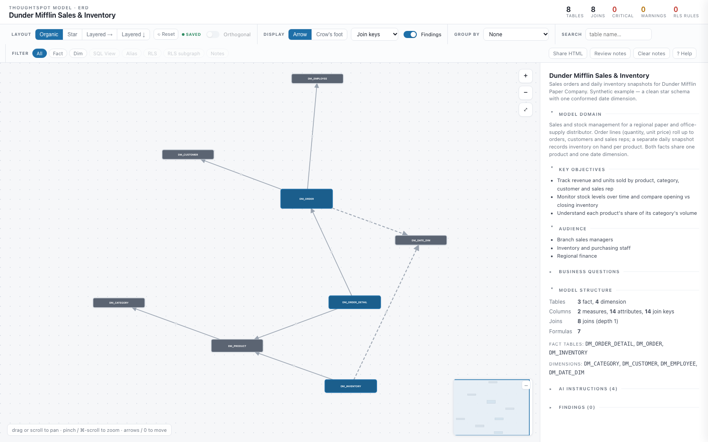
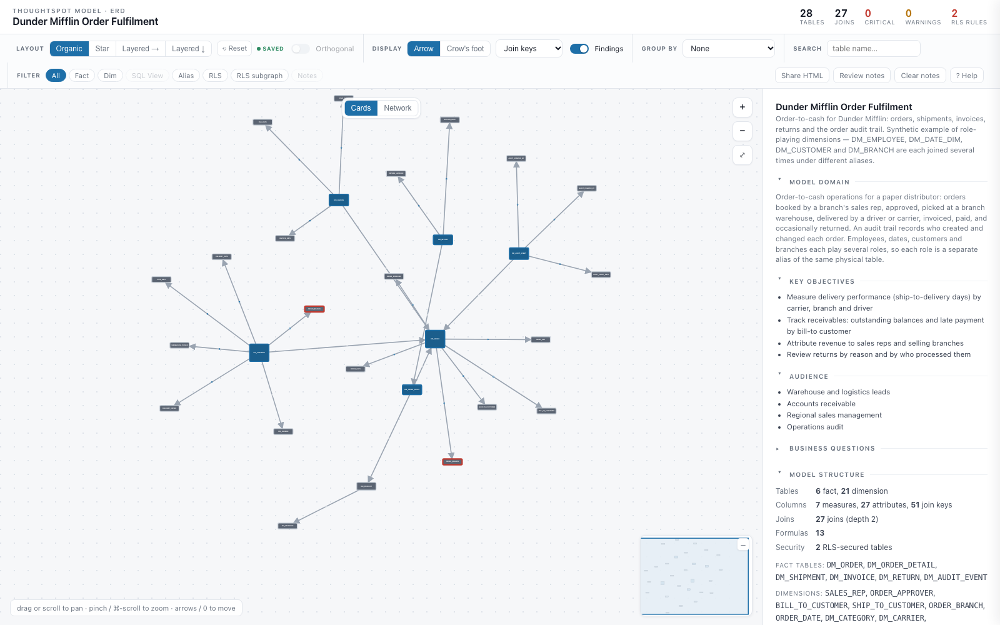
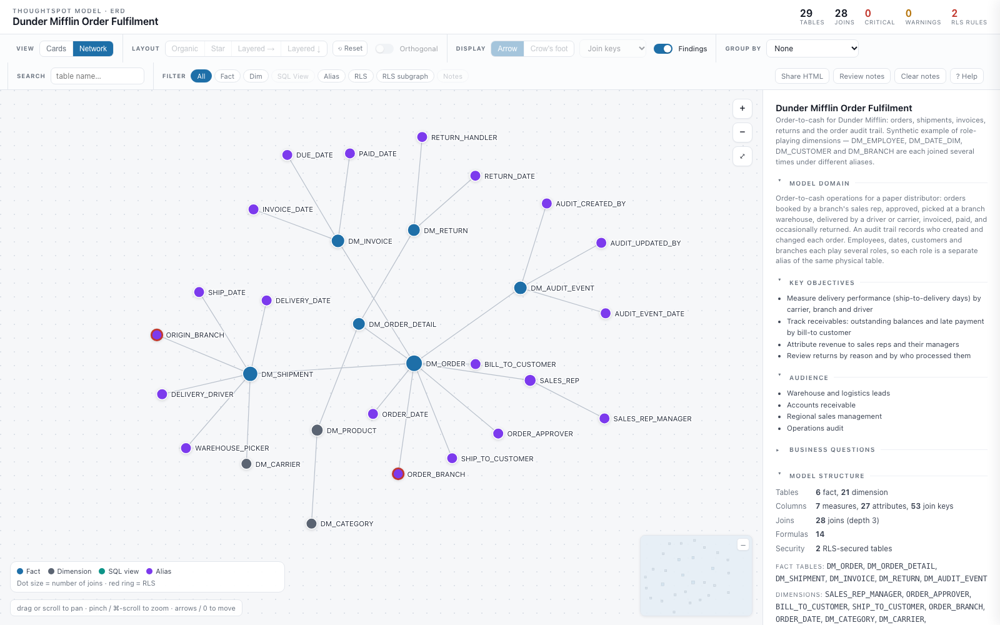

# ts-object-model-erd — example ERDs

Two rendered ERDs you can open straight away, plus the TML they were built from. The
data is synthetic: a fictional paper company, Dunder Mifflin. The TML passes
`ts tml lint`, but it has never been imported into a cluster.

**To view one:** download its `model_erd.html` and open it in a browser. GitHub shows
`.html` files as source rather than rendering them. The file is self-contained: no
network calls and no ThoughtSpot login.

| Example | Tables | What it shows |
|---|---|---|
| [Sales & Inventory](#sales--inventory) | 8 | A clean star schema: two facts sharing one product and one date dimension |
| [Order Fulfilment](#order-fulfilment) | 28 (19 of them aliases) | Role-playing dimensions: the same physical table joined many times under different aliases |

---

## Sales & Inventory

[`sales-inventory/model_erd.html`](sales-inventory/model_erd.html) ·
[TML](sales-inventory/tml/) · [business context](sales-inventory/ai_analysis.json)



This is the Model from the Snowflake Semantic View worked example
([ts-from-snowflake-dunder.md](../../../shared/worked-examples/snowflake/ts-from-snowflake-dunder.md)),
written out as ThoughtSpot TML.

- **Two facts, conformed dimensions.** `DM_ORDER_DETAIL` (via `DM_ORDER`) and
  `DM_INVENTORY` both reach `DM_PRODUCT` and `DM_DATE_DIM`. A single date table works
  here because each fact has exactly one date that matters.
- **Table-level joins.** Every join is a `referencing_join` to a `joins_with` entry in
  the Table TML, so the inspector shows each join's origin as *table*.
- **Formulas worth inspecting:** semi-additive `Inventory Balance` / `Opening Inventory`
  (`last_value` / `first_value`), `group_sum` for the category share, and
  `unique count` for distinct employees.

## Order Fulfilment

[`order-fulfilment/model_erd.html`](order-fulfilment/model_erd.html) ·
[TML](order-fulfilment/tml/) · [business context](order-fulfilment/ai_analysis.json)



The same model in **Network** view (the Cards | Network toggle at the top of the diagram): dots sized by join count, with aliases in
purple. The role-playing fan-out around each fact is easier to see here than with
cards. The viewer remembers the last view you picked. Until you pick one, adding
`#view=network` to the file's URL opens it in this view.



This one covers order-to-cash: orders, shipments, invoices, returns and an order audit
trail. Most people, dates and places in it play more than one role, and each role is a
separate `model_tables` entry with its own `alias`:

| Physical table | Aliases (roles) |
|---|---|
| `DM_EMPLOYEE` | `SALES_REP`, `ORDER_APPROVER`, `WAREHOUSE_PICKER`, `DELIVERY_DRIVER`, `RETURN_HANDLER`, `AUDIT_CREATED_BY`, `AUDIT_UPDATED_BY` |
| `DM_DATE_DIM` | `ORDER_DATE`, `SHIP_DATE`, `DELIVERY_DATE`, `INVOICE_DATE`, `DUE_DATE`, `PAID_DATE`, `RETURN_DATE`, `AUDIT_EVENT_DATE` |
| `DM_CUSTOMER` | `BILL_TO_CUSTOMER`, `SHIP_TO_CUSTOMER` |
| `DM_BRANCH` | `ORDER_BRANCH`, `ORIGIN_BRANCH` |

Things to try in the viewer:

- **Filter → Alias** highlights all 19 alias nodes. Click one and its inspector names
  the physical table behind it.
- **Why aliases instead of one shared `DM_EMPLOYEE`?** With a single employee node,
  "orders by sales rep" and "shipments by driver" would join through the same rows,
  and you could not ask for a sales rep and a driver in the same search. Each alias is
  an independent join path. The display names (`Sales Rep`, `Delivery Driver`, …) keep
  the roles distinct in search.
- **No self-joins.** A Model cannot join a table to itself, even through two aliases,
  so there is no sales-rep-to-manager join here. A hierarchy like that is flattened in
  the warehouse first.
- **RLS follows the physical table.** The rule lives on `DM_BRANCH`'s Table TML, so
  *both* `ORDER_BRANCH` and `ORIGIN_BRANCH` show as secured. Turn on **Filter → RLS**
  to see it.
- **Two join origins.** Joins between un-aliased tables reference Table TML joins.
  Every join to an alias is defined inline in the Model, because a Table TML join
  targets a physical table, not an alias. In those inline joins, `with:` names the
  alias and `on:` names the physical table on each side.
- **Group by → Fact neighbourhood** splits the diagram into the order, shipment,
  invoice, return and audit areas.

---

## Re-rendering

Run these from `agents/cli/ts-object-model-erd/`:

```bash
python3 build_erd.py examples/<name>/tml \
    --ai-analysis examples/<name>/ai_analysis.json \
    --out examples/<name>/model_erd.html
```

`tests/test_examples.py` re-renders every example and fails if the committed HTML no
longer matches. Each HTML file has the viewer's JS and CSS baked in, so any renderer
change means re-running the command above. The screenshots are illustrative, and no
test checks them.
