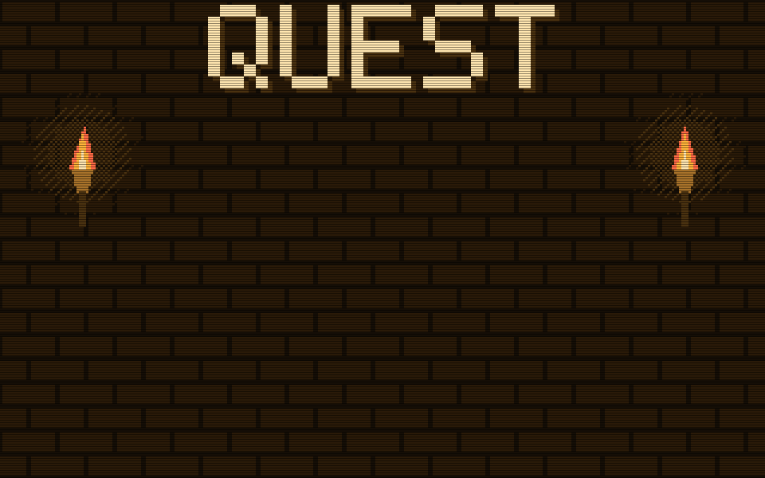

# quest

[](https://thoughtspot.github.io/thoughtspot-agent-skills/agentql-quest/)

**[Play it in your browser](https://thoughtspot.github.io/thoughtspot-agent-skills/agentql-quest/)** · [promo assets](packs/agentql/promo/)

This folder is the quest engine, and its one game so far, **AgentQL Quest**: a retro
text-adventure version of the
[Learn AgentQL course](../../agents/cli/ts-object-model-agentql-query/references/learning-path.md),
played in the browser. It teaches one idea: the AI only understands the question and writes it
as AgentQL, and ThoughtSpot compiles that AgentQL against the Model into the same governed
warehouse SQL every time.

Published to GitHub Pages at **`/agentql-quest/`** of the repo's site by
[`.github/workflows/pages.yml`](../../.github/workflows/pages.yml) on every merge to `main` that
touches this directory or the lesson capture. The site's home page, which lists it, is
[`.github/pages/index.html`](../../.github/pages/index.html).

## The realm map

Every player starts in the **Kingdom of Law**, the foundation, then takes a quest in any realm.
Each quest is a couple of minutes. The map suggests a route per audience (account rep: Law
only; data engineer: Law, Mines, Lake, Forests; SE: everything) but does not enforce one.

| Realm | Lesson | Played as |
|---|---|---|
| The Elven Kingdom of Law | Module 0 | Four halls, each teaching one idea with its slice of the comparison table, then two questions on it. The full table is the recap on the decree |
| The Dwarven Mines of Silver Ore | 2.3 | The gentle start: a simple question with the **keyword path blocked**, so even it is written in AgentQL. 4 scales |
| The Craftsmen of the Lake | 3.4 | A question keywords can't ask: every product, sold or not. 3 scales |
| The Golden Forests | 5.1 | A question in two steps (a CTE). 4 scales |
| The Shifting Isles | 5.2 | A rank within each region (a window function). 4 scales |

Every quest runs the same way: the merchant's **business question**; **read the intent** (send it
to Keyword Search, AgentQL or Code Complete, and a wrong path says why it doesn't fit); the
Wizard writes the **AgentQL**; the **dragon** is the SQL ThoughtSpot compiled; and the **hoard**
lists the deterministic rules uncovered. Each quest's question genuinely needs AgentQL, except the
Mines, where the keyword path is closed on purpose.

In a dragon fight, each scale is a line of the generated SQL, broken by saying who put it there:
ThoughtSpot (from the Model or its own rules), the AgentQL, or the AI (which never writes the
SQL that runs). Names are generic fantasy on purpose: no names, terms or quotations from any
published fantasy work.

The Kingdom of Law also covers **Code Complete**, the third engine Spotter can use (analysis
beyond SQL, on the returned results). Unreleased capabilities are left out, except two the
product team has confirmed for the near term: **keyword review of AgentQL answers** and
**pinning AgentQL answers to a Liveboard**. The game teaches both as *coming soon*, never as
shipped, and a test fails if that wording slips. Update `packs/agentql/content.yaml` when they ship.

**Gold, not hit points.** A right answer earns 10 gold. A wrong one costs 5 (the dragon takes it,
or the court fines you), never more than you carry in that realm, and you answer again, so a
realm ends on zero gold or more. **Invoke magic** shows the answer and its explanation for no
gold won or lost. Nobody dies or starts over. Each realm keeps your best gold; the map shows your
treasury against the most the open realms can give, and clearing them all shows your course high
score. Scores live in each player's own browser (there is no shared leaderboard: Pages serves
files only).

**Sound** is generated in the page with the Web Audio API: no audio files, no requests. Sound
effects (a coin for a right answer, coins tumbling away for a wrong one, a sparkle for magic, a
fanfare) are on by default;
the original 8-bit music loops are off by default. Both are toggled with the buttons under the
screen or the S and M keys, remembered in the player's browser, and nothing plays until the
player's first click or key press.

## How it is built

The engine knows only general things: realms, halls, trials, encounters, code panes, points,
routes, scoring and saves. A game is a **pack**, a folder under `packs/`, and anything specific to
one game is a **plugin** in `checks/` that the pack names. Design:
[docs/superpowers/specs/2026-10-21-agentql-quest-pack-design.md](../../docs/superpowers/specs/2026-10-21-agentql-quest-pack-design.md).

```
packs/agentql/{pack,content,strings}.yaml ─┐
packs/agentql/art/classic/*.txt           ─┤
lesson-sql.md, learning-path.md (sources) ─┤                   ┌─► quest.json         (the checked data)
classic/game.html, core/*.js, fonts/      ─┼─► build.py ───────┼─► quest.schema.json  (generated for this pack)
schema/core.json, denylist.txt            ─┤   + checks/*.py   └─► index.html         (self-contained, quest.json inside)
```

- **`packs/agentql/pack.yaml`**, the manifest: the id, title, Pages folder (`agentql-quest`), save
  key (`aqq`), the code panes every encounter shows (`scroll`, the AgentQL; `sql`, the captured
  SQL), the reward screen's rule tags, the lexicon (the Wizard, the Forge, the dragon, the hoard,
  gold) and the plugins to run.
- **`packs/agentql/content.yaml`** holds what the capture can't: the realms, halls and encounters,
  which SQL lines to ask about (matched as whole lines, never by line number), facts about the
  whole statement (`sql_count`), who put each one there, and the words shown.
- **`packs/agentql/strings.yaml`** holds every sentence a front end shows that isn't content: the
  title screen, buttons, feedback, the legend and rule card, the hoard's headings, the verdict and
  the course links. `*word*` is highlighted, `**word**` bold and `[text](https://…)` a link; the
  page escapes everything else, and `{name}` is filled in by the page.
- **`packs/agentql/art/classic/`** holds the classic page's ASCII art, one file per piece, each
  file's text less its final newline: `title`, `guide`, `compiler` and `foe` (the lexicon's roles),
  `crown`, `banner`, `map`, and `scene_<realm id>` for each realm with a scene (`@BANNER` marks
  where the realm's name goes, a leading `!` shimmers a line, `$` and `%` are lanterns). The build
  writes it into the classic page; it isn't in `quest.json`.
- **`checks/`**, the plugins this pack names:
  - `agentql_capture`: the only source of SQL is `lesson-sql.md` (in the skill's `references/`),
    the AgentQL and `executable_sql` captured live by `tools/agentql-retest --suite lessons guards`
    and generated by `tools/agentql-retest/build_lesson_sql.py`. The game never carries a copy.
  - `course_refs`: lesson and Module numbers stay in step with `learning-path.md`.
  - `agentql_rules`: who-put-it-there questions, the three engines, AgentQL as the foe's path,
    and crediting: a who-put-it-there question about a row cap or a null guard must answer
    ThoughtSpot.
- **`core/*.js`** is the front-end code every front end shares: plain scripts (not modules) that
  each add to one `Quest` global, so the classic page inlines them all and the explore page can load
  them one by one. `10-text.js` (escaping, `S()` and `H()`), `20-rules.js` (gold), `30-progress.js`
  (saves under `<storage key>-progress`), `40-machine.js` (the rules of play) and `50-sound.js`
  (effects and music, under `<storage key>-sound`). `Quest.machine(quest).act(state, action,
  progress)` returns the next state and its effects (sounds to play, gold to save) and draws
  nothing; an action the current screen doesn't offer is refused and changes nothing, so no front
  end can skip a step. The actions are `map`, `realm`, `enter`, `hear`, `answer`, `magic`, `next`,
  `carry`, `fight` and `again`. The build refuses a core file containing `</script` or `<!--`.
- **`classic/game.html`** is the page, with six placeholders (`/*__QUEST_CORE__*/`, `__QUEST_DATA__`,
  `__CLASSIC_ART__`, `__PAGE_TITLE__`, `__PAGE_DESCRIPTION__`, `/*__FONT_FACES__*/`) that `build.py`
  fills in one pass. It draws the machine's state and turns clicks and keys into its actions. It holds no game's wording or art: the build checks the pack holds every string and art
  piece the page reads (from its `S()`, `H()` and `art()` calls), and that every string is used by
  the page, the engine or a plugin, and every art file by the page. The page plays a realm's halls,
  or its one encounter, so a realm may have one or the other. What the page still draws or says
  itself, for any game: the hall's throne room (`hallScene`); the frames around the map and around a
  realm's name in its scene; the quote marks around a quest's question; the routes' `:` and ` → `;
  the `[n]` key hints, the `n/m` petition counter and the decree's numbering; the foe's `█░` bar;
  the colon after each pane's screen-reader name; upper-casing realm and hall names in banners;
  its English `lang` and the sound group's label; and trimming a leading "The " from realm names in
  the routes. It makes **no outside
  requests** and runs from Pages, any static host, or a double-click.
- **`schema/core.json`** is the general part of every pack's schema; see below.
- **`denylist.txt`** holds hashes of names from published fantasy works. A pack using one fails
  the build. Add names with `python3 tools/quest/denylist.py add < names.txt`; the names
  themselves are never committed.
- **`fonts/`** holds the Latin subsets of VT323 and IBM Plex Mono (Fontsource 5.3.0), with
  their SIL Open Font License files.

```bash
python3 tools/quest/build.py                             # → tools/quest/dist/{index.html,quest.json,quest.schema.json}
python3 tools/quest/build.py --check                     # validate only
python3 tools/validate/check_agentql_quest.py --root .   # the same, as pre-commit and CI run it
pytest tools/quest/tests -q                              # includes a headless play-through (needs node)
```

## The data contract

`quest.json` (version 2) is everything a front end needs to play the quest, already checked:

- `pack`: the pack's id, title, save key, unlock rule, explorable realms, lexicon, rule tags and
  strings;
- `meta`: what each plugin records about the whole quest (here, the capture's Model and date);
- `realms` in map order, each hall's teaching and questions, and each encounter's business
  question, path choice, code panes (one string per line, with a label and caption), points and
  hoard rules; `refs` on realms and encounters hold what plugins record (here, the case id,
  lesson and Module);
- `routes`, the suggested paths.

Pages publishes it at `/agentql-quest/quest.json`, next to the game, with its schema at
`/agentql-quest/quest.schema.json`.

The schema is **generated for each pack** from [`schema/core.json`](schema/core.json): the build
fills in the pack's strings, rule tags, panes, and what its plugins declare, so the result is
closed (every field listed and required, nothing else allowed) and a front end can rely on the
shape. `build.py` checks its own output against it, so the PR gate fails when the data and the
schema drift apart. A new field goes into `build.py` and `schema/core.json` (or a plugin's
declaration) in the same change; bump `schema_version` for any change a front end would notice.
The check is a small built-in one, so pre-commit needs no extra package. It checks the schema
itself first, whole, and accepts only a small, strict form of JSON Schema 2020-12 that it can
enforce exactly. It refuses:

- a keyword it doesn't know, or a `$schema` other than 2020-12;
- an object rule (`required`, `additionalProperties`) away from that object's `properties`;
- an object that allows unlisted or optional fields, or lists a field twice;
- `$id`, `$schema` or `$defs` below the root, and definition names other than letters, digits
  and `_`;
- a broken `$ref`, or one that reaches itself (directly, or through `anyOf`);
- a schema file that isn't strict JSON (`NaN`, trailing commas).

If you need a form it refuses, extend the checker and its tests first.

CI also installs the real `jsonschema` (pinned in `validate.yml`) and validates the published
`quest.json` against the published `quest.schema.json` the way a consumer's
`jsonschema.validate()` would, metaschema included. Locally that test runs only if a jsonschema
that supports 2020-12 (4.0 or later) is installed, and skips otherwise.

So a question is edited in the pack's `content.yaml`, never in a front end, and a second front
end (for example an explorable map) plays the same content by loading `quest.json`.

## Maps for the explore front end

A pack whose `explore.realms` lists realms has a Tiled map for each, plus an overworld:
`maps/overworld.tmj` and `maps/<realm id>.tmj`, saved by Tiled 1.10 or later as JSON (CSV tile
data). `maps.py` checks them in the build (design §4.2), and refuses anything a tile engine or the
explore page would read differently from the check:

- **Shape:** orthogonal and finite; layers at the top level, unoffset: tile layers `floor`,
  `walls` and, if you like, `decor` (each the map's size) and one object layer `objects`; one
  embedded tileset named `tiles` whose `.png` is in the pack, at the size the map says; 16px tiles;
  objects are unrotated rectangles (not tile objects or points), each exactly one tile on the grid
  (snap to grid in Tiled), because the explore page gives each a 16px body at its centre; a wall,
  or someone solid, all round the edge, because the page doesn't stop the player at the map's edge.
- **Collision** is the `walls` layer: any non-empty tile blocks. Paint walls with the wall tile
  (`tiles.json`'s `wall`): the page shows its brick face where floor is below and its dark top
  elsewhere. Any other tile on `walls` (a crate, a barrel) is drawn as it is, and blocks.
- **Decoration** that you can walk past (torches on a wall face, rails, rubble) goes on `decor`.
- **Objects** have a `type` and string properties only:
  - `spawn`, where the player appears (one per map);
  - `portal to=<realm id>`, overworld only, one per realm;
  - `exit`, realm maps only, one per map;
  - `merchant`, `guide`, `compiler`, `foe`, `reward` with `encounter=<encounter id>`;
  - `throne hall=<hall id>`;
  - `gate requires=<step id>,…`;
  - for fun, never a step (realm maps and the overworld): `chest loot=<item>` (or `loot=mimic`),
    `barrel roll=left|right|up|down`, and `hoard loot=<item>,…` on the same tile as a barrel,
    hidden until it rolls. Items are `tiles.json`'s `items`; a barrel rolls one tile, onto open
    floor. The walk treats a barrel as solid where it stands and where it rolls to, so the quest
    never depends on it, and every chest, barrel and hoard must be reachable once the quest is done;
  - someone to talk to, also never a step: `npc look=<who>` (`tiles.json`'s `npcs`) with either
    `says=<line>,…` (keys in `strings.yaml`) or `about=<realm id>` (the realm told from its own
    name and `covers`, so it stays true as the content changes).
- **Steps:** a step id is `<encounter id>:<merchant|guide|compiler|foe|reward>` or
  `hall:<hall id>`. Every step of a realm has exactly one object on its map.
- **Reachability, in the game's order:** the game plays a realm's steps in one order (halls, then
  each encounter's merchant, guide, compiler, foe, reward). Before each step, a flood-fill from the
  spawn, with only the gates whose required steps are all **done** open, must reach that step's
  object; the exit must be reachable from the start. A gate that only opens after a step behind it,
  or a first step behind a gate, fails, and so does a gate that guards nothing: shut alone, with
  every other gate open, it must cut some object off (a gate beside its doorway, or a wall with a
  way round it, would not). Objects are solid; reaching one means standing on a walkable tile next
  to it.
- **No Tiled templates,** which the explore page doesn't resolve.

`Quest.machine` accepts `interact {step}` only for the step the current screen waits on
(`expected(state)`), and changes nothing on it, so walking to the foe first does nothing.
`tests/play_map.js` plays a realm's steps through the machine with no canvas: every step is
finished, every out-of-order interaction is refused, and a test pins that the machine asks for the
steps in exactly the order `maps.py` walks.

## The explore front end (prototype)

When a pack lists `explore.realms`, the build also writes `<page folder>/explore/`: a page where
you walk the overworld and a realm's map and talk to whoever you stand next to. Every question
opens in a dialog drawn by the same `core/60-screens.js` as the classic page, and the same
`Quest.machine` decides what happens, so the two pages keep one save. A portal to a realm without a
map opens that realm in the classic page (`../#realm=<id>&from=explore`, which starts at its gate
and shows a link back to the map).

```
explore/index.html, explore.js, engine.js ─┐                 ┌─► explore/index.html, explore.js, engine.js
core/*.js, core/quest.css, fonts/          ─┼─► build.py ─────┼─► explore/core.js, quest.css, fonts.css
packs/agentql/tiles/, maps/*.tmj           ─┘                 └─► explore/art.json, tiles.json, tiles/, maps/
```

- **The build owns `explore/`:** it marks the folder it writes and replaces only a marked one. It
  refuses, before writing anything, an `explore/` it didn't write (or a link), and any output in
  `tools/quest/` other than `dist/`.
- **Everything is ours and local:** no third-party code, no outside requests, and under 3 MB
  (about 199 KB today). The page runs on `engine.js` (`Quest.engine`), a small tile engine: it
  draws the map's tile layers and one-tile sprites from the atlas on a 2D canvas, moves the
  player's 12x12 body against solid tiles and solid sprites (one axis at a time, so it slides along
  walls), reads the arrow keys on the map, follows the player with the camera, and runs timers,
  tweens and a fade. Its geometry has no DOM, so node tests drive it. (Phaser was used until it
  turned out to bundle GPL-3.0 code; design decision 5.)
- **Tiles** are three of Kenney's CC0 packs in one atlas (`tiles/LICENSE-kenney.txt`): Tiny
  Dungeon (frames 0-131), Tiny Town (144-275: trees, houses, a well) and Tiny Battle (276-473:
  water, rock, boats), plus a row of ours (132: a wall's top; 133-137: the realm guards, Tiny
  Dungeon characters recoloured). `tiles/make_atlas.py` rebuilds `tiles.png` from the packs'
  zips (their hashes are in its docstring) and `tiles/tiles.sha256` records the result, which the
  tests check. The tests can't rebuild it themselves (they don't have Kenney's zips), so after
  editing `make_atlas.py`, rebuild `tiles.png` and record its new hash.
  `tiles/tiles.json` names the frame for everything the page draws, a door per realm and how each
  person looks; the build checks it.
- **The overworld** is a small world the camera scrolls (40x14): a plaza with Elder Wren, and a
  door for each realm in its own scene, each with a guard beside it who says in one line what the
  realm is for. Leaving a realm, by its exit, by finishing it, or by the classic page's link back
  (`explore/#from=<realm>`), puts you back beside its door. The scenes: a
  tunnel into a rocky cliff, with rails (the Mines, a dwarf), a library with bookshelves at its door,
  over a moat and a plank bridge between pillars (Law, a wizard), a pier to a small town in the lake
  (the Lake, a fisherman), a tunnel of golden trees (the
  Golden Forests, an elf in golden armour), and a dock with a boat out to sea (the Isles, a sailor).
- **Law** is a library of four reading rooms in a row, a bookshelf either side of each throne.
  Each room's throne opens its hall's questions, and the gate to the next room stays shut until
  that hall is done. After the last hall the realm's decree is shown; Esc closes it like any
  dialog, and talking to a throne shows it again until you leave.
- **Fun:** talk to a chest to open it (its loot is yours, or a mimic snaps at you), to a barrel to
  roll it aside, and to the troll's hoard it uncovers to claim it. You start with the weapon
  `tiles.json` names; others come as loot, and X (or the pad's Weapon) switches the one in your
  hand, which the foe's first question mentions. Loot never touches gold or the quest: it is saved
  apart, under `<storage key>-explore`. Each realm's portal is its own door (`tiles.json`'s
  `portals`), and every item's name is `item_<id>` in `strings.yaml`. Talk to an npc to hear its
  next line (in the toast, which screen readers read); a tie between two things beside you goes to
  the one you face.
- **Motion:** the player faces the way it walks and bobs a pixel each step; the merchant, guide, people
  and foe breathe; maps fade in. With reduced motion on, none of it.
- **Screenshots:** `python3 tools/quest/tests/shoot_maps.py <folder>` saves every map as a player
  first sees it (`explore/#look=<map>`, local only), for reviewing art and map changes.
- **Play:** arrow keys or the touch pad walk; Enter, Space or the pad's talk button talks to whoever
  is next to you (up, down, left or right; the one the game waits on first), but only while the
  map has focus, so links and buttons keep Enter and Space; number keys pick in a dialog; Esc
  closes it ("not now"; the step waits). Standing by a portal names its realm and how you did
  there. S and M switch sound.
- **Checks:** the build checks the maps (above) and the tile index; `tests/play_map.js` walks
  each map through the machine with no canvas. In a real browser,
  `python3 tools/quest/tests/smoke_explore.py` builds the site, serves it, and plays each
  explorable realm in headless Chrome (`explore/#smoke=<realm>`): locked for a fresh player, the
  map loads, every step talked to in order, each gate shut exactly until its own steps are done, the decree of a realm of halls shown, kept by Esc and shown again, the
  realm saved, Enter on a link left alone, no request outside the site, and the fun and the people
  (all with page-script events, not the browser's own input). pytest runs it wherever
  Chrome is installed, CI included. The scripted play writes saves, so it runs only on a local
  server (`127.0.0.1` or `localhost`). Touch, screen reader and cross-browser checks are a manual
  list in the PR.

## When the build fails

`build.py` refuses to build when the pack no longer holds together, or no longer matches its
sources:

| Error | Meaning | Fix |
|---|---|---|
| `case '…' is not in lesson-sql.md` | the case id was renamed or dropped | update `case:` |
| `captured status was not SUCCESS` | the lesson now fails to compile | the lesson changed; pick another case or fix the lesson |
| `the scroll pane differs from the captured AgentQL` | the query changed, not just its layout | copy the new AgentQL from `lesson-sql.md` |
| `sql: no line is exactly '…'` | a recapture changed that line of the generated SQL | re-read the new SQL; update the point, **and its explanation if the behaviour moved** (a changed row cap or join type means the lesson is now wrong, not just the highlight) |
| `expected '…' N time(s) in the SQL` | a whole-statement fact moved, e.g. the fact table is read twice (pruning off) | same: check whether the lesson still holds |
| `scroll: match '…' hits no line` | a `scroll` substring no longer appears in the AgentQL | update `scroll` |
| `it asks about a row cap or a null guard, which ThoughtSpot adds` | a who point credits the row cap or a null guard to the Model or the AgentQL | answer `thoughtspot`: both are ThoughtSpot cluster settings |
| `'…' is a name from a published work` | a word in the pack, the page (`classic/`), `core/`, or the built `quest.json` (often text a plugin took from its sources) is on the denylist | use a generic fantasy name |
| `denylist: …` | `denylist.txt` is missing, or holds a line that isn't a hash | restore it; add names only with `denylist.py add` |
| `strings.yaml: the classic page needs '…'` or `art/classic/….txt: the classic page needs it` | the page reads a string or art piece the pack lacks | add it to the pack |
| `art/classic/….txt: not used` | an art file the page never reads, or a scene for a realm that doesn't exist or has halls (a realm of halls shows its crown) | remove it, or fix its name |
| `strings.yaml: '…' is not used by the page, the engine or a plugin` | a string nothing reads (often a typo, or one a plugin reads without listing it in `STRINGS`) | remove it, or list it in the plugin's `STRINGS` |
| `maps/….tmj: …` (for example `can't be reached when the game waits on …`, `must be exactly one tile on the grid`, `the map's edge must all be wall`, `step … needs exactly one object`, `is external; embed it`) | a map doesn't bind to the content, or something on it can't be reached | fix the map in Tiled; the message names the object |
| `explore/: … bytes is over the 3,000,000-byte budget` | the explore folder grew too big (usually art or maps) | shrink the tiles or maps |
| `tiles/tiles.json: an explorable pack names its tile frames here` | a pack lists `explore.realms` but has no tile index | add `tiles/tiles.json` |
| `realm …: the classic page plays either halls or one encounter per realm` | a realm with halls and an encounter, or two encounters | split it into realms |
| `pack.yaml: …` (for example `unknown key`, `unlock must be one of`, `pane …: label '…' is not in strings.yaml`, `pane id '…' is also a content key`) | the manifest is malformed | fix `pack.yaml`; the message names the rule |
| `packs … and … share storage_key '…'` (or `id`, `publish_path`) | two games would overwrite each other's saves or Pages folder | give each pack its own |
| `id '…' must be lowercase letters, digits and _ (and not 'hall')` or `duplicate id` | a realm, hall or encounter id breaks the step-id grammar | rename it |
| `caption … names {…}, which nothing provides` | a pane caption names a value no plugin records | fix the caption in `strings.yaml` |
| `a who point takes its rule tag from its answer` | a `who` point sets `rule_tag` | drop it; the answer decides the tag |
| `reads the source '…', which sources doesn't name` | a plugin needs a source the manifest lacks | add it under `sources` |
| `unknown key '…' (no check owns it)` | a content key that neither the engine nor a plugin knows (often a typo) | fix the key, or add it to the plugin that owns it |
| `lesson-sql.md: no Model named in its header` | the capture's header lost the "captured live on the sample Model" line | regenerate `lesson-sql.md` with `tools/agentql-retest/build_lesson_sql.py` |
| `the capture header names Model '…', but this AgentQL does not query FROM "…"` | the header and the captured AgentQL disagree about the Model, so the caption would name the wrong one | recapture, or fix the generator's header |
| `quest: …` or `quest.…: …`, for example `missing '…'`, `'…' is not in quest.schema.json`, `expected …, got …`, `… is not one of …`, `needs at least … item(s)`, `matches none of its allowed shapes (…)` | the built data no longer fits the contract (the path says where) | change `build.py` and `schema/core.json` (or the plugin's declaration) together |
| `quest.schema.json #…: …` | the schema uses something the built-in check can't enforce | use only the supported forms the message names |
| `schema/core.json: not valid JSON (…)` or `… NaN is not JSON` | `schema/core.json` isn't strict JSON | fix the file; every JSON parser must read it |
| `realm …: module must be a whole number` (or `minutes`) | a number like `4.0` | write `4` |

## Adding an encounter or opening a realm

Add an entry under `encounters:` in `packs/agentql/content.yaml` with an `id` (lowercase letters,
digits and `_`), a lesson's **Guarded by** `case` id and its `lesson` number, and list the id
under its realm's `encounters` (the lesson must be in that realm's module). To open a sealed
realm, drop `sealed: true` and give it encounters or halls (each hall has an `id` too). Each
encounter needs a `quest`, its `scroll` (the AgentQL, laid out for reading) and its `points`. A
`who` point names its `answer` (`model`, `thoughtspot` or `agentql`) and must highlight `sql`; a
`choice` point lists its own `options` with exactly one `correct: true`. `scroll: []` highlights
nothing in the AgentQL, which is itself the clue that ThoughtSpot added the line.

Every lesson text must be true of the captured SQL and match the course. Write numbers that
the capture can't hold (row counts, product names) as the course's taught numbers and say so
on screen. Prove a new point with a recapture variant in `tests/` that makes it false and
fails the build.

## Adding a game

Create `packs/<id>/` with a `pack.yaml` (its own `id`, `publish_path` and `storage_key`, which
no other pack may share: every game is served from the same origin), a `content.yaml`, a
`strings.yaml` holding every string the classic page reads, and `art/classic/` holding the pieces
it reads (scenes are optional: a realm without one shows a banner). The build lists anything
missing. It uses none of AgentQL's plugins, or new ones of its own (see "Plugins" in
`build.py`); its schema is generated from the core and its own plugins. Build it with
`python3 tools/quest/build.py --pack <id>`.
